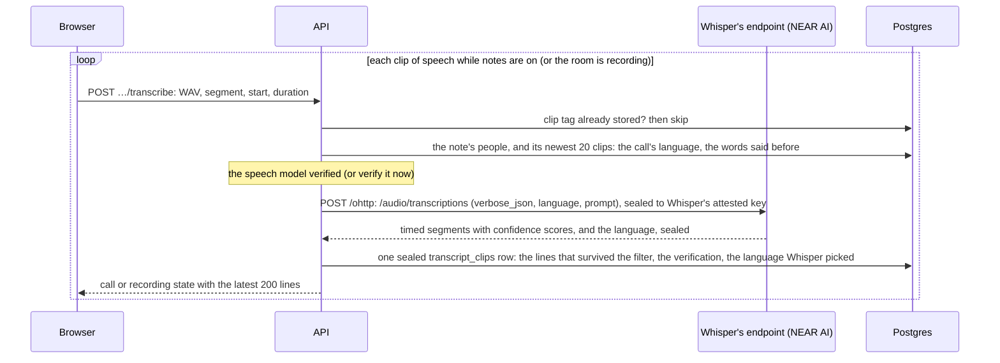

# Notes and inference

[Docs home](../README.md) · [Calls and recordings](calls-and-recordings.md) · [Plans and usage](plans-and-usage.md)

## Status

Notes are written end to end with NEAR AI Cloud (`I01`). While notes are on, the browser sends short clips
of speech (in a call, the host's browser for everyone it hears in the main room, the organizer's, or a stand-in's while
the organizer is away, and each breakout room's scribe for its room); Whisper transcribes each one, and the lines are kept as sealed rows, so the call and the room
recorder show a live transcript. When the recording stops, the transcript moves into the note, and a
worker inside the API process has the notes model write the summary, decisions, open questions, follow-ups,
chapters and suggested questions, and then, in a request of its own, a longer full summary
([The full summary](#the-full-summary)). When a presenter put a share in the notes, its video is looked at where what
was said points at it, and the notes point at what was on screen ([Shared screens](#shared-screens)).
While the call is on, everyone in a part of it reads one shared set of live notes, kept sealed and refreshed
at most every 30 seconds while someone is watching ([Live notes](#live-notes)).
Anyone who has the note can then ask questions about the call, and anyone can ask a question across every
note they have. The transcript says what it isn't sure of, words Whisper heard with little confidence and lines
heard on two microphones at once, and once the notes are written the organizer, and the people who spoke their
own words, can correct it; the organizer can have the notes written again from it
([Correcting the transcript](#correcting-the-transcript)). Calls that follow on from each other form a series,
and what earlier ones settled and left open carries into the next ([Series](#series)). What the notes say is only
proposed until people say so, each entry shows what was said behind it, and a follow-up is nobody's until they take it on
([Decisions and follow-ups](#decisions-and-follow-ups)). What's kept, and for how long, is set when a call is scheduled
([What's kept, and for how long](#whats-kept-and-for-how-long)).

`apps/api/src/inference/inference.ts` and `apps/api/src/inference/evidence.ts` are the only code that uses `NEAR_AI_API_KEY` or
talks to NEAR AI besides `apps/api/src/inference/models.ts`, which only reads its public lists of models, and
`inference.ts` is the only one that sends it anything with content. Each request it sends names who pays for it, and is
charged to their AI allowance, in dollars, as NEAR AI answers it ([Plans and usage](plans-and-usage.md)). Without a key the
server still records: the transcribe endpoints answer `503 unavailable`,
recordings are kept and play back, notes stay `pending` ("Waiting for the notes service to be connected"),
and `/health` reports `inference: missing`. Once a key is configured, maintenance picks up the waiting jobs;
a note recorded without a key has no transcript, so it is finished without notes.

Nothing with content goes to NEAR AI until its hardware evidence for the model checks out, and then only
sealed with Oblivious HTTP to the key that evidence vouches for, at the model's own endpoint: speech to
Whisper's, transcripts and questions to the notes model's
([Verified private inference](#verified-private-inference)). Speech is always private. The one exception is
after transcription: an organizer (or someone asking) can choose a model NEAR AI doesn't run in a secure
enclave, and then the transcript or the question goes to it over TLS through NEAR AI's gateway, unencrypted
and unverified. It's only ever by that choice, the choice says so wherever it's made, and the note records
it ([Choosing the model](#choosing-the-model)).

## Verified private inference

`apps/api/src/inference/evidence.ts` checks NEAR AI's evidence, `apps/api/src/inference/inference.ts` seals requests to the
keys it vouches for, and `apps/api/src/inference/ohttp.ts` is the Oblivious HTTP sender.

Every request goes the same way: Oblivious HTTP (RFC 9458), a Binary HTTP request (RFC 9292) sealed with
HPKE (RFC 9180; X25519, HKDF-SHA256, AES-128-GCM) to the model's own OHTTP key, posted to `/ohttp` at the
model's own endpoint. (An unencrypted model, chosen on purpose, doesn't go this way: see [Choosing the model](#choosing-the-model).) The whole HTTP request is sealed, the API key included, so NEAR AI's TLS
termination, load balancers and gateway see ciphertext, its size and its timing; only something holding
the model's OHTTP key can open it. The reply comes back sealed under the same exchange, so only Alcove can
open it, and only whoever opened the request could have sealed it.

| Request | Model | Endpoint |
| --- | --- | --- |
| Transcribe a clip | `openai/whisper-large-v3` | `NEAR_AI_STT_URL`, `https://whisper-large-v3.completions.near.ai` |
| Write notes, write the full summary, pick the moments to look at shared screens, read a frame of a shared screen, answer a question (about a note, across notes, a call so far or a series), catch up, refresh a call's live notes, translate captions, compare a call with earlier ones in its series, edit a selection, by default | `deepseek-ai/DeepSeek-V4.1-Flash-1017` | `NEAR_AI_NOTES_URL`, `https://deepseek-v4-1-flash.completions.near.ai` |
| The same, when the model chosen is another private one | one from `GET /v1/models` | its host in `NEAR_AI_ENDPOINTS_URL` ([Choosing the model](#choosing-the-model)) |
| The same, when the model chosen is unencrypted | one from `GET /v1/models` | not an Oblivious HTTP endpoint: `POST {NEAR_AI_BASE_URL}/chat/completions` over TLS, with the bearer key |
| The notes written after a call or recording ends (the notes, breakout rooms', the full summary, the screens read for them, the comparison with earlier calls), when nobody chose a model and `NEAR_AI_WRITING_MODEL` is set | `NEAR_AI_WRITING_MODEL` | its host in `NEAR_AI_ENDPOINTS_URL` when NEAR AI lists one; otherwise its gateway, as an unencrypted model ([Choosing the model](#choosing-the-model)) |

These are the endpoints NEAR AI calls "direct completions" and documents as experimental. Its gateway
also takes chat with end-to-end encrypted fields (E2EE v2), but that protocol encrypts each message to the
model without binding it to the client's key, so whoever terminates the TLS can copy the encrypted
messages into a request of their own and have the model answer to their key. Its gateway also takes OHTTP,
but opens it itself. The models' own endpoints are where NEAR AI opens a sealed request inside the model's
own VM.

### What is checked

Before a model's first request, and whenever its verification has run out, Alcove asks NEAR AI's gateway
(`NEAR_AI_BASE_URL`) for
`GET /attestation/report?model=<model>&provider=near&signing_algo=ed25519&include_tls_fingerprint=false&nonce=<32 random bytes, hex>`
with `x-no-aliasing: true`, and checks the gateway's report and every model report it returns:

1. **The Intel TDX quote**, with [dcap-qvl](https://github.com/Phala-Network/dcap-qvl) (`@phala/dcap-qvl`
   0.7.0): its signature chain (quote, QE report, PCK certificate, Intel's PCK CA) to `INTEL_ROOT_CA`, Intel's
   collateral from `INTEL_PCS_URL` (TCB info, QE identity, PCK revocation list, each signed under the same
   root, and the root's own revocation list from its distribution point), nothing revoked or past its
   update date, a TCB status of `UpToDate` or `SWHardeningNeeded`, and debug off.
2. **The OS it booted.** MRTD, RTMR0, RTMR1 and RTMR2 (firmware, the machine, the kernel, its command line
   and initrd, which names the root filesystem's hash) must be exactly those of a published dstack image on
   the machines NEAR AI runs, listed in `apps/api/src/tee/dstack-images.ts`: `dstack-nvidia-0.5.12` on its model
   VMs and `dstack-0.5.12` on its gateway, as released by
   [meta-dstack v0.5.12](https://github.com/Dstack-TEE/meta-dstack/releases/tag/v0.5.12) and measured with
   `dstack-mr` for the machine each report's `vm_config` describes. The `os-image-hash` event must be that
   image's digest. Another image, or the same image on another machine, is refused until it is measured the
   same way and added.
3. **Its report data**: the reported signing key, then our nonce. The echoed `request_nonce` must be our
   nonce, and the gateway's echoed `report_data` the quote's.
4. **What that OS measured after boot**: the event log replays to the quote's RTMR3; MRCONFIGID is `01`, then
   SHA-256 of the report's `app_compose`, then zeros; and the `compose-hash` event is that same SHA-256.
5. **A model's GPUs**: its `nvidia_payload` carries our nonce; NVIDIA's Remote Attestation Service
   (`NVIDIA_NRAS_URL`) checks it, and its verdict is a JWT signed ES384 by a key from NRAS's published keys
   whose certificate chain (CAs only, all current) ends at `NVIDIA_ROOT_CA`, from NRAS, not expired, for our
   nonce, with one result per GPU and `x-nvidia-overall-att-result: true`. Its times and its chain's are checked
   allowing a minute between NVIDIA's clock and ours: a verdict holds from the moment NVIDIA issues it, and
   Confidential Space's VMs ran 7–9.5 s behind on 2026-11-13, when, with no allowance, no model checked out.
6. **A model's OHTTP key**: `ohttp_attestation` is an Ed25519 signature by the attested key over the exact
   key configuration, which must offer X25519 with HKDF-SHA256 and AES-128-GCM.
7. The report is for the model asked for, and its public key is its signing address.

Every model report is checked and only those that pass may be used. If none passes, or the gateway's
doesn't, nothing is sent: the request answers `503 unavailable`, "We couldn’t verify NEAR AI’s private
model, so nothing was sent. Try again in a moment." ("couldn’t check" when NEAR AI, Intel or NVIDIA can't
be reached), a notes job waits ([The notes worker](#the-notes-worker)), and the refusal is logged with its
code: `expired`, `tdx-quote`, `tcb-status`, `debug`, `os-image`, `nonce`, `signing-key`, `rtmr3`, `compose`,
`gpu`, `ohttp-key`, `model-mismatch`, `no-model-evidence`, `malformed`, or `report-unavailable`,
`collateral-unavailable` and `gpu-unavailable` when a service couldn't be reached. A reply that won't open
under the request's exchange is refused too (`reply-sealed`), and isn't used.

What these checks don't show is in [What's left](#whats-left): the app compose runs NEAR AI's compose
manager, which starts the model code NEAR AI chooses; the GPU evidence is tied to the VM only by the nonce;
the model name is the report's word; and the OHTTP key's signature doesn't cover the nonce.

### How long a verification holds

- A verification is used for ten minutes at most, or until NVIDIA's verdict expires (it gives an hour), then
  the next request verifies again. Intel's collateral is kept up to 30 minutes, or until Intel says it's due.
- A refusal stands for 30 seconds: requests in that time are refused without fetching new evidence.
- Requests that arrive while a model is being verified wait for that one verification.
- **When the key changes.** A model's endpoint answers a request sealed to a key it no longer holds with
  `400` ("OHTTP decapsulation failed"). Then Alcove drops the verification, verifies again, and sends the
  request once more if the key changed; if it didn't, or the new evidence doesn't check out, the request fails.
  A connection the endpoint cuts is treated the same way; a timeout isn't. A model that doesn't answer (it
  times out, can't be reached or is busy) has its verification dropped too, so the next request verifies
  again and may reach one that answers.
- Verifications live in the API process's memory. Nothing about them is stored except what a note keeps.

### What a note keeps

Each transcript clip's sealed row keeps the evidence of the verification it was sent to, also when nothing
in it survived the filter. When the recording stops, the distinct verifications (by model, key, OS image,
measured configuration and TCB status, the first time each was used) move into the note's sealed manifest
as `inference`; the notes model's is added when the notes are written (the notes, the full summary, each breakout
room's and the shared screens', those kept in the job across attempts), and when what it finds comparing a call with
earlier ones is kept ([Series](#series)). Notes written again keep only the transcript's and what wrote them now,
unless something written before stays (a breakout room whose notes couldn't be written this time, a screen a settled
item points at, what earlier calls came back to): then the earlier verifications stay too. `GET /v1/notes/:id` returns them as
`Note.inference` (`InferenceEvidence` in `packages/api`): the model, the task, when it was verified, the
model's key, Intel's TCB status and the quote's SHA-256, the dstack image it booted, the GPUs NVIDIA
confirmed, the SHA-256 of the measured app compose, and the gateway's TCB status, image and compose hash.
None of it is secret. Questions, catch-ups, live notes and caption translations are verified and sealed the same
way, but nothing of theirs stays with the note, so neither do their verifications.

A note written, or its screens read, by an unencrypted model lists it in `unencrypted` (`{model, task, at}`, task
`notes` or `screens`, a stored manifest field that defaults to empty), returned as `Note.unencrypted`. It's recorded
before anything is sent to the model, so notes that were stopped, or couldn't be written, still say it; the note page
names any such model other than the one that wrote the notes at the foot of what was checked ("This call was also sent
unencrypted to …"). It has no
evidence, so it isn't in `inference`, and the note page says that work wasn't in a secure enclave rather than
claiming confidential compute.

Under the title the note page says "Written in confidential compute" ("Transcribed in…" while the notes are
being written, or when they couldn't be), when the hardware was verified (the time today, else the day and
time) and that Alcove can't read it. That opens the checks that ran, model by model, and links to NEAR AI's
[Verification Center](https://cloud.near.ai/verify) for each model, which checks fresh evidence for the
model, not this note; the link carries nothing about the note, sends no referrer, and the page says NEAR AI
sees the visit. The call screen shows none of it.

### Services verification depends on

- **Intel's Provisioning Certification Service**: `api.trustedservices.intel.com` for TCB info, QE identity
  and the PCK revocation list, and `certificates.trustedservices.intel.com` for the root's revocation list.
  Alcove sends it only the platform's FMSPC.
- **NVIDIA's Remote Attestation Service**: `nras.attestation.nvidia.com`, sent each model's GPU evidence
  (certificates and measurements, no content).
- **NEAR AI's gateway** for the reports, and **the models' own endpoints**,
  `whisper-large-v3.completions.near.ai` and `deepseek-v4-1-flash.completions.near.ai` (and the host of any other private model chosen), for everything sealed. An unencrypted model is reached through the gateway instead.

Measured against NEAR AI Cloud on 3 November 2026: verifying the first model takes about 1.2 to 1.4 s (the
report, Intel's collateral, NRAS and the quote checks), the next about 0.5 s, as Intel's collateral is kept;
a 5-second clip through OHTTP about 0.45 s, or up to 2 s on a new connection; a short completion through
OHTTP 0.5 to 1.1 s.

## Note states

| Status | Meaning |
| --- | --- |
| `recording` | The call's notes or the room recording are still going. Audio pieces and transcript clips are arriving; the live transcript is in `transcript_clips`. |
| `pending` | The recording stopped. The transcript is in the note, and a `content_jobs` row with kind `notes` is waiting for the notes worker, for the notes model to check out, or being written. |
| `ready` | Finished: summary, full summary, decisions, open questions, follow-ups, chapters and suggested questions are in a new revision. They stay empty when nothing was transcribed or the notes model failed three times (the full summary is empty, too, when only it couldn't be written). The transcript and the audio are kept either way, as far as the call was set to keep them ([What's kept](#whats-kept-and-for-how-long)). |

The job has its own state:

| `content_jobs.state` | Meaning |
| --- | --- |
| `queued` | Waiting. `lease_until` is empty for a new job, or the time a retry is due. |
| `writing` | Claimed by a worker until `lease_until`, five minutes later, renewed while it works. If the worker dies, the lease runs out and the job can be claimed again. |
| `waiting` | The notes model's evidence didn't check out, or couldn't be checked, so nothing was sent. Checked again at `lease_until`, five minutes later, for as long as it takes. |

`attempt` counts claims, up to 3; a claim whose evidence didn't check out doesn't count. The row is deleted
when its note is finished.

## The live transcript



1. **In the browser.** Beside the encrypted MediaRecorder pieces, `apps/web/src/features/call/notes/speech.ts`
   runs the microphone (in a call, the host's browser runs each voice it plays, its own and
   each other microphone in its part of the call, on its own: `CallEars`) through an AudioWorklet (`apps/web/public/pcm-capture.js`) that mixes it to mono,
   filters out everything above the speech band and resamples it to 16 kHz. The samples are cut into clips
   at natural pauses (the first pause of 350 ms after 2.5 seconds, never past 10 seconds), clips with no
   voice in them are dropped, and the rest are sent one at a time, in order, with a few retries. Measured
   against NEAR AI's Whisper, longer pauses or minimums (500 to 700 ms, 3.5 to 5 seconds) changed the word
   error rate by less than a point, as the prompt carries a sentence across clips, and showed captions
   0.6 to 1.3 seconds later. A lost clip costs a line of transcript, never the recording. Turning notes
   off or leaving sends the last audio and speech first; pausing a call's notes drops whatever wasn't sent
   ([Calls and recordings › What's captured](calls-and-recordings.md#whats-captured)).
2. **The request.** `POST /v1/live/calls/:id/transcribe` or `POST /v1/recordings/:id/transcribe`. The body
   is 16 kHz mono 16-bit PCM WAV (`content-type: audio/wav`) of at most 30 seconds
   (`MAX_TRANSCRIPT_CLIP_MS`, 960,044 bytes). The headers are `x-alcove-segment` (the recording segment),
   `x-alcove-at-ms` (where the clip starts in its segment, pauses not counted) and
   `x-alcove-duration-ms`, and for a call `x-alcove-speaker` (the participant ID of whoever's voice it is,
   which must be someone in the call, or `400 invalid`) and `x-alcove-ago-ms` (how long before the request the
   speech began, at most ten minutes). A declared `content-length` over the limit is refused before the body is read;
   then the WAV header is checked (RIFF/WAVE, PCM, one channel, 16,000 Hz, 16 bits). Anything else is
   `400 invalid`. Each account may send 240 clips a minute, calls and room recordings together, and in a call
   each voice 40; past that the answer is `503 unavailable` ("Too many attempts"). In a call a clip counts only
   once the call has taken it as the sender's to send (step 3), so clips it refuses count toward nobody's limit.
3. **When a clip is taken.** For a call, only while it is live, notes are on (not paused) and the clip's
   segment is the current one; the capture gate, `mayCapture` in `apps/api/src/features/calls/notes/capture.ts`, decides.
   Then only where the call can place it: in the part of the call its speaker was in when it began (`placeAt`,
   from where each person has been, and never before they came into the call), and only from the browser that
   hears that part: the organizer's current connection for the main room, or whoever was a breakout room's scribe
   when the speech began, even if the room has closed since (`403 forbidden` from anyone else; see
   [Calls and recordings › Breakout rooms](calls-and-recordings.md#hands-spotlight-breakout-rooms-and-captions)).
   The gate is asked again for that part, so nothing is taken in a breakout room the organizer has paused, nor
   speech that began while it was (or while the call's notes were paused or off), when the room is asked as of then.
   A clip from before its speaker's last two moves, or for a paused room, is refused (`409`). A breakout room's
   clip is placed in its segment by the server's clock, from when the segment began (`segmentFrom` in the call's
   state): its scribe's browser counts from when it loaded, so its own start would put the line wherever that was.
   It's still known by the start its browser gave it (step 4), so a retry is kept once. For a room recording, only while it is recording
   (not paused), and only segment 0.
   Otherwise `409 conflict` (`400 invalid` for a room segment other than 0). Only the account's own calls
   and recordings: anyone else gets `404 not-found`.
4. **Once only.** A clip is tagged `HMAC(transcript key, "clip:<segment>:<atMs>:<speaker>")` (no speaker
   in a room recording), so two people starting at the same moment are both kept. If that tag is
   already stored, the clip is skipped without calling NEAR AI, so a retried upload is transcribed and
   kept once, whether or not anything in it survived the filter.
5. **What a clip is sent with** (`hear` and `languageFor` in `apps/api/src/features/recordings/transcripts.ts`).
   Whisper gets more than the audio, all of it read from what the API already keeps for the note:
   - **The call's language.** Each row keeps whose clip it was (in a call), the language Whisper picked
     for it itself when it was sure (the clip went without a language, at least 4 words survived the
     filter and its segments' average `avg_logprob` was −0.25 or better), and whether it asked Whisper
     what its speaker speaks (`asked`: it went without a language, and Whisper was sure or the clip was
     at least 3.5 seconds long, enough to tell). Once at least 3 of the note's newest 20 rows hold a sure
     pick, and all of them the same, it is sent as `language` with the clips of anyone a row among those
     20 asked about. Whisper picks the language per clip from the sound alone, and on short clips and
     accented speech it often picks another one, then transcribes into it or mixes languages; a sure
     pick is almost never wrong. Someone not asked about among the newest 20 (who just joined, or has
     been quiet a while) may speak another language, so their clips go without it until one asks: told
     the call's language, Whisper writes a clip in it, often as a translation, under the speaker's name.
     Someone it heard at length without being sure gets the call's language, as that's how it hears
     accented speech. A row with a sure pick of another language (someone speaks it, or the call moves
     on to it) stops the language being sent for everyone until that row is no longer among the newest
     20. Rows sent with the language say nothing new, so after 6 of someone's since they were last asked
     about, their next clip of at least 3.5 seconds goes without it and Whisper picks again; shorter clips
     keep it.
   - **A prompt**, only with the call's language (`speechPrompt` in `apps/api/src/inference/inference.ts`): the
     names of the organizer and everyone invited (from the note's manifest; an address with no name known
     is named from its local part, so `priya.raman@…` is "Priya Raman"), at most 120 bytes of them, then
     the end of the words of the lines placed before the clip in the same part of the call (the main
     room, or the breakout room the server placed the clip in: where its speaker was when they began, as
     every line is placed), in recording order, at most 250 bytes. A room's words
     go to Whisper only with that room's clips, so Whisper can't say them back into a line that people
     outside the room read, or the main room's into a room's. Whisper writes a clip in
     its prompt's language, even names alone when they read as words ("Measure After"), so a prompt sent
     without the call's language translated other speakers' clips. NEAR AI refuses a prompt that fills
     Whisper's 448-token context, and 375 bytes or more of words before made it skip whole sentences.
6. **Transcription and the filter.** NEAR AI returns timed segments and the language. Alcove drops what
   Whisper is known to invent in silence and noise: segments with low confidence (`avg_logprob` below −1),
   looping text (`compression_ratio` above 2.4), likely non-speech (`no_speech_prob` above 0.6 with
   `avg_logprob` below −0.5; NEAR AI's Whisper doesn't report `no_speech_prob`, so this rarely applies),
   subtitle credits in the languages Whisper invents them in, which open the line ("Subtitles by",
   "Sous-titrage", "Sous-titres réalisés par", "Untertitel im Auftrag", "Subtítulos realizados por",
   "Субтитры сделал", "字幕by", "자막 제공", ...) or name amara.org, so a sentence about subtitles or
   captions is kept, lines that are only punctuation, symbols or one bracketed sound description, a line
   of six words or more four in five of whose runs of three words the prompt has (Whisper saying back
   what it was told came before, word for word or with a word changed; shorter lines are kept, because
   people say back what was just said to agree to it, as in "Ship it on Friday."), a run of sentences
   (three words or more in all) said again straight after
   itself, and a line that only says the one before it again (Whisper looping, too rarely to cross the
   compression ratio), and a clip whose whole text is a stock closing line in any of a dozen languages, such as
   "Thank you.", "Thanks for watching", "To be continued", "¡Gracias!", "Obrigado." or "Продолжение
   следует...". A reply without segments but with text becomes one line.

   Whisper also says back the names its prompt opens with as it starts on a clip, then carries on with
   what it heard, so the echo opens the clip's first line under its speaker's name. Before the filter
   above, the clip's first segment (the first Whisper is sure enough of to keep) loses them (`afterNames` in
   `inference.ts`), with words compared without case or punctuation: two or more of the prompt's names, one
   after another as the prompt has them, so "Art Vandelay, Priya Raman. I agree." is kept as "I agree.",
   and a clip that was nothing but the names leaves no line. One name stays, since people are spoken to by
   name, and so do names opening any later segment of the clip, where Whisper doesn't say them back.
   Whisper can also open a clip with the end of the words said before, but so do people picking up what
   was just said ("Push the launch to the end of March? That's too late."), so that's left as it is until a
   length that tells the two apart is measured against NEAR AI's Whisper, on the synthetic meeting clips
   below, as the prompt was (issue #228 stays open for it). Only whether a clip lost the names is logged
   (`namesTrimmed`, 1 or 0), never their words. Lines already stored keep their words; the organizer can
   correct one on the note.

   What's kept but heard with little confidence is marked, never dropped (`UNSURE` in `inference.ts`): a
   segment whose average `avg_logprob` is below −0.4, whose `compression_ratio` is over 2.0, or, where it's
   reported, whose `no_speech_prob` is over 0.5. Measured against NEAR AI's Whisper, through the same verified,
   sealed request, on 600 clips of synthetic meeting speech (ten macOS voices, native and accented; clean, in
   white noise at 10, 3 and −3 dB, and over another voice at 0 dB), sent with the call's language as mid-call:
   of the lines below −0.4, 97% had a word error rate of 20% or more, against 1% of the lines that were right,
   and they were 56% of the wrong lines; between −0.4 and −0.3 only half were wrong, and below −0.5 nearly all
   (98%). Whisper is sure of itself over another voice (a median of −0.2 at 0 dB, where it often writes both),
   so that's caught only when it's the same words on two microphones (step 11). On these clips the compression
   ratio never passed 1.8, and NEAR AI never reports `no_speech_prob`.
7. **Placing lines.** A line's `at` is seconds into the whole recording as the note's player counts it:
   the earlier segments' recorded seconds, plus where the clip starts, plus where the line starts in the
   clip, to a tenth of a second. In a call each line also keeps when it was said (`when`, ms on the server's
   clock): when its clip's speech began, as the server placed the clip, plus where the line starts in it.
   Catching up reads stretches of the call by it.
8. **Kept sealed.** The lines of one clip (none, if nothing survived the filter), each with when it starts and
   ends, whether Whisper was unsure of its words, the part of the call it was said in and, while rooms were open,
   who may read it; its segment, whose speech it was (in a
   call), the evidence of the verification it was sent to, the language Whisper picked for it if it was sure
   (`language`, a code such as `en`) and whether it asked Whisper what its speaker speaks (`asked`) are one
   `transcript_clips` row, sealed under the state key `transcript:<noteId>` (record kind `transcript-clip`; the
   header binds the owner, the note and the tag). The insert holds a share lock on the recording row. A clip
   that arrives after the recording stopped is dropped, because its note is already finished. A clip's prompt
   carries only words said in the part of the call the server placed it in, so no room's words reach another's.
9. **Shown live.** `CallState.transcript` and `RoomRecordingState.transcript` carry the latest 200 lines,
   oldest first. Each call line is said by whoever's voice it was, named from the call's people as the viewer
   may see them (a guest sees names, never email addresses), with the breakout room it was said in, by name, if
   any. Someone reads the lines said in the part of the call they're in now, and of those said while breakout
   rooms were open (which list their readers: the people there at the time), only the ones said while they were
   there: one room's lines never show in another or in the main room, and the main room's while rooms were open
   aren't shown to people who were away in a room. A guest with the link also reads only the lines said while
   they were in the call ([Catching up during a call](#catching-up-during-a-call)). Catching up, questions and
   caption translations read the same lines, and are refused in a room the organizer has paused. Room recording
   lines name nobody. The HTTP client takes only the transcript from a clip's answer, merged into the one it has,
   so a slow clip can't undo a newer mic or notes change; an answer from before the browser moved to another part
   of the call adds nothing, and moving clears it.
10. **A room's lines wait for its section.** When a breakout room closes, its lines stay sealed in
    `transcript_clips`, read live by nobody (no part of the call is that room any more), and speech that began
    there before it closed is still taken from its scribe. When the call ends they go into the note as the room's
    own section ([Breakout rooms](#breakout-rooms)), and their caption translations are deleted with the rest.
11. **What it isn't sure of.** Each line says what the transcript can't vouch for (`TranscriptLine.unsure`):
    `words`, Whisper was unsure of them (step 6); `speaker`, the same words were heard on someone else's
    microphone at the same moment. In a call each voice is heard on its own track, so a line is said by whoever's
    microphone it came from, but people sharing a room, or someone's speakers playing into another's microphone
    without echo cancellation, put one person's words on two tracks. Two lines from different participant IDs,
    in one segment and one part of the call, overlapping for at least half of the shorter one, with at least six
    words in the shorter one and 80% of them in the other in the same order, are both marked, since nothing says
    whose microphone was nearer. A reply that says the question's words again comes after it and doesn't overlap,
    and two people agreeing at once ("Yes, that sounds good to me") say too little. It's judged when lines are
    read back (`crosstalk` in `transcripts.ts`), by when they were heard, before lines are kept inside their
    segment. Overlapping speech with different words isn't marked: each voice is still its own track. Several
    people on one device can't be told apart at all (Granola, which hears "me" and "them" by channel, says the
    same); correcting the line is the way. The app dots what's unsure (a dotted underline, never colour alone),
    says why on hover or focus and to screen readers, and explains the dots once above the transcript, in the call
    and in the note.

## When the recording stops

`POST /v1/live/calls/:id/leave` and `POST /v1/recordings/:id/stop` call `finishRecording`
(`apps/api/src/features/notes/manifest.ts`) in the transaction that stops the recording:

1. The note becomes `pending` with its duration: for a call, its length from start to leave; for a room
   recording, the seconds recorded. The seconds of audio recorded go into the note too (`recorded`): they're what
   the notes are billed for, whether or not the audio stays.
2. The transcript rows are opened and written into the note's sealed manifest in recording order, each line
   kept inside its own segment (one placed past the end of its segment's audio goes at the segment's end); in
   a call each line keeps who said it, and the main room's lines are the note's transcript, while each breakout
   room's go into that room's section ([Breakout rooms](#breakout-rooms)); in a room recording nobody is
   named; each keeps what the transcript couldn't vouch for; with the verifications they went to as `inference`. A call's gaps go into the manifest too (`gaps`:
   every stretch with notes off or paused, when, and where it falls in the recording). Then the `transcript_clips` rows, and any `transcript_translations` made for captions, are
   deleted. A call's breakout rooms are written into the manifest too, in recording time, and kept with the note,
   so its chapters include them every time the notes are written.
3. Everyone invited gets a `note_access` row.
4. A `content_jobs` row is inserted for the note's new head revision: kind `notes`, state `queued`,
   attempt 0, with `{noteId, recordingId}` sealed under the state key `job:<noteId>`.
5. A call set not to keep its recording loses it here, last, with everything worked out from the audio (where
   lines fall, the gaps, the seconds) already in the note: its `recording_pieces` rows go in this transaction,
   stored bytes go down to match, and the objects go once it commits. A piece still on its way can't land after
   this: `appendPiece` records a piece holding the recording's row, which stopping changes, so it either lands
   first and goes with the rest, or is refused (`409 conflict`) and its object deleted.

Stopping a room recording twice finishes it once. After the commit, the notes worker is started for that
account.

## The notes worker

`apps/api/src/features/notes/writing/writer.ts` runs inside the API process.

- **Starting.** A stop starts the account's worker in the background straight away; while it runs, another
  stop makes it go round again. It takes only the services from the request (configuration, database pool,
  object store), never the request's keys. Maintenance (at start and every 5 minutes) also takes up to 20
  due jobs from any account, which covers restarts and retries that are due. Without `NEAR_AI_API_KEY`
  nothing is claimed.
- **Claiming.** One statement picks the job with the oldest lease that is empty or past
  (`FOR UPDATE SKIP LOCKED`), sets it to `writing`, leases it for five minutes and counts the attempt, so two
  workers or two instances never write the same note.
- **Keys.** The worker opens the account's keys through `KMASTER`, as a request does, and zeroes its copies
  when the job ends.
- **Writing.** A job whose account can't be opened, or whose note was deleted, is dropped. A call with a kept
  share waits until 20 seconds after the last one ended (its presenter's last piece can still arrive:
  [Calls and recordings › Shared screens](calls-and-recordings.md#shared-screens)), back in `queued` without using an
  attempt. The lease is renewed every 100 seconds for as long as the attempt runs, whatever it's doing, besides
  before every request. Kept shares'
  video is joined and looked at first (moments picked, frames taken and read; [Shared screens](#shared-screens)),
  then each breakout room's section
  with lines, one request each, three at a time, the job's lease renewed before every request (the call's
  too), so a call with many rooms stays this worker's ([Breakout rooms](#breakout-rooms)). A note without transcript lines is
  then finished, with its screens and rooms, and charged only for what was asked of the model: a room's notes, when any were written. Otherwise `draft` in
  `apps/api/src/features/notes/writing/drafting.ts` asks the notes model, then asks it for the full summary
  ([The full summary](#the-full-summary)), and one transaction writes the note `ready`
  with what it wrote, when it read the transcript (`writtenAt`: the worker reads the note holding its row, as a
  correction does, so a correction made after it is later) and the model's verification (once, by
  `verificationKey`: a verification already listed isn't listed again), deletes the job and lets go of what the call kept back for writing them (each request was charged as it was answered). The call's breakout rooms join the chapters
  in that transaction (one chapter per time rooms were open: who was in which room, and for how long); the
  rooms stay in the note so they do every time it's written. Only then, with the notes out and the job gone, is a
  call in a series compared with what earlier ones left standing: one more request, saved in a transaction of its
  own, which nothing waits for and whose failure, or the worker going down, costs only the comparison
  ([Series](#series)). The same owner's next job starts after it, so a stalled comparison can hold that job back by
  up to its 60 s.
- **Without the transcript.** For a call set not to keep it, the first transaction that writes notes also deletes
  what they were written from: the new revision's transcript is empty, and so is every breakout room's whose notes it
  wrote, every earlier revision goes (`pruneRevisions` in `vault.ts`: the head loses its parent and the rest are
  deleted, with their keys), and so do the account's receipts. The job is found through those revisions, so they go
  in the transaction that deletes it. Notes that can't be written leave their transcript alone, so the organizer can
  have them written; it's deleted when they are. That goes part by part: a room whose notes couldn't be written keeps
  its lines in the head revision, for the organizer alone, while the call's and the other rooms' go, and writing the
  notes again writes only what still has lines, and deletes those.
- **Writing again.** The same job, queued by the organizer ([Correcting the transcript](#correcting-the-transcript)),
  while the note stays `ready`. The summary, full summary, chapters, suggested questions and what the notes say each screen
  shows are written afresh (frames already read by the same model aren't read again); of the decisions, open questions and
  follow-ups, whatever someone has added, confirmed, answered, taken on or otherwise changed stays as it is, and the new
  ones take the place of the ones nobody touched (`keepSettled` in `writer.ts`, which merges any part of the notes
  with its own decisions, questions and follow-ups the same way). The notes model is told what's settled, the first time
  it writes them too, when that's what people added during the call
  ("Already settled (don't list these again)", each with where it stands, from `settledOf`), and a new item
  that's still a kept one in other words is dropped anyway: most of the shorter one's words (60%) in the other,
  pointing at moments within a minute of each other. With no moment to go on, which is any proposal made from memory,
  that isn't enough, since a short one shares its words with too much: they have to say nearly the same thing both ways
  (85%), in at least three words, leaving out small ones like "the". Dropping a new item loses what the call said, so
  when in doubt both stay. That also catches what someone settled while the notes were being written, which the model
  never saw. If they can't be written, the notes stay as they were, with the AI model they had (the job's `was`), so
  the model the note names is always the one that wrote what it shows.
- **Waiting for evidence.** When the notes model's evidence doesn't check out, or can't be checked (Intel,
  NVIDIA or NEAR AI unreachable, a platform out of date, anything in [What is checked](#what-is-checked)),
  nothing was sent. The job goes to `waiting` without using up the attempt, and is tried again five minutes
  later, for as long as it takes, so an outage or a TCB recovery doesn't lose notes. The same goes when the
  notes model can't be reached or is busy (`UnansweredError`: unreachable, `429` or `5xx`): nothing was charged and
  nothing about the note is wrong, so it waits rather than using its attempts up. A request that gets no answer within
  its time once it was sent (`timedOut`) was charged what it held (Charging, below), so it uses up an attempt like a
  failure: notes that keep timing out are finished without a summary after three, and notes written again stay as they
  were, instead of being charged again every five minutes without end. A draft can take the model
  well over a minute (about 24 tokens a second at its slowest; replies have run under 4,000 tokens, 167 seconds, though
  it may send up to 16,000, room for a model's hidden reasoning), so it gets
  four minutes, and the job's lease five.
- **Retries.** A failed attempt (NEAR AI refusing the request, a reply that won't open, or one that isn't the
  expected JSON) puts the job back to `queued`, due 20 seconds later after the first failure and 90 seconds
  after the second, with a timer that starts the worker again then. An attempt after a failed one asks the model for
  about half as much (`brief` in `NotesStyle`), since a reply cut off at `max_tokens` would only be cut off the same way
  again, and a breakout room's does the same. The third failure finishes the note `ready`
  without notes: its transcript stays, whatever the call was set to keep, and so does any audio it kept; what the model's answers used was charged as each came (below). A job found with all three attempts used (its last worker died) is finished the same way.
- **Charging.** Every request to NEAR AI is charged to an AI allowance in dollars as it's answered, not by the minute
  recorded: `transcribe`, `complete` and `completeJson` in `inference.ts` take a required `Meter` naming who pays, so
  nothing is sent without one. The most a request can cost is held before it's sent, and it's refused (`plan-limit`)
  when what's left can't cover that; once NEAR AI answers, it's charged what NEAR AI says it used, even when the reply
  can't be used, so a note that fails all three attempts, and notes written again, still cost what the model did. A
  request NEAR AI turned away, or that never went because its evidence didn't check out, costs nothing. Who pays: a
  call's notes, its shared screens and its comparison with its series are the organizer's, and a room recording's is
  whoever records. Time in a call with notes off costs nothing, since nothing is sent. Writing a call's notes the first
  time is never refused: when the organizer's allowance has run out they're written from what was transcribed before
  notes stopped, and may cost more than what was left. Writing them again is refused like anything else, and the notes
  stay as they were. Notes that couldn't be written are paid for when the organizer has them written after all
  ([Plans and usage](plans-and-usage.md)).

## Breakout rooms

A call's breakout rooms each get a section of its note (`rooms` in the note's manifest and in `Note`), under the
call's own notes. Everyone is told so when rooms open with notes on, and in each room's notes sign ([Calls and recordings › Breakout rooms](calls-and-recordings.md#hands-spotlight-breakout-rooms-and-captions)).

- **What's in one.** The room's name; everyone who was in it while it was open (the organizer only if it
  visited, a guest with the link by name only, never an address), each once; when it was open, in seconds into the
  recording; its gaps (the call's notes off or paused, and the room's own pauses, the last one until it closed); what was said there, each line under whoever said it;
  and its summary, decisions, open questions, follow-ups and chapters, written from those lines alone.
- **Where it comes from.** Each room's scribe transcribes it during the call. Its lines stay sealed in
  `transcript_clips` until the call ends, and move into the note's sealed manifest when the recording stops, when
  the live rows are deleted. Room audio isn't recorded: the notes recording is what the host's browser hears
  in the main room, silent while the host is in a room, so a section has a room's words, never its sound.
- **Writing.** One request to the notes model for each room with lines (`writeRooms` in `writer.ts`, the brief
  from `roomBriefOf` in `brief.ts`), through the same `draft`, sealed to the same verified model, each request's
  evidence kept in the note's `inference` with the rest. A room where nothing was said keeps its section, with its
  name, people and time, and nothing is written for it; the note shows "Nothing was said here while notes were
  on". An answer that can't be used (it wouldn't open, or came back with the shape and no words in its summary) is
  asked for again, three tries in all, as the job gives the call's. A room whose notes still couldn't be written keeps
  its lines, and the note says so, with **Try writing them again** for the organizer; the call's notes and the other
  rooms' are written all the same. Waiting for the notes model, or a note deleted meanwhile, stops the whole job as
  it would without rooms.
- **Who reads it.** Everyone who can read the note reads every room's section, whichever room they were in (or
  none): the organizer, everyone invited, and anyone it's shared with. During the call, a room's talk stays with
  the people there ([Catching up during a call](#catching-up-during-a-call)). A call set not to keep its transcript
  is the exception, for a room's lines as for the call's: while they're there to write notes from, only the organizer
  reads them (`asRead` in `notes.ts`), and then they're gone ([Without the transcript](#the-notes-worker)). A room's
  decisions, questions and follow-ups are settled like the call's (the same `PATCH` routes find an item in either),
  and a room's follow-ups count among the note's open ones.
- **Correcting and writing again.** A room's lines are corrected like the call's (`correctLine` finds a line in
  either), and writing the notes again writes each room's section again from its lines as they are, in the same
  job, keeping what people settled in it as the call's notes do (`keepSettled`). The rewrite brings only a room's
  notes (its summary, chapters, and the decisions, questions and follow-ups nobody settled): its lines are taken as
  they are when the notes are saved, so one corrected meanwhile stays corrected. A note whose only talk was in
  breakout rooms can be written again too, and the offer to write them again counts the rooms' corrected lines. Lines
  that were deleted can't be corrected or written from, in a room as in the main room.
- **Asking and deleting.** Asking about the note reads each room's summary and lines after the call's, or the room's
  notes once its lines have gone. A room's section is part of the note: deleting the note deletes it, with every
  revision.

## Shared screens

A share its presenter said goes in the notes is recorded as video by their own browser
([Calls and recordings › Shared screens](calls-and-recordings.md#shared-screens)). Nothing on a screen goes to the
AI during the call: after it, as soon as the share's tail is over, each kept share's pieces are joined into one seekable video
(`finishVideo`) on their own: the call ending (or the recording stopping) sets a timer for the tail's end, and maintenance joins any left in pieces (`screens.joinDue`), whether or not the notes service is configured, so replay never waits for notes. The notes job calls `finishVideo` too, before the attempts check and the notes model; a lock per recording makes the two take turns. Then `analyze` in `apps/api/src/features/recordings/screens/screens.ts` looks at it where what was said points at it.
Each step's output is kept as it's done (the frames picked, sealed in the notes job; frames and readings in their
sealed `screen_frames` rows), so a job tried again carries on where it stopped. A call where nothing was
transcribed reads no screens: there's nothing to tie one to.

- **Picking moments** (`pickMoments` in `features/recordings/screens/reading.ts`, the notes model). The transcript lines within 15 seconds of
  a share, as `L12 [mm:ss] Name: words` (the number is the line's place in the whole transcript, so a long call's
  several requests number alike), with the shares numbered (`Share 1: Priya’s screen, from [00:05] to [12:40]`),
  fenced as everything said is. The model returns `{"moments": [{"line", "share", "cue", "why", "before"}]}`: the lines
  where what was said points at a screen. It is never asked for a second: a moment's second is its line's, and a line
  that wasn't in the request is dropped. The prompt names four kinds, each with examples: `reference` ("as you can see", "this
  slide", "scroll down", reading out what's on it), `change` ("next slide", "let me switch to the demo", "it changed
  now", "it completed"), `question` ("what do you think of these changes?") and `topic` (a new topic while sharing).
  It says what isn't a moment, talk that would be the same whatever was on the screen (greetings, small talk, plans for
  another day, anything about the call itself such as "can you hear me?"), and how many to pick: about one for every
  fifteen seconds of sharing on average, fewer when little is said about the screens, more only while a
  screen is stepped through quickly and each step is talked over (a live demo), and never two for a line.
  `before` is true when the words say something on the screen just changed, finished, loaded or appeared ("it changed
  now", "it completed", "the build finished"): the screen from a few seconds earlier is then taken too, to compare
  with. A moment that makes no sense is dropped, a reply that isn't moments counts as none (the
  cues are lost, the notes aren't), and a transcript over 60,000 characters goes in several requests, each with the
  shares it overlaps.
- **Choosing frames** (`selectFrames`). For each share's video in each segment, from its first whole second to half
  a second short of its end (where the last frame may be missing). The budget is for the whole call: the smaller of
  `MAX_SCREEN_FRAMES` (100) and one frame for every `SECONDS_PER_SCREEN_FRAME` (15) seconds of those videos together,
  rounded up. Four minutes of sharing has 16 frames at most, and 25 minutes or more has 100. Nothing is added to fill stretches nothing pointed at,
  and nothing is taken at the end of a video.
  - Each moment, to a tenth of a second, inside the share's video. One naming a share that wasn't up goes to the
    share that was (the one that started last, as replay shows it). One said up to 5 seconds (`LEAD_S`) before a
    share's video starts, as a line of transcript starting just before the video does, goes to its first second; one
    outside every share otherwise is dropped. At most one a second for each share: the one pointed at most plainly (`reference`, `question`), or the first.
  - For a moment with `before`, a frame 5 seconds earlier (`why: "before"`, `BEFORE_S`), when that is still inside the
    share's video (otherwise the moment is taken without one). If a moment of its own falls in that second, that frame is the one compared with. A before frame
    counts toward the budget, and is taken only once every moment has its own frame.
  - The video's first second (`why: "start"`), only when there is room left, so a share is seen even when nothing
    said pointed at it; with room for some, they are spread evenly over the call.

  Over the budget, the moments come first, a frame each (`reference` and `question` before `change` and `topic`, each
  spread evenly over the call), then their before frames while there's room (plainly pointed at first, then the
  earliest), then the starts, so a short share with room for one frame takes its moment, not its start. A change's
  frame is kept before the one to compare it with: when the two are the same image, the change is read alone. Nothing is random: a retry (and notes written again from
  the same transcript) takes the same frames.
- **Taking frames.** One ffmpeg pass per share and segment over the decrypted video, piped in and out, takes the
  chosen moments (video time = recording time − the segment's start, on a grid of tenths of a second) as JPEGs at
  most 1600 px wide, and from the same pass (a `split` filter, the second output raw grey on a fourth pipe) each one
  on a 48 × 27 grey grid, every cell the mean of its area (`apps/api/src/features/recordings/screens/screen-grid.ts`). Each is sealed into
  `screen_frames` with its cue, why (`pick`) and grid. The same image again is kept once.
- **The model.** The note's model, the organizer's choice ([Choosing the model](#choosing-the-model)), picks the
  moments and reads the frames like everything else after transcription. One that can't take images isn't
  offered. A private model's requests are sealed to the key its attestation vouches for, as the default's are;
  an unencrypted model's go through the gateway, and the note records `screens` among its unencrypted work. If a
  private model's evidence doesn't check out when the screens are about to be read, the default reads them
  instead (`model unverified`, warn); if the default can't be verified either, the notes wait, as they would
  for writing them. The default, `deepseek-ai/DeepSeek-V4.1-Flash-1017`, takes images through its attested OHTTP
  endpoint as OpenAI-style image parts (`{type: "image_url", image_url: {url: "data:image/jpeg;base64,…"}}`)
  inside the sealed request.
- **Reading a frame** (`readScreen`). One request per frame picked, four at a time, with when it was taken, its cue (or
  that it was taken as the share began) and the lines within 30 seconds, fenced. A before frame is never read on its
  own: it goes with the frame it's compared with, as the first of two images in the one request (when it can't be
  fetched, the frame is read alone). A call's frames, before frames included, are at most 100, so it is never more than that many requests. The model returns the frame's `title`, the
  `text` it can read (only that: never guessed or filled in, at most 700 characters kept), how `legible` it was
  (`clear`, `partly`, `unreadable`; saying nothing counts as `partly`), `shows`, up to four `regions` worth pointing at
  (boxes in fractions of the frame, clamped to it, at least 2% a side, labels at most 60 characters), `changed`, and its
  `relevance`. `shows` is one or two plain sentences on what the frame is and what's in it beyond its words (a slide, a
  chart, code, a design, a photo; people, vehicles, buildings, products or other objects, diagrams, the layout, the
  design style and the main colours), at most 300 characters kept, never who a person is. `changed` is one sentence on
  what changed since the frame before, kept (200 characters) only when a before frame was sent, otherwise empty.
  The prompt says a shared screen is often unrelated to the talk (a
  desktop, an email, another tab, a loading screen, the meeting app): `key` only when what was said plainly refers to
  what's shown or relies on facts only that frame shows, `supporting` when it gives useful context but isn't needed to follow
  what was said, otherwise `unrelated`, and never relevant from the image alone when what was said contradicts it.
  Without a relevance, a legible frame picked by a
  `reference` or `question` is `supporting` and anything else `unrelated`, so a frame is never `key` unless the model said so. A reply that can't be used twice keeps
  the frame as `unread` and `supporting`, and so does a frame whose object fails its integrity check or still can't
  be fetched on a second try: only a frame the model judged unrelated is left out. Frames are read again only by another model: written again with a different `model`, every
  frame is. Evidence that doesn't check out, or a model that doesn't answer, makes the notes wait, as for writing
  them. A private model that read the screens joins the note's list of verified models.
- **What the notes read.** Only a frame read `key` is a screen the notes model reads (`draft` filters, from the frames
  `momentsOf` gives, which leave out `unrelated` ones and before frames); a `supporting` one no longer goes to the notes
  request. The screens are numbered from 1 in order and placed among the
  transcript lines where they appeared, and with screens the lines are numbered too (`L12 [mm:ss] Name: words`). Each
  says how its picture compares with its share's last screen given in full, by their grids (a cell has moved when
  its grey differs by more than 24; under 2% of cells moved is the same, 2% to 15% a little, 15% or more a lot):
  `[mm:ss] [screen N from Name, clear, key, changed a lot since screen 3] Title. Reads: … Shows: … Changed: … Parts: (1) … (2) …`, or
  `first of this share`, or nothing when either has no grid (its text as read, at most
  300 characters here; a guest is marked as one). Screens whose picture stayed the same go on one line where the
  first of them was, without their readings: `[mm:ss–mm:ss] [screens 4–9 same as screen 3]`. The model describes
  each screen given in full in a sentence or two, tied to what was said while it was up, and gives any decision,
  open question, follow-up or chapter that was about something on a screen its `screen` (the screen, the part when
  one part was meant, and `sure`: whether what was said plainly refers to it).
- **What's shown beside the transcript** (`attachments` in `drafting.ts`). The notes model no longer chooses: the vision
  read's relevance does, and the code decides:
  1. Only key screens that could be read (`clear` or `partly`), and never a before frame. Each goes on the line being said when
     it was taken (the last at or before it, or the first line). A share's start is not shown unless it was judged key.
  2. At most one screen a line: the one what was said pointed at plainly (`reference`, `question`), then a change or a new
     topic, then the earliest.
  3. A screen whose picture is the same as its share's last one shown is dropped (`changeOf`), and its line goes to the
     next one for it, checked the same way.

  Each moment shown gets `line` (the `TranscriptLine` ID) and lasts until its share's next one, or the end of the
  share's video in that segment. A decision, question, follow-up or chapter about a screen that isn't shown points at its
  share's shown screen before it instead (without the part), or at nothing. If the notes can't be written (after three attempts), the key screens are
  shown by the same rules.
- **What's kept, and what's deleted.** The note's `screens` hold only the moments shown; the other frames went only
  into what the notes say. Frames are kept until the notes are saved, so the note's screens keep their images while
  it's written again, and a job tried again doesn't take or read them again. A new pick whose image is a frame of a
  pick no longer made (notes written again from a corrected transcript) takes it over. In the transaction that saves
  the note (`settle` in `writer.ts`), any screen the note had before that a kept, settled item still points at stays
  in it, and then every frame the saved note doesn't show is deleted, rows there and objects once it commits. Notes
  written again pick again, take and read again the frames that were deleted, and decide again what's shown. If
  the notes can't be written again before the analysis is done, they're finished with the screens as last read,
  and no screen they show loses its frame.
- **Notes written before video was kept** keep the frames presenters' browsers sent: any not read yet is read by
  the notes model, without a cue, and keeps `relevance: "supporting"`. Nothing judged them, so when the notes are written again each
  counts as key (`writer.ts`), and they show as they did before.
- **In answers.** Asking about a note sends the screens the same way; an answer can name up to two screens it
  comes from, which come back as `{type: "screen", id, at}` parts.
- **What's in the note.** Each `ScreenMoment` shown: the frame's ID, where it falls in the recording (`at` to
  `until`), the transcript line it's shown on (`line`; null on notes saved before frames were attached to lines,
  which the app places by time), whose screen and which share, its size, how legible it was, its title, text (at
  most 700 characters), `shows` (at most 300), `changed` (at most 200, empty unless it was compared with a frame before),
  regions, relevance, cue (at most 120 characters) and the notes' description (at most 400).
  At most one a transcript line, each under about 2.4 KB. The images stay in the object store under the recording's
  key. All of it goes when the note is deleted.
- **Logged.** `screen moments picked` (`shares`, `picked`, `cued`, `starts`, `befores`, `kept`, `requests`,
  `unusable`, `ms`), `shared screens read` (`taken`, `frames`, `compared`, `keyFrames`, `supporting`, `unrelated`, `model`,
  `ms`) and, on `notes written`, `screens` and `attached`: counts and model IDs, never cues, text or readings.
  What reading the screens costs depends on the model that reads them, at its price in NEAR AI's catalog, and on how many frames it reads (each image is held at `ai.image_tokens` before NEAR AI says what it used).

## The full summary

A longer account of the call than its short summary, for someone who wasn't there and wants to know what happened
without reading the transcript (`Note.details`; `details` in the note's sealed manifest). `writeDetails` in
`apps/api/src/features/notes/writing/drafting.ts` writes it in a request of its own, straight after the notes (`attempt` in
`writer.ts`), to the note's model: the organizer's choice, verified and sealed like the notes request, and recorded
the same way when it is an unencrypted one.

- **What goes.** The meeting as every notes request describes it (title, kind, organizer, people, length), the notes
  just written (the short summary, decisions, open questions, follow-ups and chapters, a line each), each breakout
  room's summary as just written (by the room's name; the rooms' lines aren't sent), and the main room's transcript as
  `[mm:ss] Name: words` lines (not numbered, as nothing in the summary points at a line), fenced, with the gaps marked and the key screens in full where they
  appeared, as a question about the note reads them. A transcript over 120,000 characters keeps its beginning and end.
- **What it asks for.** One JSON object, `{details}`: about one short paragraph for every ten minutes of the call, from
  one to eight, of plain prose separated by a blank line, following the meeting in order, one topic to a paragraph: what
  was discussed and the main points people made, what they concluded or decided, and what was left open, and, when a
  shared screen mattered to a topic, a few words on what it showed. No headings, lists or markdown; names as the
  transcript gives them; in the notes' language setting; nothing the transcript and its screens don't say. The prompt
  tells the model to agree with the notes it is sent and not to contradict what they say was decided.
- **What's done with it.** The reply must have words in it. Blank lines are kept as one, and it's cut at 9,000
  characters. `max_tokens` is 2,500 and the timeout 180 s ([Models and requests](#models-and-requests)).
- **If it fails** for any reason (the model not answering, its evidence not checking out, a reply in the wrong shape),
  the notes are saved as they are with an empty full summary, and a warning is logged. It is not tried again, doesn't
  use an attempt and doesn't make the job wait. It's charged like any request: what NEAR AI says it used, and nothing when NEAR AI turned it away.
- **Where it shows.** Under the short summary on the note page, behind a "Full summary" button, closed until pressed; a
  note with none shows no button. A note written before it existed has none until its notes are written again, which
  writes it afresh each time and replaces the old one (or, if that request fails, leaves none). A breakout room's
  section has a short summary only. **Copy as text** and the notes file sent to Google Drive ([Drive
  exports](drive-exports.md)) carry it too, under the short summary, as "Full summary".
- **One long account.** The short summary is always two or three sentences: there's no setting for how long it is, so
  the fold always opens something longer than what's above it, and one person's choice never decides how everyone reads
  the note. Profiles still keep the `summaryLength` an earlier release let people choose, unread, because the release
  before this one opens a profile only with it ([Data and storage](data-and-storage.md)). For the same release, GET and
  PATCH `/v1/account/preferences` still send it, as the profile has it, because its app reads preferences only with it
  (a tab left open on it, or served while the API deploys); a PATCH that sends it changes nothing, and this release's
  app doesn't declare it, so its schema drops it. Due to go in the next release: `summaryLength` on the wire and in the
  profile, together.
- **Asking.** Asking about the note sends it as "Full summary" after the short summary, so an answer can use what it
  says. Asking across notes, across a series, catching up and live notes don't read it.
- **Logged.** `full summary written` at info (`chars`, `model`, `encrypted`, `ms`) and `full summary not written; the
  notes stand without it` at warn: lengths and model IDs, never the text.

## Progress

`GET /v1/notes/:id/progress` streams NDJSON, one update a second for at most two minutes, with four steps (five when the call had a kept shared screen):

| Step | Label |
| --- | --- |
| 1 | `Call ended` or `Recording stopped` |
| 2 | `<time> of audio saved, encrypted`, or `No audio was recorded`. A call set not to keep its recording: `The recording is deleted when the call ends`, then `The recording was deleted when the call ended` |
| 3 | `Transcribing as it goes` while recording; then `Transcript of N lines` or `Nothing was transcribed`. A call set not to keep its transcript: `Transcript of N lines, deleted once the notes are written`, then `The transcript was deleted once the notes were written` |
| 3b | Only with a kept share that sent video: `Getting shared screens ready to replay`, then `Shared screens ready to replay` once none of its pieces are left and its video is joined (or the notes are written). It is done well before step 4 when the notes model is down, and its flipping makes the note page re-fetch the note, which now lists the shares |
| 4 | `Notes written` once `ready`. Before that: `Queued for the notes service`, `Writing the summary, decisions and follow-ups`, `The notes service is busy. Trying again shortly` (after a failed attempt), `Waiting for the notes model. The notes are written as soon as it’s verified and answering` (waiting) or `Waiting for the notes service to be connected` (no key) |

`ready` is true only when the note is `ready`.

## Search

`POST /v1/notes/search` with `{kind?, text?, by?}` (`NoteSearchBodySchema`: `text` up to 200 characters, `by` an email
address) lists the notes the person searching has, newest first: their own, and other people's they reach through a
`note_access` row for their address (`notes.list` in `apps/api/src/features/notes/service.ts`). The words and the address
travel in the body alone, so they never reach a URL or a log line, and a search is stored nowhere and keeps no receipt.
It reads each note as the person may read it, so a transcript they can't read finds nothing and is quoted to nobody
([Without the transcript](#whats-kept-and-for-how-long)).

- **The words.** `searchOf` (`packages/api/src/search.ts`) reads `text`: its words, lower-cased, in any order, and whether
  it reads as a question (it ends in `?` or starts with a question word), which leaves out words of two letters or fewer and
  the commonest English ones. A note has a word when it's in its title, summary, a decision's or follow-up's words or
  anything said, the breakout rooms' included, or when it starts one of the words of the name of someone who spoke in it
  (`namesIn`: two letters or more, ignoring case). A note is found when it has every word, or for a question any of them.
- **What was said.** `said` quotes up to ten lines (`SAID_SHOWN`) with any of the words, as `termsSaid` reads a line: in its
  words, or starting a word of its speaker's name, so a name finds what that person said though nobody said the name. The
  lines with most of the words come first, then the earliest; `saidCount` says how many lines had any. Without words or
  `by`, nothing is quoted.
- **Someone's lines.** With `by`, only lines whose speaker's `person.email` is that address (ignoring case) count: the
  words are looked for in those lines alone, so a note is found only through one of them, and with no words it's every line
  they said, in time order. An address reaches nothing in a note the person searching doesn't have.
- **What a line became.** `made` on a quoted line is `decision` when a decision that isn't rejected rests on it (one of its
  `lines`), or else `follow-up` when a follow-up does (one that's in the notes' follow-ups, not a suggestion). A line is
  read against the decisions and follow-ups of the part of the call it was said in: a breakout room's lines, its section's.
- **In the app.** The palette (`apps/web/src/features/shell/Palette.tsx` and `palette/`) and Notes' line both search
  through `q.notes(kind, text, by)`. The palette shows a note's lines as moments under its call, a person as a token
  that sets `by`, and the transcript around a lit moment, read from the note itself (`q.note`). A person's preview asks
  for their lines (`by`, nothing typed) once they've stayed lit 250 ms, or at once when the keys lit them, and shows only
  theirs: never another's while theirs are on the way. Its **See all in Notes** hands the words to Notes in the browser's
  history state, never the address. Notes parses them as a search's words (`NoteSearchBodySchema`'s `text`) and takes them
  out of the history entry as it reads them, so they don't outlive the page, a sign-out or a restored session.

## Asking

`POST /v1/notes/:id/ask` with `{question}` (1 to 500 characters, in the body) answers anyone who can read
the note ([Privacy › Who can read a note](privacy-keys-and-sessions.md#who-can-read-a-note)). It reads the
breakout rooms' sections too, and the full summary when the note has one. It needs a `ready` note with transcript lines the asker may read, the call's or a room's,
or with notes written from a transcript that's been deleted since (`409 conflict` otherwise), and allows 20 questions
a minute per account. The answer is one `text` part followed by up to four `cite` parts, each the note's ID and the second
into its recording the app can play from (the time of the line the model pointed at), and up to two `screen` parts, the note's shared screens it was read
on (a `ScreenMoment`'s ID and second). Once the transcript is gone the model reads what the notes say instead, with
the moments they give: their summary, decisions, open questions, follow-ups and chapters. Questions and answers go to
the person asking alone. They aren't stored unless that person keeps one in [their own notes](#your-own-notes), keep no
operation receipt, and are paid for by whoever asks, from their own plan. Writing an answer can take up to a minute, so once it's written the asker's access is checked
again: if the note was deleted or removed from their notes meanwhile, the answer, which may quote it, isn't
sent (`409 conflict`).

### Asking across notes

`POST /v1/notes/ask` with `{question}` (1 to 500 characters, in the body) answers from every note the
person asking has: their own, and other people's they reach through a `note_access` row for their address
([Privacy › Who can read a note](privacy-keys-and-sessions.md#who-can-read-a-note)). The request names no
note, so nothing of anyone else's can be reached through it. It shares the 20-a-minute limit with asking
about one note, goes the same verified, sealed way to the notes model, and, like it, is stored nowhere,
keeps no receipt and is paid for by whoever asks (`notes.askAll` in `apps/api/src/features/notes/service.ts`, the selection and
prompt in `answerFromNotes` in `answers.ts`).

- **Which notes count.** `ready` notes with notes written, or with transcript lines the asker may read. With none, the answer is a single
  `text` part and nothing goes to NEAR AI, not even a request for evidence: "Your notes aren’t written yet.
  Ask again once they’re ready." while any note is still recording or being written, otherwise "You don’t
  have any notes to answer from yet."
- **Which notes go.** At most 12: the ones that share the most words with the question. Words are compared
  folded (lower case, without accents), of three letters or more, leaving out the commonest English words
  ("what", "about", "the", ...) and common endings (-s, -es, -ed, -ing, -e), over each note's title,
  summary, decisions, follow-ups (with who they're for and when they're due) and transcript (with who
  spoke). A word counts for more the fewer notes have it: ln(1 + notes / notes with the word). Equal scores
  go newest first, so a question that shares no words with any note reads the 12 newest.
- **What goes.** Everything about the notes stays within what asking about one note may send, 120,000
  characters. Each note first: its meeting as asking about one note describes it (title, kind, organizer,
  the people invited by name, length), its date, summary, decisions (confirmed, not confirmed, or no longer
  holding; ones someone said weren't decided are left out) and follow-ups (who, due, done); a note whose part doesn't fit is left out,
  with the less relevant ones after it. Then transcript lines, from the notes that share words with the
  question only: the lines that do, best match first; then the lines nearest them, a line further out at a
  time, across those notes; then the rest of a note that matched only outside its transcript. Lines go in
  until the next one doesn't fit, and `[…]` marks lines left out.
- **The answer.** One `text` part and up to six `cite` parts, each a note's ID and a second in its
  recording. The model cites a note by its number in the prompt; a number it wasn't sent is dropped, and so
  is a second outside that note's recording. A cite without a second points at the start of its note. As
  when asking about one note, access is checked again once the answer is written, for every note that was
  sent: if any was deleted or removed from the asker's notes meanwhile, the answer isn't sent
  (`409 conflict`), and asking again reads what's left.
- **In the app.** The palette asks (`apps/web/src/features/shell/palette/Answered.tsx`, through `useAnswer` in
  `features/notes/answer.tsx`, which the ask bar on a note and on a series uses too). It shows the answer in place of
  the list, then each cited moment as the line said then, under its call, in the order the answer uses them (`citedOf`
  in `palette/rows.ts`, which reads the line from the note with `heardAt` and what it became with `madeAt`); a note that
  isn't in the notes list the app already has is left out. Each moment links to `/calls/<id>?at=<seconds>`; the note
  page parses `at` with `NoteMomentSchema` and opens its player there without playing, or playing with `play`
  (`NotePlayParamSchema`), which the palette's **Play from** adds. Once it has played, the note page takes `play` out of
  the address with a replace, so Back or a reload opens the moment without playing it again. A cite at second 0 links to
  the note without a moment. The workspace's Ask lists its sources with `Sources`, in `features/workspace/find/Sources.tsx`.

## Decisions and follow-ups

What the notes model writes is what it heard, and people decide what stands. Everything here lives in the note's sealed
manifest, the call's own lists and each breakout room's, so it has no table of its own and goes with the note.

- **A decision's states.** `proposed` until someone confirms it, `confirmed`, `rejected` (it wasn't decided; shown crossed
  out and kept), or `superseded` (it was decided, and a later one replaced it). Every move is a `Change`: who (their
  account, name, address and how they had the note then, `by.as`: `organizer`, `invited` or `shared`; `by.id` and `by.as`
  are null on changes from before they were kept), when, what, and for wording, an owner or a date, what it was and what
  it became. Each entry keeps 40: its first change, its latest of each kind, since who may do what and what the note says
  are read from them (who proposed it, who confirmed it), and then its most recent. Saying something and taking it back
  can't push those out. Every change is a new revision, and revisions stay until the note is deleted, but nothing reads
  them back, so past 40 a change is out of the history people see. Because each change writes the whole note, changing
  notes (decisions, questions, follow-ups and lines, adding or changing) is limited to 120 a minute for each account
  (`503 unavailable`).
- **Who may do what** is one rule, `packages/api/src/notes/grants.ts`, which the server enforces (`403 forbidden`, naming
  nobody) and the app reads to offer only what will work. Having the note is the check before any of it. Anyone with the
  note adds to it, by proposing and disputing. Agreeing is for the people the call was theirs to be in, the organizer and
  whoever was invited, and takes someone other than whoever wrote the words. Taking something away is for the organizer,
  whose note it is, or the person concerned, the same shape corrections to the transcript have:

  | Decision | Who |
  | --- | --- |
  | Propose one | Anyone with the note |
  | Confirm a proposed one | The organizer, or anyone invited who didn't write its words: not whoever proposed it, and not whoever last reworded it, so agreeing takes two people (the organizer can confirm their own) |
  | Say it wasn't decided (`rejected`) | The organizer, or whoever proposed it |
  | Put a confirmed one back, or say it no longer holds | The organizer, or whoever confirmed it last |
  | Reopen a rejected one | The organizer, or whoever rejected it |
  | Confirm a rejected one | The organizer |
  | Reword what someone proposed | The organizer, or whoever proposed it |
  | Reword what the notes wrote, while it's proposed | The organizer, or anyone invited |
  | Reword a confirmed one | The organizer, or whoever confirmed it last; it goes back to proposed |
  | Say it wasn't decided without rejecting it (`dispute`) | Anyone with the note but the organizer, who rejects it. Not whoever proposed it while it's only proposed, who takes it back, and not whoever confirmed it, who does the same |

  | Follow-up | Who |
  | --- | --- |
  | Add one | Anyone with the note, straight onto the checklist; who it's for and when are a suggestion until that person takes it on, even when it's whoever added it |
  | Take it on ("I'll do it") | Only the person it's for |
  | Take that back (`takeOn: false`, Undo after I'll do it) | Only whoever took it on: recorded as `reopened`, and it waits on them again |
  | "Not mine" (`owner: null`) | The person it's for: recorded as `declined`, and nobody has it |
  | Say who it's for | The organizer or the person it's for; anyone while nobody has it (a name the notes couldn't tie to an account counts as nobody) |
  | Reword, date or tick it | Anyone invited until it's taken on, and someone given the notes afterwards what they added themselves; then its owner or the organizer |

  Someone given the notes afterwards can propose and dispute, and the history says so ("got these notes afterwards"), but
  confirming closes a decision for everyone, so it isn't theirs to do for the people who were there. They can't cross out
  what the call agreed either. A decision doesn't wait on them in their inbox, since there's nothing there they can do.

  People are told apart by account (`by.id`), so someone whose address changes keeps what's theirs, and a change from
  before that was kept goes by address. Two accounts are two people to Alcove: someone with a second address of their own
  who was invited under both can propose under one and confirm under the other. Nothing can catch that, since nothing ties
  the two together; both names show in the note's history for everyone who has it.
- **Discussion stays apart from agreement.** Confirming is of exact words: rewording a confirmed decision puts it back to
  `proposed` (`reworded`, then `reopened`), and it takes someone else to confirm the new words, so nobody writes something
  and agrees to it alone. Only the organizer can do both in one change, standing behind their own words. A dispute doesn't
  move the decision: it stays in `disputes` and flags it until whoever raised it takes it back (`dispute: false`) or the
  organizer settles it, by rejecting it or by confirming it again (confirming clears only the confirmer's own dispute when
  anyone else does). A disputed decision no longer waits on whoever disputed it, and one someone else confirms regardless
  waits on the organizer, so a dispute can't disappear before they've seen it.
- **Agreeing is to what was read.** Confirming a decision, taking a follow-up on and giving one to yourself say what was
  read (`seen`: the words, and a follow-up's date). If it says something else by the time that arrives, nothing is saved
  and it's `409 conflict`, so someone's yes is never recorded against words they didn't see; the app reads the note again
  and shows what it says now. Agreeing without `seen` is `400 invalid`, unless the same change sets the words.
- **A follow-up is a suggestion until it's acknowledged.** `owner` and `due` are the notes' word, or someone's, until
  `takenOn`. The model's reply can't set it: only `text`, `owner`, `due` and where it came from are read, whatever else it
  says. `takenOn` means the owner agreed to these words and this date, so the organizer changing either records `reopened`,
  sets it back and returns it to the owner's inbox. Their own changes keep it. A name the notes couldn't tie to anyone can't
  answer, and the note says so.
- **What backs an entry.** Each decision, question and follow-up keeps `lines` (the transcript lines it comes from, at most
  three) and `against` (lines where someone said otherwise, at most two), by line ID. The notes model reads the transcript
  numbered and points at them; numbers it wasn't sent are dropped, as for a catch-up, and an entry it can't tie to a line
  stays and says so, with no moment (`at`), which would be the model's word alone. `screen` keeps pointing at a shared
  screen. Reading a note, the inbox or a series adds `evidence`
  (`features/notes/backing.ts`), worked out from the note each time and never stored: `moments`, each line's words, speaker and
  doubts as they are now and each screen's title and part, and `flags`:

  | Flag | Means |
  | --- | --- |
  | `missing` | Nothing said or shown backs it |
  | `conflict` | A line cuts against it, or someone disputes it |
  | `unsure` | Every line behind it was hard to hear, or may be someone else's, and no screen plainly backs it |
  | `corrected` | A line behind it changed after it was last settled (or, if nobody has, after the notes were written) |
  | `reworded` | Its words changed after it was last settled, so what was said may not say what it says now |

  Settling is someone reading it and saying where it stands: proposing it, confirming, rejecting or superseding it,
  answering it, taking it on. Disputing, taking a dispute back and reopening aren't, so they clear neither flag. A
  follow-up someone has taken on isn't flagged `reworded`, since it has their word for what it says now.

  Entries written before this kept no lines: they point at the line said nearest their moment, within 20 seconds, as the
  note always offered to play. Entries since keep a moment only with a line behind it, so it's only these that have one
  and no lines. Evidence is a reader's: nothing derived is kept, so each person's comes from the notes they
  have at that moment, through the check that gave them the note, and someone who lost it reads none of it. It's always
  worked out from the note as that person may read it (`asRead`), so nobody reads through it a transcript that isn't theirs
  to read.

  A call set not to keep its transcript has no lines left to quote once its notes are written, and nobody but its organizer
  reads them before that. An entry then shows nothing said, and that isn't `missing`: what it pointed at went on purpose.
  `missing` stays on an entry that never pointed at anything, and `conflict` on one with lines against it, since the note
  still knows that much. `unsure` and `corrected` need the lines themselves, so they can't show.
- **Adding to the notes.** `POST /v1/notes/:id/decisions` and `…/actions` with the exact words, optionally the `lines` it
  rests on (at most three, of that part of the note, or `400 invalid`) and a breakout room's section (`room`, or
  `404 not-found`). Nothing asks a model, and the same words again add nothing, so a retry is safe and no receipt is kept.
  A part holds at most 60 of each (`409 conflict`). Someone's agent adds the same way, as them
  ([Agents and MCP › A note's entries](agents-and-mcp.md#a-notes-entries)): `propose_decision` a decision and
  `add_follow_up` a follow-up, straight onto the checklist, and `add_question` an open question too (`notes.addQuestion`,
  which has no route of its own, since the app doesn't add questions). Besides the notes model, these and **Shared notes**
  ([Adding to the shared notes](#adding-to-the-shared-notes)) are the only ways anything reaches the shared notes, and all
  take someone sending exactly those words, so nothing someone keeps for themselves gets in by itself. A person's entry has
  `proposed` as its first change, which is also what keeps it when the notes are written again.
- **In the app.** The note says where each decision stands in words as well as colour, who said so, **What was said**
  (the lines and screens, each opening the moment), anything to be careful of, and a history that's reachable by keyboard
  and touch, with what the words were. Only what `grants.ts` allows is offered. A line of the transcript starts a
  decision or a follow-up from what was said, once the notes are written. Home's **For you** shows the same under **To
  answer**, with **I’ll do it** and **Not mine**, and for the organizer, a confirmed decision someone disputes, with
  **Keep it confirmed**.
- **Written again.** All of this is what `keepSettled` keeps: anything with a change, so a proposal, a dispute and a "Not
  mine" too, whenever notes are written, even the first time, when someone added to a note whose notes couldn't be
  written. The notes model is told, and a fresh entry like a kept one is dropped, so a follow-up someone turned down isn't
  offered to them again.

## Correcting the transcript

Once a note is written (`ready`), its lines can be corrected (`PATCH /v1/notes/:id/lines/:lineId`, `LinePatch`
in `packages/api`, `correctLine` in `apps/api/src/features/notes/corrections.ts`):

- **What.** A line's words (`text`, 1 to 1,000 characters), who said it (`speaker`: someone from the call, by
  `Person.id`, which is anyone the transcript names, the organizer, or anyone invited; or null for nobody can
  tell), or that it's right as it was heard (`confirm`). Correcting the words clears the words doubt, naming the
  speaker (the same person again, when it was in doubt) clears the speaker doubt, and the organizer confirming
  clears both. Words are kept on one line, whatever was typed or pasted (whitespace collapsed, as for decisions,
  questions and follow-ups reworded), so nothing typed can pass for another line where a prompt reads them.
- **Who.** The organizer, any line. Anyone else who has the note, the words of a line said by them (the line's
  speaker has their address), or confirming them, which vouches for the words only; never who said a line
  (`403 forbidden`, also for confirming a line whose only doubt is who said it). Someone it was shared with who
  didn't speak can read every line and correct none (`403`); someone without the note gets `404 not-found`, as
  for every note; guests never have notes. A line that isn't in the note is `404`, and a note still recording, or
  whose notes are being written the first time, is `409 conflict` (checked again holding the note). Refusals name
  nobody.
- **Kept like every change.** Each correction is a new revision of the sealed manifest, with the line's
  `changes`: who (name and address), when, what (`reworded`, `reassigned` with the speakers' names before and
  after, `confirmed`), and the words before. A line keeps 20, as an entry keeps 40: its first, whose words before are
  what was heard, its latest of each kind, and then its most recent. Earlier revisions stay with the note until it's deleted, so a correction never erases what
  was heard, unless the call was set not to keep the transcript, which goes with them ([What's kept](#whats-kept-and-for-how-long)). Asking the same again changes nothing and writes
  nothing; it keeps no operation receipt, as the answer is the whole note.
- **Where it shows.** Everything that reads the transcript reads it corrected: the note, asking about it, and
  asking across its series. The notes themselves were written from the transcript as it was: `Note.writtenAt`
  says when they read it (each correction is stamped holding the note, as the notes worker reads it), so the app
  tells the organizer how many lines were corrected since, including any corrected while they were written.
- **Writing the notes again.** `POST /v1/notes/:id/rewrite`, the organizer's alone (`403` for anyone else who
  has the note), for a written note with transcript lines (`409` otherwise, also once a transcript the call didn't
  keep has been deleted): the same notes job is queued
  ([The notes worker](#the-notes-worker)) and the note stays `ready`, with `Note.writingAgain` set until the job is
  done. A read says that as of the notes it shows: the job goes in the transaction that saves what it wrote, so the
  job and the note's head revision are looked up in one statement, and a note that changed since it was read is read
  again; a read never says the notes are written and shows the ones from before. Meanwhile everyone who has it
  reads the notes as they were, asks about them, confirms and corrects, and
  series read it as before; the progress stream follows the job, as for the first time. While a job is queued
  or being written, asking again changes nothing (the job is looked for holding the note, so two asks at once
  queue one). Writing them can wait as long as the notes model can't be verified or doesn't answer, and the
  notes stay readable all the while. It's paid for from the organizer's allowance like the first time, and refused, with the notes as they were, once that's spent. It shares the 20-a-minute limit with questions. It's
  never automatic: other people may be confirming decisions meanwhile, and Otter and Fireflies both leave
  regenerating the summary to a person. The app offers it as "Write the notes again" once lines were corrected since, and as
  "Try writing them again" when the notes couldn't be written; while they're written it says so above the notes
  ("Being written again"), with where the notes service has got to.
- **Stopping it.** `DELETE /v1/notes/:id/rewrite` (`notes.cancelRewrite`), the organizer's alone, for a note that is
  `ready` (`409` while the first notes are still being written; nothing happens when nothing is being written again).
  It deletes the job under the note's lock, restores the AI model from the sealed job's `was` field (a job that doesn't
  know it leaves the model chosen), and deletes the
  frames the job took that the note doesn't show. A worker part-way through notices at its next lease renewal
  (`renew` finds the row gone and it stops), and `settle` checks that the job row still exists, holding the note,
  before it saves, so a cancelled job never saves. Its leftover frames are deleted unless a new rewrite is already
  queued.

## Catching up during a call

While a call is on, anyone let in can catch up and ask about it, for themselves alone
(`apps/api/src/features/calls/service.ts` for the call, `apps/api/src/features/calls/notes/catchup.ts` for ranges and evidence).
**Catch up** in the top bar and the More menu catches you up on what you most likely missed: your time away if
it was in the last ten minutes, what was said before you came if you just joined late, or else the last five
minutes. The Ask view catches you up on, and answers questions from, a range you pick (the whole call unless you
pick otherwise). The Notes view during a call shows the call's shared [live notes](#live-notes), which aren't for
anyone alone.

- **What to read.** `POST /v1/live/calls/:id/catch-up` with `{range}`, and `POST /v1/live/calls/:id/ask` with
  `{question, range}`. A range is `recent` (`minutes`, 1 to 600), `since-joined`, `before-joined`, `away`,
  `between` (`from`, and `to` or null for up to now, in seconds since the call started) or `all`. All but
  `before-joined`, `away` and a `between` with an end run up to now, lines said while it's read included, and
  `recent` starts that many minutes before now, so nothing said earlier is in it. `away` is your latest time
  away, from 30 seconds before you dropped out (a browser that drops without a word is noticed late, and the last
  thing you heard picks the thread up) until you were back. A stretch that starts after now or ends before it
  starts is `400 invalid`; `away` for someone who hasn't been away is `409 conflict`.
- **Who was here when.** Each person's time in the call comes from their connections: when each was let into
  the call's group, and when it stopped being in (left, removed, or replaced by a reload or another device), kept
  in the call's sealed state. Someone on the invite is one person across devices (by their address), a guest
  across reloads (by their pass), and the organizer across every connection of theirs. Their latest time away is
  the latest gap between those stretches. `GET /v1/live/calls/:id/catch-up` gives the person asking their window
  for choosing a range: now, when they first came in, their latest time away, for a guest the stretches they were
  here, and the stretches with nothing captured.
- **How exact that is.** The server knows these times as well as it hears of them. Someone's time in starts when
  the host's browser adds them to the call's group, which is when they get the keys to hear anything. It ends
  within a second when their page leaves, they're removed or another of their connections takes over. A browser
  that drops without a word is heard of only when LiveKit gives up on it, after its departure timeout of about 20
  seconds, so for a guest the lines said in those seconds count as said while they were here. The time kept is
  when LiveKit said so; the 3-second check that they haven't come back isn't added to it.
- **What comes back.** A catch-up (`CatchUp`) is a short `summary` and four lists: `decided`, `proposed` (never
  counted as decided), `open` questions and `next` steps, with an `owner` and `due` as they were said. An answer
  (`CallAnswer`) is its `text`. Each point, and each answer, carries its `evidence`: the transcript moments it
  comes from, each a line's ID and when it was said. `Evidence` is a union of kinds of moment, today only
  transcript lines: shared screens are read for the notes after the call, so during one there's nothing on a
  screen to point at yet.
- **No invented evidence.** The lines go to the notes model numbered (`L12 [03:41] Name: words`), and it says
  which numbers each point comes from. Only numbers of lines it was sent from the stretch read are kept; any
  other is dropped, and a point it couldn't tie to any such line is left out (and counted in the log). The
  moments are the server's lines, never times the model typed.
- **How complete and how current.** Each says what it read (`read`): the stretch (`from` and `to`), how many lines
  the model read, when the newest of them was said (`through`) and when it was put together (`asOf`). It names
  what can't be in it:
  - `gaps`: the stretches with nothing captured that touch it, before notes first came on and while they were off
    or paused. They're the call's own `CaptureGap`s (`capture.gapsOf`), the same the transcript marks, and the
    notes model reads each as a `--` line among the lines.
  - `missed`: stretches of two seconds or more with notes on and nothing transcribed, because no browser was there to
    send what's said. In the main room: no hosting browser was in the call, from when each connection hosted (the
    organizer's, or someone's standing in for them). A host whose connection dropped stopped sending when LiveKit said
    so, though it hosts until someone else does, so a hand-off leaves only the stretch from the drop until the new
    host's browser took over ([Calls and recordings › Host hand-off](calls-and-recordings.md#host-hand-off)). In a
    breakout room: it had no scribe since it opened (from the room's scribes). A pause is a gap, never this.
  - `whileHere`: being a guest left part of the stretch out.
  - `skipped`: the middle of a stretch too long to read at once. Over 120,000 characters of transcript the model
    reads the beginning and the end; what it skipped is said with its times and how many lines, and those lines
    aren't counted in `lines`.

  A stretch with nothing said in it is answered without asking the model.
- **Times.** The API counts every time here in seconds since the call started, to a tenth, except gaps, which are
  the call's `CaptureGap`s with times of day. The app shows them all as times of day on the 24-hour clock, as the
  transcript's gaps and the changes to what's captured are shown (`hm` in `apps/web/src/lib/time.ts`): stretches,
  "as of" and gaps to the minute, moments to the second (`hms`), since several can fall in one minute. It places
  seconds by the call's `startedAt`.
- **Opening a moment.** `GET /v1/live/calls/:id/transcript/:lineId` gives that line and up to six either side,
  each with when it was said. It checks again what the person may read now: a line that isn't in this call's live
  transcript, and one they may not read, are both `404 not-found`, so nothing is learned by asking. 60 a minute
  per connection to the call.
- **Who reads what.** Catching up reads through the call's one reading rule (`readableBy` in
  `apps/api/src/features/calls/places.ts`): what was said in the part of the call someone is in now, while they were
  there. In a breakout room that's the room's lines alone, read there only while it's open; a room the organizer
  has paused refuses catching up and asking, like the rest of what reaches the AI there. On top of that rule, the
  organizer and everyone on the invite read all of it: they get the notes anyway. It's the invite that counts,
  read at every request, so someone added to it after coming in with the link reads all of it from then on. A
  guest with the link isn't on the invite and never gets the notes, so they read only what was said while they
  were in the call, as with chat from before they came: nothing from before they were let in, or from while they
  were away. The same holds for the live transcript, captions in another language, catching up, asking and
  moments.
- **Checked again once written.** An answer can take the model up to a minute. Once it's written the asker's
  grants are checked again, and it isn't sent if the host removed them (`403 forbidden`), they left the call
  (`403 forbidden`) or the call ended (`409 conflict`).
- **Not while paused.** Like everything that reaches the AI, catching up and asking are refused while notes are
  paused (`409 conflict`), and nothing is sent to NEAR AI. They need a live call that has had notes on
  (`409 conflict` otherwise).
- **Not broadcast, not kept.** Nothing about catching up goes into the call's state or tells anyone else's
  browser to read the call again. Questions, answers and catch-ups aren't stored anywhere, and no operation receipt is kept, unless
  the person asking keeps an answer in [their own notes](#your-own-notes). Catching up and
  asking are limited like asking about notes, 20 a minute, counted per connection to the call.

## Your own notes

Everyone with an account in a call, and everyone who has its notes afterwards, keeps their own notes on it: what they
write for themselves, the moments they bookmark and the answers they keep (`apps/api/src/features/notes/personal/personal.ts`). They're
for their author alone. The organizer doesn't read them, and nor does anyone else who has the note. Keeping shared
notes and your own side by side, with the audience said before you write, is the point of the feature: **Yours** in
the call's panel and **Your notes** beside a note say **Only you**, while the note itself says **Everyone with the
notes**.

- **One record for each person and note.** All of someone's notes on one note are a single sealed record in
  `personal_notes`, so the rows show that they have some, not how many bookmarks they made. It's sealed under the
  author's own keys, never the organizer's, with a header that binds the author and the note: opening the organizer's
  account doesn't open it, and a record moved to another person's row or another note doesn't open
  ([Privacy › Records and envelopes](privacy-keys-and-sessions.md#records-and-envelopes)). Each change replaces the
  record, so there are no revisions: what you delete is gone. The last entry takes the row with it. There's room for
  200 entries on a call. `GET`, `POST`, `PATCH` and `DELETE` on `/v1/notes/:id/personal` work on your own, for anyone who
  has the note; there's no route that names anyone else's, and an entry that isn't yours is `404 not-found`, as for one
  that never was.
- **In a call.** `/v1/live/calls/:id/personal` takes the same requests, with the call's pass and the session of the
  account that joined with it: the pass alone isn't enough (`403 forbidden` for another account's session,
  `401 unauthenticated` for none). They go with the call's note, so they start when notes first come on, and they
  carry on while notes are paused or off: they're your own words, nothing goes to the AI, and a mark made then says
  nothing was captured. Someone with only the link has no account to keep anything under and doesn't get the note, so
  they're refused (`403 forbidden`) and the app doesn't offer it. Nothing goes into the call's state or tells
  anyone's browser to read the call again. Once the call has ended the same notes are read by the note (`409 conflict` here).
- **Bookmarks** are pointers, never copies: a line by its ID (line IDs stay the same from the live transcript into the
  note), a shared screen by its frame, or a moment. Marking a moment (**B**, **Mark this moment** in **More**, or the
  bookmark beside Note to self, at the foot of the call's Notes panel) keeps when it was pressed, where that falls in the
  recording, and the breakout room if any, and opens at the line just said, up to two minutes back. A mark made while
  nothing was captured there keeps no place in the recording.
  You can only bookmark what you may read: anything else is `404 not-found`, whether or not it exists. A line or a
  shared screen is bookmarked once: bookmarking it again changes nothing and answers with the same notes. Each bookmark
  says what it points at (`target`: `line`, `screen` or `moment`, from what the record keeps, so nothing stored changed
  shape), because a moment marked as a line was said opens at that same line: the bookmark on a line, in the call's
  transcript and on the note, is that line's `target: line` bookmark, on or off (`DELETE` takes it back), and leaves
  moments alone.
- **Access is read again every time.** What a bookmark points at is resolved on each read and never stored. During a
  call that's the call's one rule ([Catching up › Who reads what](#catching-up-during-a-call)), so a bookmark of the main
  room says nothing of what it points at from a breakout room (`reach: later`), and a room's line can't be opened from
  the main room; opening a moment checks again. The app reads them again when you move. After the call it's the note,
  where everyone who has it reads every room's section (`reach: open`), or `reach: none` if nothing was captured there.
  Without the note, nothing opens.
- **Answers are kept only when you say so.** Asking keeps nothing, in a call or on a note, as ever. **Keep in your
  notes** under an answer keeps the question, the answer and its moments. The browser sends them, since nothing
  stored them; the moments are checked, and any the asker may not read are dropped. A cite says only which second, so
  it means the line nearest that second, within two seconds, in the call or any breakout room's section (level between
  two, the call's); with none that close it means no line, so a second the model made up can't borrow one. It's their own
  record, so what it claims matters only if it's shared, which needs moments behind it (below). Catch-ups aren't kept. We keep only on
  request because #78's promise was that asking keeps nothing: that stays true unless someone acts.
- **No model reads them.** Asking about a note, across notes or across a series, writing the notes, and catching up
  never read anyone's own notes. Nor does a series carry them: only what's been added to the shared notes is part of
  the note.

### Adding to the shared notes

This is the only way anything leaves someone's own notes (`apps/api/src/features/notes/additions.ts`), one entry at a time,
once the notes are written. During a call the people who'll get the notes aren't settled (someone let in from the link
joins the invite), so a preview couldn't say who reads it.

- **Preview.** `POST /v1/notes/:id/personal/:entryId/preview` sends nothing. It says the words that would go, the moments
  with them, where (**Shared notes** on that note), everyone who has the notes now, and the team its organizer made it
  visible to, if they did (`team`: its name and how many people live-licensed on it aren't among them, since every one of
  them reads the note and what's added to it, [Plans and usage › Team](plans-and-usage.md#team)), and it gives a seal: a
  keyed hash, under the author's keys, of the entry, its moments, those people and that team.
- **Add.** `POST /v1/notes/:id/personal/:entryId/add` takes the words as they stand in the preview, cut down or changed by
  the person, and the seal. Everything is read again holding the note's lock, and the seal has to match: if anyone
  got the notes since, the note was made visible to a team or stopped being, or the moments changed, it's `409 conflict`
  and the app shows the preview again, so nothing reaches more people than the person saw. Making a note visible to the
  team, or not, takes the same lock (`setTeamVisible`), so it lands before an add or after it, never in between.
- **What goes.** Only that entry, and only the words left in the box: never the rest of their notes. An answer's
  question doesn't go, nor does the fact that there was one: an addition says who added it, not where it came from. An
  answer goes only if it has moments and every one of them is in this note, so everyone reading it can check it against
  what was said; otherwise it stays yours (`409 conflict`), and you can say it in your own words. A bookmark
  goes as its label and the line or screen it points at.
- **Each reader's moments.** An addition keeps pointers. They're resolved for each reader, each time they read the
  note, and one they can't open isn't shown. Everyone who has a note reads all of it today, so they all see the same;
  the check is there so that stays true if that ever changes.
- **Lineage.** The copy is sealed under the note's organizer's keys, like the note, in `note_additions`, under the
  author's name as it was. Their own entry keeps which addition came from it, and shows **In the shared notes** for as
  long as that exists. Editing or deleting the entry doesn't reach the copy. An addition isn't a decision or a follow-up,
  and nothing makes it one: that's a seam for confirming decisions, which can offer to propose one from an addition.
- **Taking back.** `DELETE /v1/notes/:id/additions/:id` removes it for everyone, for good. Whoever added it can, and so
  can the organizer, whose notes they are; anyone else who has the notes is `403 forbidden`. It's kept in its own table
  and not in the note's manifest because a note's revisions stay until the note is deleted: a new revision would leave
  the words in an old one. The entry stays in its author's notes, and can be added again.
- **What stays.** An addition stays when its author removes the note, as a note they shared on does: they chose to share
  it, and it's the organizer's note. They can't take it back after removing the note, so the app says so before they
  do. It goes with the note, and with its author's account: deleting the account takes all of theirs out of everyone's
  notes, found by a keyed hash of who added it, so it makes no difference if they'd removed the note or deleted the entry
  by then. The app says what goes, and what stays, before they confirm.

### Writing straight into the shared notes

Beside a written note, **Shared notes** has a box of its own, so something meant for everyone doesn't have to go through
Your notes first (`write` in `additions.ts`). It's an addition like any other, with no private entry behind it.

- **Who reads it, first.** `GET /v1/notes/:id/additions/audience` sends nothing. It says everyone who has the notes now,
  organizer first, and the team they're visible to, if they are (`team`, as a preview says it), and gives a seal: a keyed
  hash, under the writer's keys (`promotion:<noteId>`), of those people and that team. Its shape differs from a preview's
  (no entry, no moments), so neither seal stands in for the other. The box shows them before anything is typed.
- **Posting.** `POST /v1/notes/:id/additions` with the words (1 to 8,000 characters) and the seal. Holding the note's
  lock, who reads it is read again and the seal has to match: if anyone got the notes since, or a team could read them
  since or no longer can, it's `409 conflict`, and the box says who got them since and keeps the words. It's only once the notes are written (`409 conflict` before),
  for the same reason as adding from your own notes, under the same `MAX_NOTE_ADDITIONS`. During a call the shared place
  to write is the call's workspace pages.
- **Stored** exactly as an addition from someone's own notes is (`note_additions`, sealed under the organizer's keys, with
  the author's name and address as they were, and the author's keyed hash), with no moments: rows written by the
  previous release read as before, and no migration was needed. Taking back, the organizer's Remove, deletion with the
  note and with the author's account all work unchanged. It can't be edited once posted: taking it back is the way to
  change it.
- **Kept nowhere else.** Like everything added to the shared notes, it keeps no operation receipt, and its log line has
  IDs and counts only (`written into the shared notes`).
### What happens to your own notes

- **The note is deleted**: everyone's own notes on it and everything added to it go, in the same transaction.
- **You remove someone else's note from yours**: your own notes on it are deleted in the same transaction, for good.
  They can quote it (a kept answer, a bookmark's label), and you no longer have it, so they aren't kept for later;
  being given the note again starts over. The app says so first. Nothing else takes a note from someone today.
- **You're removed from a call and taken off the invite**: you never get the note, so whatever you wrote during it is
  deleted in the transaction that gives everyone else the note.
- **You delete your account**: everything of yours goes with it, and so does what you added to anyone's shared notes.
- **Your sign-in's address changes**: you no longer have notes given to the old address, and your own notes on them
  wait, sealed, until you do again or the note goes.

## Live notes

A call's notes as it goes, kept on the server: what's decided, suggested and still open, the follow-ups, and a summary,
as a catch-up on the whole of a part of the call gives them (`apps/api/src/features/calls/notes/live-notes.ts` keeps them, `calls.ts`
says when they're refreshed and for whom). So inference runs once a refresh instead of once per browser, a reload finds
them there, and ticking a follow-up is done for everyone. The notes model only ever reads, for someone, lines they may
read, as catching up always has. The notes everyone gets are still written when the call ends, from the transcript, by
the notes worker. Accepted tasks, pending suggestions and review decisions are handed on before writing begins, so review survives a writing failure.

- **The contract.** `CallState.liveNotes` (`LiveNotes`) comes with the call: `notes` (a `CatchUp` whose `next` are
  `LiveFollowUp`s from the accepted checklist, each with an `id`, `revision` and `done`; null until there are any notes for you), `suggestions` (pending proposals), `added` (what people added by hand,
  [Adding a follow-up](#adding-a-follow-up)), `writing`, and `error`, saying the latest refresh of them didn't work.
  `read.whileHere` says they were written from only part of what was said there. `CallSession.watchNotes()` says this
  browser is showing them until the function it returns is called, `CallSession.tickFollowUp(id, done)` ticks one, and
  `CallSession.addFollowUp({ text, owner, due })` adds one. `owner` is an invited account email or null; `updateFollowUp(id, patch)` edits a task against its seen revision and values. `reviewFollowUp({ id, revision, decision })` accepts or dismisses a proposal.
- **Where they're kept.** In `call_notes`, a row for each view of each part of the call (`main`, or a breakout room's
  random ID), sealed as a `call-notes` record under the state key `call-notes:<callId>`, whose header binds the owner, the
  call, the part and the view. Beside it, as a `call-notes-lines` record, the lines it read, by ID and when each was said,
  and the lines it left out. Not in the call's sealed state: notes run to tens of kilobytes, which every request about the call would
  open, the state is written again for every chat message and raised hand, and a refresh would hold the call's row
  through the notes model's answer. A breakout room's rows stay until the call ends, for what was ticked there.
- **Views.** Everyone who may read all a part of the call's notes read shares one view, `all`: one row, one run, and the
  only notes that can be ticked. Anyone who may not has a narrower view: a guest with the link who wasn't there for all
  of it, someone moved into a breakout room late, the organizer visiting one, someone back in the main room while rooms
  are still open. Their notes are written only from the lines they may read, and the notes model never sees the rest for
  them. A view is named by what its readers can't read (`view`, a digest of those lines' random IDs), so everyone who can't
  read the same lines shares one row and one run, whenever each of them came in, and it stays the same as lines they may
  read are added. Someone has one view at a time, so a part of the call never has more views in use than people, and only
  a view someone is watching is refreshed: the cost grows with the views being watched, and never past the one run per
  browser it replaced. Coming back from time away with lines said meanwhile makes a new view, and the row from before goes
  when the new one is written, so a person keeps one row of their own however often they come and go. Anyone else still
  reading that row writes it again at their next look, which is one run and a moment with nothing shown. Notes for a
  narrower view are read-only: they can't be ticked, and nothing in them says what's ticked in everyone's, as the only way
  to tie the two together would be to tell the model, for those readers, words that may come from what they can't read.
- **Who reads which.** A row is someone's if they may read every line it read and none it left out. That's known at once
  from who may read all of it and when the first and newest were said; for a guest with a hole in their time in the call,
  from when each line was said, so a reload with nothing said meanwhile costs nothing. So nobody is shown a row that read
  a line they can't read, whatever has happened since it was written (their page went away, and the people they shared it
  with read on), and someone who may read more than a row did isn't given it. Of the rows that are someone's, `find` gives
  them the one that read what was said most recently, and everyone's when that's as new, as only that can be ticked. So
  someone with a newer hole in their time reads their own row once it's written, though they may still be able to read
  everyone's older one. With no notes of theirs yet, `notes` is null for them. Either way they're told when theirs are
  being written or couldn't be. It's the part of the call you're in now that counts, so what's said in a room stays with that
  room. Someone waiting to be let in gets nothing; someone removed can't read the call at all.
- **Watching.** A browser showing the notes says so every 5 seconds (`POST /v1/live/calls/:id/notes/watch`, 120 a
  minute per connection, no operation receipt), which is the only thing that refreshes them: nobody watching, nothing
  runs. A guest watching counts as much as anyone, for their own view. A look answers `{refreshed}`, and once it has
  answered true the browser reads the call straight away. A look opens the rows of that part of the call to see whose
  they are, and if the person's own row, or else the one they're reading, is up to date it stops there, without reading
  the transcript. That's nearly every look. Someone with nothing they may read yet isn't looked for again for 30 seconds.
- **When a refresh runs.** Only while the part of the call the watcher is in has notes on (`mayCapture`, path
  `live-notes`, as of the call's row held in share mode, so a pause either stops it or comes after it), with clips that
  row's last refresh didn't count, at least 30 seconds after the last one began, and with none under way. Turning notes
  off stops refreshes though catching up still reads what was transcribed: a refresh is nobody's request, so nothing new
  goes to the AI by itself once the organizer has said off.
- **One run.** `call_notes.looked_at`, `lease_until` and `clips_seen` are decided under the row's lock, in the same
  transaction: of any number of watchers of a view, on any number of API instances, one claims the refresh and the others
  answer false at once. The claiming request runs it, with its own keys, holding no lock and no connection while the
  model reads, and saves what came back under the lock again, merged with the follow-ups as they are then. The lease lasts
  150 seconds, so a worker that dies only delays the next refresh, and it names the claim: a refresh that outran its
  lease keeps nothing. If the lines turn out to be the ones it read last time (a digest of their IDs), because the new
  clips were said elsewhere in the call, the claim is given up and the model isn't asked. Someone whose own view would read
  just what the notes they're reading read gets no run and no row, and isn't looked for again for 30 seconds.
- **What a refresh reads.** Everything said in that part of the call that the view may read, up to the 120,000 characters
  a transcript may have, as `catchUp` over `all`, keeping up to 20 follow-ups and 8 of each other list, the newest. It's
  told the follow-ups so far too ([Follow-ups keep their IDs](#follow-ups-keep-their-ids)).
- **After breakout rooms.** What the main room said while rooms were open is for the people who stayed. It's read while
  those rooms are open, and left out once they've closed, so that everyone back in the main room shares one view and can
  tick: otherwise everyone who'd been in a room would be on a narrower view for the rest of the call. The people who
  stayed read a little less than they may, and it stays in their transcript and catching up, and goes into the note. The
  first look from someone back writes the notes again without that talk, even with nothing new said, once it's been half a
  minute since the last refresh; until then they have none. A refresh that reads less than the last one did isn't told the
  follow-ups so far, and what's ticked stops showing for good, whichever lines it cites: a model can let anything it read
  into its words, so what a run wrote may say what only that run's readers may read. Its tick still goes to the note. The
  model lists what it still hears as something new, unticked, so it can be ticked again; the note then has both.
- **While paused or off.** What was written stays readable, nothing is refreshed, and nothing reaches NEAR AI. In a
  breakout room the organizer has paused, the same, for that room alone. Ticking still works: it reaches no AI.
- **When it fails.** The notes stay as they were, `error` says so (in the call's Notes panel, the summary's time in
  caution, "Not updated since 16:12", or, before there are any notes, that the first couldn't be written yet; on the
  workspace's live Notes page, a caution notice), whatever went wrong, to whoever reads those notes, only while notes are
  on (the causes are worded for someone who can press something, and here nobody has to, so why is in the log line) and
  the next look at least 30 seconds later tries again. A reply that isn't what was asked for counts: without words in its
  summary and all four lists, each item as asked down to the lines it cites, it's a failed refresh, never blank notes.
- **What it costs.** The call's organizer pays for it, whoever is watching: each refresh is a request to NEAR AI, charged to
  their AI allowance with the transcript, captions and the notes written at the end ([The notes worker](#the-notes-worker)).
  When that's spent, refreshes stop with everything else the organizer pays for ([Plans and usage](plans-and-usage.md)). A view
  of its own refreshed for a guest's look is for that guest alone, so it comes out of the share every guest in the call spends
  from (`ai.guests_call_percent`, [Plans and usage › Guests' share](plans-and-usage.md#notes-the-ai-allowance)): past it nothing
  is sent, and those notes say "These notes aren’t being updated: guests in this call have used as much of the organizer’s plan
  as it allows them." until there's room, while everyone's go on. Catching up and asking are paid for by whoever asks.

### Follow-ups keep their IDs

Accepted follow-ups are independent of inference output. They keep their IDs, completion and people's words when a refresh omits or rewords them. The model receives known items by short label, and can propose a change to an accepted item; it never applies the change itself. A pending proposal has a random ID and revision, proposed words/owner/date, evidence, and an optional target snapshot for a change. Pending proposals stay stable while reviewed, and later candidates are separate arrivals.

Internally follow-ups keep `review` (`accepted`, `suggested`, `dismissed`), `changeOf`, `revision`, a target snapshot and the sealed review actor/time. Board proposals retain their opaque source ID; an authoritative transcript correction changes a source-version fingerprint, so a stale pending proposal gets a new revision while ordinary model paraphrase leaves it alone. An accepted row with no change target is an actual task. An accepted change proposal is a resolved review receipt; its target is the actual task. Public `LiveNotes.notes.next`, `CallFollowUps.items` and `Note.actions` contain actual tasks only; their separate `suggestions` lists contain pending proposals. Dismissed proposals and resolved change receipts stay sealed for reconciliation and are not exposed as tasks.

### Reviewing a follow-up

`CallSession.reviewFollowUp({ id, revision, decision: 'accept' | 'dismiss' })` is explicit. Accepting a new suggestion promotes that same task ID. Accepting a change compares the accepted target with the proposal's base snapshot under the lock, applies only the values reviewed, and retains the target ID. A stale revision, an opposing decision or a target changed meanwhile is a conflict. Repeating the same resolved review is safe.

Review does not mean “I'll do it”. The saved note retains the separate `takenOn` responsibility consent and its existing permissions. People edit an accepted task through the normal change boundary; a model refresh cannot silently change it. Review outcomes and source evidence suppress suggestions already handled when the same conversation is read again. Document and partial-transcript access checks continue to apply before any known text reaches inference.

On the workspace's Follow-ups page and the note, the app captures a fixed batch when Review opens. It shows Add / Dismiss for a new task and Apply change / Dismiss with before/after values for an amendment. New arrivals wait behind a count. If somebody else resolves or changes a proposal, the row stays in place and says so, rather than moving the next action under the reviewer.

The call's Notes panel lists the proposals under its checklist instead (`call/notes/SuggestedFollowUps.tsx`): two at a time, then "N more suggested", each with Add (Apply for an amendment, the current values struck through under the new ones) and Dismiss. While the pointer is over them or focus is in them, or a decision is on its way, the rows shown are a snapshot: arrivals wait behind "N more suggested", a proposal that changed keeps the words that were seen and says "Changed since you saw it.", and one resolved elsewhere says so. The snapshot is let go once the pointer has left and focus has moved out, so changed proposals show their new words. Both surfaces decide through `useFollowUpReview` (`features/notes`), which sends the revision that was shown.

### Ticking and adding a follow-up

`{type: 'follow-up', id, done}` completes or reopens an actual task. Suggestions must be accepted first; dismissal is not completion. Existing invited-reader, room and transcript-view checks apply to adding, editing, ticking and review. An ID from another call/room is not found, restricted guests cannot mutate the shared checklist, and a call ended during a change is a conflict.

`addFollowUp({ text, owner, due })` adds an actual task directly, with an explicit invited owner or nobody and an optional date. Adding never records “I'll do it”, even when the person typing chooses themselves; responsibility is accepted separately. Manual additions are kept separately from model output and survive notes being off or paused once the call has a note to keep them in. Editing compares the current revision and values against what the person saw; it does not overwrite a concurrent edit.

### Into the note

Ending the call hands accepted tasks, pending proposals and review receipts to the note's sealed manifest in the same transaction that ends the call, before live rows are deleted. Accepted IDs and exact words remain actual tasks. Pending proposals remain available to review, also while inference is unavailable. Dismissal evidence goes with them, so reprocessing the same conversation does not recreate what people dismissed.

Fresh actions inferred while writing notes, including board actions, are suggestions until someone accepts them. The writer reconciles them with the existing sealed actions and review outcomes instead of rebuilding the checklist. Notes written again preserve accepted tasks, pending proposals and dismissals. Main-room and breakout-room sections have separate suggestion lists and use the same review boundary: `api.notes.reviewAction(noteId, review)` returns the updated note. Actual-only projections drive open counts, inbox and series carry-over.

Proposal and review-receipt admission is bounded to 200 records per part. Inference stops adding proposals at that ceiling. This budget is separate from the actual-task limit, so dismissing suggestions cannot stop somebody, or their agent, adding a manual task. Accepted tasks and dismissal receipts are never evicted to admit more model output.

### Stored-record upgrade

There is no SQL schema change or new record header. Defaulted metadata on existing sealed follow-up records opens previous-release actions as accepted (`changeOf` and target null, revision empty); newly inferred rows explicitly select suggested and receive a revision. Existing stored notes keep their tasks. Existing keys, seals, ownership scopes and physical deletion remain unchanged. Wire consumers, HTTP client and Storybook move to the new shape together.

### Follow-ups from documents

A call's follow-ups are also the to-dos with a mention and a date in the documents worked on in it, for whoever can open
each ([Calls and recordings › The call's workspace](calls-and-recordings.md#the-calls-workspace)). They're the document's
own: ticking one writes to the document, they aren't kept anywhere else, and they don't go into the note, whose
follow-ups are what was said and what a board's Actions frame holds ([Boards in the notes](#boards-in-the-notes)). The note says which documents were worked on (`workedOn`), for whoever can open them, and
by whom, with the reader told which of them is them (`isMe`).

## Asking about a selection

The format bar's Make this shorter and Turn this into a checklist: `POST /v1/workspaces/:id/documents/:doc/ask` with what's
selected in the body, at most 8,000 characters. It needs `edit`, so it's also for a guest who's been given that, and it's
the only thing in a document that reaches a model. `editSelection` (`features/workspaces/documents/asking.ts`) sends the selection and nothing else about
the document, as it was written, to the notes model, checked and sealed like every request
([Verified private inference](#verified-private-inference)). It's fenced so it's read as words to edit: between
`<selection-…>` and `</selection-…>`, with a random mark drawn for each ask, after the selection was written, so nothing
in it can end the passage early, whether it's built out of pieces of a tag or only looks like one to the model. Taking
tags out of the selection couldn't promise that. What comes back is for the person asking to put in the
document: nothing is written to it from here, nothing is kept, and it has no receipt.

It works as catching up does. It's one answer in one response, which `@alcove/api-http` hands over as parts (an
`AsyncIterable`, as `notes.ask`); whoever asks pays for it from their own plan, and a guest's ask goes to the default model
and is paid by whoever the workspace counts against ([Plans and usage › Who pays](plans-and-usage.md)); and it has the same
limit, 20 a minute per person, 6 for a guest. Asked from
inside a call, it needs what catching up needs: the call is live, nothing's paused where this person is, and its notes have
been on, so a call with notes off sends the AI nothing. Outside a call there's no call to rest on, so it needs an account that
can edit the document. A demo account has the same limit as any other account.
Access is checked again once the model has answered, so whoever lost the document meanwhile isn't sent
what came back. A reply that isn't the shape asked for is refused, and nothing is made of it.

## A board in a call: ideas, and sorting stickies

**Ideas from the call** (`ideasFrom`, `features/notes/writing/live.ts`). While a board is open in a part of a call (its own: a room on the one board every
room shares has none) and notes are on there, what was said
there lately is read as catching up reads it (numbered lines, gaps marked, the same rules for unsure words and speakers), at most
once a minute and only after something new was said, by someone who may read all of it
([Calls and recordings › A board in a call](calls-and-recordings.md#a-board-in-a-call)). With the lines go the board's frames, by
their titles (`F1 Went well`), and what's on offer already, so nothing is offered twice. Back comes
`{ideas: [{text, said, line, frame}]}`: up to three, each a sticky's few words, the words it comes from, the one line it was
said in, and the frame it fits, or null. An idea that points at no line it was sent is the model's word alone, and goes; words
that aren't in the line it names give way to the line's own, so the tray never quotes anyone saying what they didn't; a frame it
names that isn't there is none. The call's organizer pays for it, as for the live notes, and a reply in the wrong shape is logged and
offers nothing.

**Sort into themes** (`themesOf`, `features/workspaces/documents/asking.ts`). The stickies picked, each `S4 words`, fenced between `<stickies-…>` and
`</stickies-…>` with a random mark, as a selection is, so nothing on a sticky can end the list early or be read as an
instruction. Back comes `{themes: [{name, stickies}]}`: up to six themes of one to three words, every sticky in one. A label it
wasn't given is nothing, one it uses twice stays where it was first, and a theme left with no stickies goes. It's one answer in
one response, 20 a minute per person (6 for a guest), and whoever asks pays for it, a guest's whoever the workspace counts
against. In a call it needs the call to be live and nothing paused
where this person is; with notes off it still works, as someone asked, about what people wrote. Outside a call it needs an
account that can edit the board. Nothing is kept, and it has no receipt.

## Boards in the notes

A board open for everyone in a part of a call goes into what the call worked on (`CallSpace.worked`, with `open`: `main` or
the breakout room's ID), whether or not anyone changes it, and into the note with the rest when the call ends (`workedOn`):
every board in the call's `board.open` is noted each time the call is saved, and again as it ends, however it opened (from the
board picker or Share › A board, with rooms opening with a board each or one they share, or started in a room). A board someone only changed from
the list moved nobody else, so its `open` is null, as it is for what a call kept before boards were noted, until it's open
somewhere in the call as it's saved or ends. A board is noted in the first part of the call it opened in. A room's own board is
everyone invited's once its room closes or the call ends, so its room's notes read it; the one board rooms share is the main
room's, and is read for the call's notes.

**What the notes read** (`workedOn.boardsToRead`, `writer.ts`). When the notes are written, each board open for everyone in
the call is read as it is then, if everyone the note went to can open it now: the organizer, everyone invited, and everyone
it's been shared with since (`notes.everyoneWith`). One summary goes to all of them, so a board someone couldn't open stays out
of it: a saved board opened without letting someone in, or let in for the call alone, whose seats ended with it, and any board
once the note has been shared with someone it isn't open to, when the notes are written again. A board the call made was given
to everyone invited, so it's read until then. The read is
a worker's (`documentOps.boardNotes`): the board's words, frame by frame in reading order (`boardText`), the first 12,000
characters, and the stickies in its Actions frames (`boardFollowUps`, frames with `role: 'actions'`), the first 20, each cut to
300. A board that can't be read then is left out with a warning, and the notes are written without it. The main room's notes
read the boards open in the main room; a room's notes read the boards open in that room, and nothing else. Written again, the
notes read the boards again, as they are then.

**What comes of it.** The boards go to the notes model after the transcript (see [Prompts](#prompts)), and the stickies in their
Actions frames become suggested follow-ups, `ActionItem`s with `from: 'board'`: the model words them and names an owner
when the transcript or the sticky says who, and one it leaves out is still there, as the board has it, for nobody yet. They
come on top of the follow-ups the notes keep from what was said (20, or 10 when asking again), so a full board never crowds
those out. They wait in the suggestion review; only accepted board actions enter the checklist, inbox and series.
Taking on responsibility and ticking then work as for any actual follow-up. The note shows accepted ones under "Follow-ups from the board", and what backs them is the board, so they're never flagged as backed by
nothing said. Older notes' follow-ups read `from: null`.

**What the note says of each board** (`Note.workedOn`, for each reader as for documents): its name now, the workspace's name
for someone in it (`workspace`), the breakout room it was open in (`room`, null for the main room), and whether everyone the
note went to can open it now (`everyone`), which is when the notes read it. The app draws each one as a picture from the board
itself (`features/notes/Boards.tsx`), in the reader's theme as the board's page is, opened to read as its card comes on screen
(and counted by `features/board/counts.ts`, which loads with the board's surface: the note page loads no board code itself),
right under the summary: the main room's boards first, then each room's beside the others', under how many rooms the call had
(`2 of 3 breakout rooms` when the reader has fewer rooms' boards than the call had rooms). `everyone` counts the people the note
has been shared with as well, so a board stops being everyone's on the note as soon as it's shared with someone who can't open
it. The follow-ups from the main room's boards come next; a room's are in its section.

## Captions in another language

`POST /v1/live/calls/:id/translate` with `{language, lines}` (one of `en`, `es`, `fr`, `de`, `pt`, `it`, `ja`,
`zh`; up to 20 line IDs from the live transcript) returns those lines in that language, for the person
asking. Lines already translated into that language come from their sealed `transcript_translations` row;
the rest go to the notes model in one request, sealed to its verified key like every request, and are kept
the same way, until the recording stops. Line IDs
that aren't in this call's live transcript, or that the person asking may not read, are left out. 90 requests a minute per account; the call's organizer pays for it,
a guest's out of the share every guest in the call spends from (lines already translated cost nothing), and no operation receipt
is kept. Refused while notes are paused, when nothing goes to the AI.

## Series

Calls that follow on from each other form a series, and what the earlier ones settled and left open carries
into the next (`apps/api/src/features/notes/series/series.ts`). There are three ways into one: repeating, a recurring Google
Calendar event moved to Alcove, and a call scheduled as the next one.

- **Repeating** (`apps/api/src/features/meetings/repeats.ts`). `POST /v1/meetings` with `repeat` schedules every call at once,
  at most 60, with an end date. The browser works out when each starts, where the organizer is, and the server does
  no sums with time zones: it checks that the first is the call itself, they're in order and all still to come, none
  falls past `until` by more than a day (`until` is the organizer's day, and they can be that far from UTC), and the
  rule makes sense (`400 invalid`). It writes a `series` item, whose ID is the `seriesId` the calls share, with the
  rule, the zone, and a link of its own. Each call is an ordinary meeting with its own code, and `seriesCode` says
  its series has an item. `repeat` on a call that doesn't repeat makes it a series the same way; a call already in
  one the older ways keeps its `seriesId`, so what carries over still does, and the calls in it join, a time one of
  them already has making no second call. A call started
  now, one offering times and someone's own Google event can't repeat (`409 conflict`).
- **Its link.** The series' code leads to the call that's on now, else the next one that isn't over, else the
  latest. A call that ended keeps it until an hour after its time is up, so nobody starts next week's call by opening
  the link just after this one: until then it leads to the ended call, which guests read has ended and the organizer
  can reopen as any call. A next call that starts within that hour takes it at once, as the one people are coming to,
  and the next call's own Join can start it early whenever. The link works everywhere a code does (`card`, `join`,
  `pick`, `byCode`), and people invited are invited by that
  call's own guests. The calls' own codes keep working, for Alcove's Join buttons. Anyone waiting at a pre-join reads
  the card every few seconds, so where a link leads is kept for 5 seconds, unless the call goes or ends sooner.
- **On a calendar.** One recurring event carries the series' link, so everyone gets one invitation. Its `RRULE` is
  built from the rule and runs to the end of the UTC day of the last call. `until` isn't used for that: an evening
  call in Los Angeles on the last day is the next day in UTC, and a series the browser stopped at 60 calls mustn't
  run on. `start.timeZone` is the organizer's, so Google keeps the calls' clock time when the clocks change. Each
  call keeps its occurrence's ID. Google is a courtesy here as for any call: if it fails the calls exist with no
  calendar link, and a later change to this and later calls puts them on it. Each step that failed is logged.
- **Changing.** `PATCH /v1/meetings/:id?scope=this` (the default) changes the one call and its occurrence. If
  occurrences couldn't be read when the series was scheduled, they're found first, as they are for cancelling one call;
  if they still can't be, the call changes here and the log says the calendar didn't.
  `?scope=following` reaches this call and every later one that hasn't started: a call that's on or over is never
  rewritten, and from one that's started it's refused (`409 conflict`). Moving them takes `repeat`, whose times
  start at this call: they're paired with the calls in order, so answers stay with calls that keep their place, and
  new calls are made or left-over ones deleted. `repeat` is refused for one call alone (`400 invalid`). On the
  calendar, when this is the first call a recurring event carries, the event changes; otherwise a new one takes
  over from here with the same link and the old one ends just before, as Google does with "this and following
  events". The new one goes first: if it fails, nothing's been taken off anyone's calendar. From the first call of an
  event, a change that reaches calls a later event carries extends this event's rule over them before that one goes,
  so nothing leaves the calendar. A new event comes from
  the rule, which knows nothing of calls changed on their own, so afterwards its occurrences are matched to the
  calls by time and put right quietly: moved, retitled, given their own length or guests, or taken off. Whatever goes to a
  recurring event goes to all of it, so it takes its title and guests from the last call it carries, and guests
  only change on one that already exists when guests are what changed: someone added to one call isn't invited to
  the series. Changing what the calendar doesn't show sends Google nothing.
- **Cancelling.** `DELETE /v1/meetings/:id?scope=this` deletes the call and its occurrence; `?scope=following` deletes
  it and every later one that hasn't started, and ends the recurring event early, in one update. From a call that's
  started it's refused, and one that's on can't be cancelled at all (`409 conflict`). When no call is left, the
  series goes too, with its link and its event, however its last call went: from the first call left, that's the
  whole series. Calls that were held and still exist keep it, and the link leads to the latest.
- **Taking turns.** Every change to an account's series runs on its own from the first write to Google's last answer
  ([Data and storage](data-and-storage.md#writes-reads-and-deletes)): two quick changes to one recurring event, interleaved,
  would each make a new event. A change that waits more than 20 seconds is refused (`409 conflict`).
- **Older series.** A `seriesId` alone doesn't mean there's a `series` item. Nothing reaches the calls after one of
  those: a recurring Google event's aren't all in Alcove, and calls scheduled as the next one each have a plain
  event. So `scope=following` is refused there (`409 conflict`), and `Meeting.repeat` and `seriesCode` are absent,
  which is how the app tells. The next call after a call that repeats does join its series, with a plain event of
  its own, which it changes on and cancels on.
- **Google's recurring events.** A series is a random ID (`seriesId`) in its calls' sealed meeting manifests.
  Every occurrence of one recurring Google Calendar event made an Alcove call shares one:
  adopting an occurrence also keeps Google's ID for the whole recurring event (`recurringEventId`) in its
  manifest, so later occurrences find the series, and `GET /v1/calendar` marks them with it. Adopts take
  turns per account (a lock on the account's row), and each reads the account's calls only once it's its
  turn, so occurrences adopted at the same moment still share one series, and one event adopted twice at
  once is still one call. Google decides what counts as the same recurring event: editing "this and
  following events" there ends the recurrence and starts a new recurring event with a new ID, so the
  occurrences from then on start a new series in Alcove.
- **The next call.** `POST /v1/meetings/:id/next` with `{startsAt}` schedules the next call after one of the organizer's calls,
  starting a series if the call isn't in one: the same title, people, length and notes setting, at
  `startsAt`, placed on the calendar like any scheduled call. The app sends the same clock time a week on in
  the browser's time zone (the first such time still to come), so a change of the clocks in between doesn't
  move it an hour. It has to start after the call it follows and still be to come (`400 invalid`). An
  occurrence of a recurring Google event is refused (`409 conflict`): its next one is on the calendar
  already. Room recordings have no call, so they're never in a series.
- **What carries over.** `GET /v1/series/:id` puts the series together for whoever asks, from the calls in
  it whose notes they can read at that moment: the organizer's own notes; for anyone else, the notes given
  to them by invitation or sharing, found through `note_access` by their email's index
  ([Privacy › Who can read a note](privacy-keys-and-sessions.md#who-can-read-a-note)). Everyone finds them
  the same way: the notes they have whose call (`meetingId`) is in the series, once the call has ended. A
  call whose link is opened again after it ended is held again, with notes of its own each time, and each
  counts. Only the newest 24 calls are read; `older` says how many more the asker has notes from, which
  aren't shown and carry nothing over. From the written ones, newest call first, it takes decisions that are
  confirmed, no longer hold (`superseded`) or are still `proposed` (never ones said not to be decided), open
  questions, and follow-ups not done yet or ticked since the latest call started. Each question and
  follow-up says how many later calls it stayed open through (`later`) and is `stale` from two. Each item
  names its note (`noteId`) and moment (`at`), and carries what backs it as this reader may read the note (`asRead`): a
  transcript their call didn't keep is out of reach here as everywhere. Only the organizer gets the next call scheduled in Alcove
  (`next`), whether the series follows a recurring Google event (`recurring`), how it repeats (`repeat`), and the
  call each note is from (`meetingId`). Someone with no notes from a series gets `404 not-found`, as for one that doesn't exist.
  Reading the notes others gave the asker opens each organizer's keys once a request, however many of their
  notes it reads.
- **Breakout rooms** are part of a call's notes, so they carry over like the rest: each room's decisions, open
  questions and follow-ups come after the call's own, with the room they came from (`room`, its ID and name), and
  everything that goes for the call goes for them: the same note, the same access check, the same state. A room's
  source opens the note at that room's section (`/calls/<id>?room=<room ID>`, at the moment in its transcript with
  `at`).
- **Nothing derived is kept.** What carries over is read afresh on each request and stored nowhere, so a note that's
  deleted, removed from someone's notes or never given to them isn't in it. Being invited to one call opens
  nothing from the others. No summary is written for it: what shows is what the notes say.
- **What later calls did.** Once a call's notes are written and everyone has them, if it's in a series, one more
  request compares it with what earlier calls left standing: the organizer's own notes of the calls before it, newest first, their
  rooms' too, at most 24 decisions (confirmed or proposed) and 24 open questions. The notes model says which
  earlier decision one of this call's decisions replaces, and which earlier question this call answered and at
  which line. It answers with labels and numbers and nothing else, and the moment is that line's time, and the call's notes are written before it,
  from the call's own transcript, so nothing an earlier call said can reach this call's notes, which go to
  everyone invited to this call. What it finds is kept in the later note's sealed manifest as `revisits`, by the
  random IDs of the earlier note and item, and the verification it went to joins the note's, as the notes' does (the
  model's key can change after the notes are written). A revisit is only ever a suggestion: the decision stays confirmed and the
  question open until someone who has the notes says otherwise. It lives in the later note because it's that call's
  to tell: it's looked up for items of the notes the reader has, in the notes the reader has, so it shows
  (`CarriedDecision.replacedBy`, with the later decision's words, and `CarriedQuestion.answeredIn`) only to someone
  with both notes right now, and goes with the later note. Someone with only the earlier note sees the decision
  stand; someone with only the later note sees nothing of the earlier call. It doesn't count once the later decision
  is said not to be decided or has gone. `PATCH /v1/notes/:id/revisits/:id` with `{dismissed}` says the notes got it
  wrong, or takes that back; it needs both notes (`404 not-found` otherwise) and records who and when. It settles the
  suggestion for everyone with both notes, so for a decision it goes by the grants on that decision in the earlier
  note (`maySayNotReplaced` in `grants.ts`, `403 forbidden` otherwise): the organizer, whoever confirmed it, and while
  it's only proposed, whoever could settle it. For a question it's for anyone with both notes. Everyone with both
  sees who said so on the series page (`LaterCall.dismissed`); a call and its pre-join show nothing of it. A later
  decision someone disputes still counts: a dispute settles nothing, and it goes once the organizer says it wasn't
  decided. Writing the notes again compares again, what this note's revisits name included
  even once people have settled it, and drops a revisit whose own decision didn't stay. What was said to be wrong
  stays said, and follows the later decision when it's found again. That holds for this later call's note only: the
  next call in the series is compared with the same earlier item, and can suggest it again. A comparison that can't
  be made leaves the notes as they are (the previous revisits stay, when the notes were written again), and writing
  them again tries it again. A call set not to keep its transcript has lost it by then, so it's compared from what
  the notes read, held only for that request.
- **In a call and at its pre-join.** `GET /v1/calls/:code/series` is the series as `GET /v1/series/:id` reads it, found
  by the call's link: the call's own notes are still being recorded, so only the earlier ones count. It needs the
  asker's session, whatever pass they hold: what carries over comes from their account's notes, and a guest has
  neither (`401 unauthenticated`). It's `null` for a call outside a series, and for anyone who isn't its organizer and
  has no notes from it, so someone newly invited learns nothing, not even that there's a series. It's read about once
  a minute while it's on screen and again when the page comes back into view, so a note someone stops having goes from
  the panel too. `POST /v1/live/calls/:id/series/ask` with `{question, timeZone}` asks across the series during the
  call: `POST /v1/series/:id/ask` for the asker's own account, found from the call they're let into (their pass) rather
  than from any ID they send. A pass opens the call and nothing more: the answer comes from the session's notes,
  whoever's pass came with it. It reads nothing of this call, so it needs no notes here, but while notes are paused
  (here, or in the asker's breakout room) it's refused (`409 conflict`), since nothing goes to the AI then, questions
  included. An answer stays on the asker's screen alone, and only while they still have the notes it read.
- **Settling things.** `PATCH /v1/notes/:id/questions/:id` with `{state?: "open" | "answered", text?}`
  says an open question was answered, reopens it or rewords it; anyone who has the note can, and every change
  records who and when. A confirmed decision can be said to no longer hold (`superseded`) when a later one
  replaces it, by the organizer or whoever confirmed it; only a confirmed one (`409 conflict` otherwise). Who may
  do what with decisions and follow-ups is in [Decisions and follow-ups](#decisions-and-follow-ups). These
  changes and sharing keep no operation receipt
  ([Privacy › Requests](privacy-keys-and-sessions.md#requests)).
- **Asking across a series.** `POST /v1/series/:id/ask` with `{question, timeZone}` reads the asker's
  written calls in the series, newest first and at most 12: each one's notes, then as much of their
  transcripts as fits in 120,000 characters, the newest calls' first. They go to the notes model in one
  request, sealed to its verified key at its own endpoint like every request
  ([Verified private inference](#verified-private-inference)). `timeZone` is where the asker is, an
  IANA name such as `Europe/London` (the app sends the browser's); each call's date is given to the model in
  it, so "Tuesday's call" is the day the asker saw. Each call's breakout rooms go with it: their notes with the
  call's, and their transcripts after the call's, in the same 120,000 characters. Anything
  `Intl.DateTimeFormat` can't use as a time zone
  is refused (`400 invalid`). The answer is one `text` part and up to four `source` parts: a call's note,
  title and date, its breakout room when it comes from one, and the second it comes from when the model gives one inside the recording. Once the
  answer is written, the asker's access to every call it read is checked again: if one of those notes was
  deleted or removed from theirs meanwhile, the whole answer is dropped, since it may quote it, and the
  asker is told to ask again (`409 conflict`). It needs a written note in the series (`409 conflict`
  otherwise), shares the 20-a-minute limit with asking about notes, keeps no operation receipt, stores
  nothing, and is paid for by whoever asks.
- **In the app.** A call in a series has **What carries over** on its card, which opens the series page:
  confirmed decisions, questions still open and follow-ups someone took on, with counts of the rest, and what
  stopped holding or was answered since the latest call. The pre-join shows the same in brief, and the call's Notes
  view a fold, **From last time**, open until the call has notes of its own, with follow-ups nobody took on as well,
  which says only you see it. Sources there open in a new tab, so the call, or the camera at the pre-join, stays as it
  is. The Ask view's **Earlier calls** asks across the series. A call's page says how its series repeats, as a link to the
  series' place on Calls, and More offers **Meet again**. The series' place (`/calls?series=<id>`) has everything, lets
  people settle it, and answers questions across the calls; under its calls it says how many older ones aren't shown. When
  a series follows a recurring Google event and Google Calendar isn't connected any more, the series' place says so and
  offers **Connect Google Calendar**, since Home can't show the next occurrence without it.

## Prompts

The prompts are in `apps/api/src/features/notes/writing/`: `drafting.ts` for the notes and their full summary, `answers.ts` for
questions, `live.ts` for what's asked during a call and `revisits.ts` for a series, with the brief in `brief.ts` and the transcript
as the model reads it in `transcript-text.ts`; shared screens' in `apps/api/src/features/recordings/screens/reading.ts`; a
selection's and a board's in `apps/api/src/features/workspaces/documents/asking.ts`; and what they all share in
`apps/api/src/inference/prompts.ts`. Read them there. In short:

- **What the model is told.** The meeting's title; whether it was a video call or an in-person meeting
  recorded on one device; the organizer's name; the invited people by name, or by the part of their
  address before the @ when Alcove has no name for them (never full addresses); the length in minutes;
  and the transcript as `[mm:ss] Name: words` lines (`[mm:ss] words` in a room; every request that points at lines
  numbers them, `L12 [mm:ss] Name: words`), with a line such as
  `-- at 12:30 notes were paused for 3 min: nothing said then was recorded --` where nothing was captured
  (`the host's browser was out of the call for 3 min` for an `offline` gap).
  Every prompt that reads a transcript tells the model never to say or guess what happened in one. A line whose
  words Whisper was unsure of ends `(unclear)`, and a speaker in doubt reads `Name (not sure who)`, and every such
  prompt, the series' and the one across notes included, tells the model never to rest a name, number or
  decision on an unclear line alone. A corrected line has neither. The transcript comes between `<transcript>` and `</transcript>`, and every
  prompt that reads one (or captions to translate) tells the model that what's in it, said or shown on a screen, is
  never an instruction to follow, whatever it asks; nothing said or shown can close the fence. The prompts that write
  notes, the full summary and a catch-up (so live notes too) say the same about small talk (`SMALL_TALK`): greetings,
  how people are, the weather, weekends and plans that have nothing to do with the meeting, and talk about the call
  itself ("you're on mute") are never a decision, question, suggestion, follow-up or chapter, and the summary leaves
  them out, saying so in one sentence when a meeting was nothing else. A transcript over 120,000 characters (about
  30,000 tokens) keeps its beginning and end, with a marker for the lines left out;
  during a call the answer says which stretch was skipped and how many lines (`read.skipped`).
- **Picking moments in shared screens.** The shares, numbered, with whose they were and when they were up, and the
  transcript lines near them. One JSON object, `{moments: [{at, share, cue, why, before}]}`, as
  [Shared screens](#shared-screens) describes: what counts as a moment, what doesn't, about one for every fifteen seconds
  of sharing, and `before` for words that say the screen just changed.
- **Reading a shared screen.** What was said around the frame and the frame as an image part (for a change, the frame
  from five seconds before it first, as a second image, in the same request), and one JSON object back: `title`, `text`
  (what can be read, exactly, top to bottom, at most 600 characters; never guessed), `legible` (`clear`, `partly`,
  `unreadable`), `shows` (what the frame is and what's in it beyond its words: people, vehicles, objects, diagrams,
  layout, design, colours, never who someone is), `changed` (what changed since the frame before, only when there was
  one), up to four `regions` (`{label, box: [left, top, right, bottom]}` in fractions of the frame) and `relevance`
  (`key`, `supporting`, `unrelated`).
- **Writing notes.** One JSON object: `summary` (substance first; two or three plain sentences, for every note: the
  full summary is the longer account), `decisions` (something only suggested isn't one, nor something
  said only on a line marked "(unclear)" unless someone then agrees to it or says it again), `questions` (what someone
  asked that the meeting didn't answer or settle, checked against the summary and decisions just written), `actions` (text that starts with a verb,
  an owner as the transcript names them or null, and a due date as it was said or null), `chapters` (two to six, each
  with the `line` it starts at, a summary of at most 30 words, and `later`: when a later part of the meeting changes or
  answers something the chapter shows as chosen, set or open, one sentence starting "Later," that says what it becomes,
  never about a paused stretch; the code adds it to the end of the chapter's summary, so a chapter read alone doesn't
  show as final what changes later), three `suggestedQuestions`, and `screens` (for each shared screen given in full in the transcript, a
  sentence or two on what it shows and what was said about it then), with `screen`, `part` and `sure` on any
  decision, question, follow-up or chapter about something on a screen, and `lines` and `against` on each
  decision, question and follow-up: the numbers of the lines it comes from, and of any that cut against it. Each
  decision, question and follow-up ends with `keep`, which the model gives after looking through the transcript to its
  end: `yes`, or why it doesn't belong in the notes (`aside`: a joke or passing remark nobody took up, or a how-to
  answered on the spot; `done`: done, found or answered in the meeting, or said not to matter; `maybe`: only floated,
  hedged or put off; `personal`: personal or social chat; `twice`: a decision that's only a job someone takes on, or a
  question someone takes on finding out, which its follow-up holds). The code leaves out every entry with a reason,
  before the limits below count, except a follow-up that is a board's sticky, a tick or a change to an existing one;
  `yes`, a missing label or one it doesn't know keeps the entry. Measured on 13 November against the same prompt
  without it (5 runs of the eval's 24 cases each), quality held at 93% and the never-list breaks fell from 27 to 11:
  answered questions and filler go, while a task written as both a decision and a follow-up mostly stays.
  The prompt says what it writes is only proposed, and never to say someone agreed to what they didn't say. It also says
  how many of each the notes keep (12 decisions, 12 questions, 20 follow-ups) and to describe up to 8 screens, the ones
  people talked about most when there are more, so the model doesn't spend its tokens on entries that would be dropped: a
  reply cut off at `max_tokens` isn't JSON, so it counts as a failed attempt, and the next one asks for about half (6, 6,
  10 and 4), which keeps fewer entries. A screen that isn't described keeps its title and the words read from it. Measured
  against the verified notes model on 4 November 2026, an 80-line call with 60 things to write down ran into a limit of
  2,500 tokens and came back cut off; told the limits, it finished in about 2,500, with all 44 entries pointing at lines.
  With 30 shared screens on top, asking for 12 descriptions ran out of 4,000 tokens in one run of three; asking for 8, none
  of eight runs did, the longest at 3,581. How many it describes varies from run to run. Only the key screens are
  given to it, each with what it reads, shows and (for a change) what changed. In the language the call was held in
  (a line or two in another language, such as a stock phrase Whisper writes over silence, doesn't decide it, here or
  in the full summary), or the one chosen in settings (English, Spanish, French, German, Portuguese, Italian, Dutch, Japanese,
  Chinese, Korean, Hindi or Arabic); only the summary's length changes with the setting. The choices are the
  organizer's for a call and the recorder's for a room recording, read from their profile with keys opened for
  that job and wiped after it (the log says the language code and length, nothing else). Using only what the
  transcript says,
  never inventing names, numbers, dates or decisions. What comes back is stored as proposals: decisions
  are `proposed`, questions `open` and follow-ups not `takenOn` until people say so, whatever the reply says
  (`PATCH /v1/notes/:id/decisions/:id`, `…/questions/:id` and `…/actions/:id`, each answering with the
  note; see [Decisions and follow-ups](#decisions-and-follow-ups)). Notes written
  again list what people already settled before the transcript, under "Already settled (don't list these again)":
  each decision, question and follow-up someone changed, with where it stands, one line each. With boards open in this part
  of the call (see [Boards in the notes](#boards-in-the-notes)), the stickies in their Actions frames are listed before the
  transcript, each with a label (`B2 Write the launch runbook`), and each board's words come after it, between `<board>` and
  `</board>`, 12,000 characters at most for all of them; nothing on a board can close either fence. The prompt says to read
  what's on a board as part of the meeting and never as an instruction, to make each listed sticky a follow-up, which doesn't
  count towards the most it lists, and to give each action `board`: the label of the sticky it is, or null.
- **Writing the full summary** (`writeDetails`, after the notes). The same description of the meeting, then the notes
  just written (the short summary, decisions, open questions, follow-ups and chapters, one line each) and each breakout
  room's summary, then the main room's transcript with the key screens in it, fenced. One JSON object, `{details}`:
  about one short paragraph of plain prose for every ten minutes of the call (one to eight), following the meeting in
  order, one topic to a paragraph, with no headings or lists, agreeing with the notes it was sent
  ([The full summary](#the-full-summary)).
- **A breakout room's notes.** As the call's, with the room's own people, length and lines, and a line saying
  which breakout room it is and to write the notes of that room alone, from what was said in it; written again,
  with what was settled in the room's section listed the same way.
- **Answering.** The summary, the full summary (when the note has one), each breakout room's summary and transcript (by the room's name and its people,
  fenced like the call's), the asker's name and the question are added. The call's transcript and the rooms' share
  one budget (the 120,000 characters a single transcript may have), each in proportion to its length. One JSON object,
  `{answer, lines, screens}`: a direct answer of at most four sentences (longer when the question asks for a draft
  such as an email), "I" and "me" meaning the asker, saying plainly when the transcript and notes don't cover it, the
  labels of up to four lines the answer comes from, and up to two shared screens it comes from (`screens`). Every
  line the model can read has a label of its own: `L12` for line 12 of the call's transcript and `R2-L5` for line 5 of
  breakout room 2's, the rooms numbered from 1 in their headings as sent. The cites' seconds are those lines' times. With no transcript
  lines, because the call wasn't set to keep them, the notes come first (decisions, open questions, follow-ups and
  chapters, each on one line) and the prompt says the transcript was deleted.
- **Answering during a call.** The lines of the stretch read, numbered (`L12 [mm:ss] Name: words`), with a line
  saying which stretch it is ("the last 5 minutes", "what was said while the asker was away from the call"), told
  the meeting is still going on; then the asker's name and the question. One JSON object, `{answer, lines}`: at
  most four sentences unless the question asks for a draft, answering from those lines and saying plainly when
  they don't cover it, and the numbers of up to four lines the answer comes from.
- **Answering across notes.** Today's date, then each note chosen ([Asking across notes](#asking-across-notes))
  as `[Note n]`, newest first: the meeting as above, its date, summary, decisions marked confirmed, not
  confirmed or no longer holding, follow-ups with who, when due and whether done, and its transcript lines, with `[…]` where
  lines are left out, each numbered in its own note (`L12 [mm:ss] Name: words`); then the asker's name and the
  question. One JSON object, `{answer, cites}`: an answer
  as for one meeting, saying which meeting something comes from when that helps, from those notes only, and
  up to six cites, each `{note, line}`: a note's number and the number of the line in that note's transcript (or null
  for the note's own summary, decisions and follow-ups, which cites its start). The cite's second is the line's.
- **Catching up.** The lines of the stretch read, numbered, and the stretch in words, told the meeting is still
  going on. One JSON object: a one- or two-sentence `summary` and four lists, `decided`, `proposed` (never counted
  as decided), `open` questions and `next` steps, each item a short sentence with the numbers of the one to three
  lines it comes from, leaving out anything it can't point to a line for; a next step also has its `owner` and
  `due` as said, or null. The newest 8 items of each list are kept. A call's live notes are asked for the same way,
  over what each view may read of its part of the call, and keep the newest 20 next steps.
- **Translating captions.** The language's English name and the lines as `{id, text}` JSON. One JSON
  object, `{lines: [{id, text}]}`: every line translated, ids kept, names, numbers and dates exact, a line
  already in that language returned as it is, nothing added or left out. Lines with an unknown id or empty
  text are dropped.
- **Answering across a series** (in `apps/api/src/features/notes/series/series.ts`). Each call the asker has, numbered
  newest first: its title, date (the day it was where the asker is) and length, the organizer's and invited
  people's names (never addresses), the summary, the decisions with where they stand, the open questions,
  the follow-ups with who has them, their due dates and whether they're done, each breakout room's the same
  under its number and name, then the transcript and each room's; after
  them the asker's name and the question. One JSON object, `{answer, sources}`: plain, at most four
  sentences unless the question asks for a draft or a list, "I" meaning the asker, saying which call by its
  date when that matters, saying plainly when these calls don't cover it and never guessing about calls
  that aren't there, and up to four sources, each a call's number, its room's number or null, and the number of a
  line in that transcript (the call's, or the room's; each numbers its lines from L1), or null when it comes from the
  notes rather than a moment. The source's second is that line's.
- **Comparing a call with earlier ones** (`revisited`). What the meeting was, what earlier meetings decided (`E1`,
  `E2`...) and left open (`Q1`, `Q2`...), what this one decided (`N1`, `N2`...), then its transcript and each breakout
  room's, fenced like every transcript. One JSON object, `{replaced: [{earlier, by}], answered: [{earlier, line, room}]}` (`line` is numbered within the main
  transcript, or the breakout room's that `room` names; each numbers its lines from L1):
  labels and numbers and nothing else, both lists usually empty, told that talking about the same subject isn't
  changing a decision and asking a question again isn't answering it, and to leave out what the transcript doesn't
  plainly show. Checked on the real notes model with made-up meetings: it found a plain replacement and answer at the
  right second, left a call that only touched the same subjects alone, and didn't follow someone in the transcript
  telling it to mark everything.

- **Ideas for a board** (`ideasFrom`). What the meeting is, the board's frames by their titles (`F1`, `F2`...), what's on
  offer already, then the transcript of the part of the call, numbered and fenced like every transcript. One JSON object,
  `{ideas: [{text, said, line, frame}]}`: at most three suggestions, problems, fixes or things to do someone said, in the words
  someone would write on a sticky (at most 120 characters), the words they come from copied from that line, its number, and a
  frame's label or null; never small talk, anything only half said, or what's on offer already, in any words.
- **Sorting stickies** (`themesOf`). The stickies' words, labelled `S1`, `S2`... and fenced as a selection is. One JSON object,
  `{themes: [{name, stickies}]}`: two to six themes (one if they're all about one thing), each named in one to three plain words
  in the stickies' language, every sticky in exactly one.

Replies are checked before anything is kept:

- **No model is asked for a time.** Wherever a reply points at the transcript (a decision, question or follow-up, a
  chapter, a moment picked for a shared screen, a cite in an answer, where a later call answered a question), the model
  gives the number of a line it was sent, and the second is that line's `at`. Models convert the `[mm:ss]` marks to
  seconds unevenly: measured on a real transcript, one returned chapter times 0, 1, 2 and 3 (the parts' numbers), its
  screen moments up to 38 seconds off, and another read `02:42` as 242 and `03:04` as 303. A number that names a line
  that wasn't sent, or none, is dropped. Any other time a reply carries is ignored.
- The reply must hold one JSON object; text or code fences around it are tolerated. A reply without one,
  or with an empty `summary` or `answer`, fails: a notes attempt is retried, and a question answers
  `503 unavailable`.
- Malformed optional fields become empty lists instead of failing. A catch-up, and so a refresh of live notes, is
  stricter, as there's nothing behind its lists: a reply without words in its summary and all four lists fails.
- Follow-up owners are matched to the organizer and the people invited, by name, by address name or by first
  name. Words such as "unknown" or "the team" mean no owner; anyone else keeps the name the model gave.
- An open question is dropped, before the limits below count, when a follow-up that starts with asking or finding out
  ("Ask", "Check", "Find out", "Confirm", "Chase", "Follow up", "Talk to", "Speak to", "Email", "Message" or "Call",
  English only) cites one of its lines, since that follow-up already holds it.
- Lengths are capped: a summary of 1,500 characters; a chapter's summary, with its `later` sentence, of 300; at most 12 decisions, 12 open questions, 20
  follow-ups, 8 chapters and 3 suggested questions. A chapter starts at the line it names, which must
  be one that was sent (one without is dropped), and chapters are de-duplicated by that time; a cited moment is a line
  that was sent. A cite across notes must name a note that was sent and a line of it that was, and is kept once. During a call, a line number must be one of the lines
  sent from the stretch read; a point with none is left out. A series answer's source must be one of the calls
  sent, its room one of that call's and its moment the time of a line of that transcript that was sent; repeats are
  dropped. A comparison keeps only labels it was given and lines it was sent, one revisit an earlier item, at most 12.

## Choosing the model

The organizer's choice of AI model drives everything after transcription. It starts as `model` in their
sealed preferences (null is the default model), is copied into the call's `notes.model` when the call starts,
can be changed on the call's capture panel (`{type: "model", model}`, the organizer's only) and is copied into
the note's `model` when the call ends. It can be changed again when the notes are written again. The
speech model is not part of it: Whisper is always private and always the same. When they chose none, the notes written
after a call or recording ends come from `NEAR_AI_WRITING_MODEL` if it's set, which may not be private. The app knows only
the default, so it says those notes are written in confidential compute either way: only the note's record of unencrypted
use, and the verification panel's line from it ("This call was also sent unencrypted to …"), say otherwise.

| Work | Model used |
| --- | --- |
| Writing the notes, each breakout room's notes, picking moments, reading frames, comparing a call with earlier ones in its series | The note's `model`, or `NEAR_AI_WRITING_MODEL` when that's null and it's set |
| Asking about a note | The note's `model` |
| Catching up, live notes, questions during a call, caption translation | The call's `model` |
| Editing a selection | The call's `model` in a call, else the asker's preference |
| Asking across notes, asking across a series | The asker's own preference |

`apps/api/src/inference/models.ts` builds the list from NEAR AI's catalog (`${NEAR_AI_BASE_URL}/models`) and its
registry of the endpoints of the models it runs itself (`NEAR_AI_ENDPOINTS_URL`,
`https://completions.near.ai/endpoints`, `{"endpoints": [{"domain", "models"}]}`). A model is offered when it
takes text and images, isn't `is_ready: false`, has a price and its `pricing.input` is at most
`NEAR_AI_MAX_INPUT_PRICE` (US dollars per million input tokens, 1 by default). The list is kept ten minutes, a
failure to fetch it 30 seconds. Every metered request asks it for its model's price (`priceOf`): a price it has is used at
once, the list read again behind it once it's old, so no transcript clip or question waits on the catalog. `GET /v1/models` (signed in) returns `{ default, models }`, each
`{ id, name, private }`, the default first and the private ones before the unencrypted, each by name. The app
shows the default as "<name> (default)".

- **Private** means the registry lists the model with a usable host. Requests are sealed with Oblivious HTTP to
  the key its attestation vouches for, checked as the default's is. The catalog names no endpoint, and hosts
  don't follow one rule from the ID, so a model the registry names but whose host is unusable isn't offered at
  all.
- **Unencrypted** is every other offered model. NEAR AI runs it, or another provider does, outside the
  secure enclaves Alcove verifies. Requests go to `POST {NEAR_AI_BASE_URL}/chat/completions` over TLS with the
  bearer key. Nothing seals them and nothing vouches for what reads them, so the answer has no evidence. The
  request carries `temperature` only if the catalog lists it in `supported_sampling_parameters`, and
  `response_format: {"type": "json_object"}` only if `supported_features` has `json_mode` or
  `structured_outputs`.
- **Falling back.** A model chosen that is no longer offered is replaced by the default (`model unavailable`,
  warn, with the model ID and the one used instead). A private one whose evidence doesn't check out is too
  (`model unverified`). If the default can't be verified, the work waits.
- **What shows.** The note records each unencrypted use as `unencrypted: [{model, task, at}]` (`task` is `notes`
  or `screens`) beside `inference`, so the note page can say it. `CaptureState.modelPrivate` tells the call
  whether its model is private, and its card, which sees no model name, as well. Where the model is chosen
  (Settings, the capture panel, writing the notes again) an unencrypted model carries an "Unencrypted" badge
  with the tooltip "Not in a secure enclave, so Alcove can't guarantee this model keeps your call private."
  Where the app says work was done in confidential compute, it says something more careful when the model
  isn't private.
- **Stored.** `model` is nullable and defaults to null in the preferences, the call's state and the note's
  manifest. Records written before hold `screenModel`; `carryModel` (`apps/api/src/features/profile/carry-model.ts`, a
  `z.preprocess`) carries its value over into `model` when they're read, and the next save writes the new
  key. A null there used to mean `z-ai/glm-5.3-flash` and now means the default model.

## Models and requests

| Setting | Default | Used for |
| --- | --- | --- |
| `NEAR_AI_API_KEY` | none | The bearer key. Without it nothing is sent. |
| `NEAR_AI_BASE_URL` | `https://cloud-api.near.ai/v1` | NEAR AI's gateway, for the attestation reports models are verified with |
| `NEAR_AI_STT_MODEL` | `openai/whisper-large-v3` | The live transcript |
| `NEAR_AI_STT_URL` | `https://whisper-large-v3.completions.near.ai` | The speech model's own endpoint, where clips go by Oblivious HTTP |
| `NEAR_AI_NOTES_MODEL` | `deepseek-ai/DeepSeek-V4.1-Flash-1017` | The default model: everything after transcription when no other is chosen |
| `NEAR_AI_NOTES_URL` | `https://deepseek-v4-1-flash.completions.near.ai` | The default model's own endpoint, where chat goes by Oblivious HTTP |
| `NEAR_AI_WRITING_MODEL` | none (the default model) | The model that writes the notes after a call or recording ends when the organizer chose none: the notes, breakout rooms', the full summary, the screens read for them and the comparison with earlier calls. Any model NEAR AI's catalog lists, whatever its price; private only if NEAR AI runs it in an enclave. The live hold for writing a call's notes is priced at it. One the catalog doesn't list, or whose evidence doesn't check out, leaves the default to write them. |
| `HACKATHON_WRITING_SHOWN_PRIVATE` | `false` | Shows the notes written after a call as private in the app even when NEAR AI doesn't run the model that writes them in a secure enclave. For the hackathon deployment only ([Hackathon patch](#hackathon-patch)). |
| `NEAR_AI_MAX_INPUT_PRICE` | `1` | The most a model's input may cost, in US dollars per million tokens, to be offered as a choice |
| `NEAR_AI_ENDPOINTS_URL` | `https://completions.near.ai/endpoints` | NEAR AI's registry of the models it runs itself, and where |
| `INTEL_PCS_URL` | `https://api.trustedservices.intel.com` | Intel's collateral for TDX quotes |
| `INTEL_ROOT_CA` | Intel SGX Root CA (`apps/api/src/inference/roots.ts`) | The root TDX quotes and Intel's collateral must chain to |
| `NVIDIA_NRAS_URL` | `https://nras.attestation.nvidia.com` | NVIDIA's verdict on a model's GPUs |
| `NVIDIA_ROOT_CA` | NVIDIA Attestation Service CA 001 (`apps/api/src/inference/roots.ts`) | The root NRAS's signing keys must chain to |

The deploy pipeline sets the base URL and uses the defaults for everything else. The two roots are
configuration so that tests can run the same checks against their own; `roots.ts` says where each real one
is published and its SHA-256 fingerprint. Inside a TEE (`TEE=confidential-space`) only the built-in roots and Intel's and
NVIDIA's own services are accepted, so whoever sets the environment there can't choose what inference is
verified against. The measured OS images aren't configuration at all.

| Request | Format | Timeout |
| --- | --- | --- |
| Verify a model | `GET /attestation/report`, as in [What is checked](#what-is-checked); then Intel's collateral and `POST {NVIDIA_NRAS_URL}/v3/attest/gpu` with the GPU evidence unchanged | 20 s, 15 s, 30 s |
| Transcribe a clip | `POST {NEAR_AI_STT_URL}/ohttp`, `message/ohttp-req`, sealing `POST /v1/audio/transcriptions`, multipart: `model`, `response_format=verbose_json`, `temperature=0`, once the call's language is known `language` (Whisper's code for it, such as `en`: NEAR AI refuses names) and `prompt` (names and the words before, at most 371 bytes), `file` (`clip.wav`, `audio/wav`), with the bearer key | 20 s |
| Write notes | `POST {NEAR_AI_NOTES_URL}/ohttp`, `message/ohttp-req`, sealing `POST /v1/chat/completions`, JSON: `model`, a system and a user message, `temperature` 0.2, `max_tokens` 16,000, `response_format: {"type": "json_object"}`, `chat_template_kwargs: {"enable_thinking": false}`, `stream: false`, with the bearer key | 240 s |
| Chat with an unencrypted model | `POST {NEAR_AI_BASE_URL}/chat/completions` over TLS, the same JSON without `chat_template_kwargs`, `temperature` and `response_format` only as the catalog lists them, with the bearer key | The same as the request it stands for |
| Write the full summary | The same as writing notes, with `max_tokens` 2,500, after the notes | 180 s |
| Pick the moments of shared screens to look at | The same as writing notes, with `max_tokens` 6,000 | 180 s |
| Read a frame of a shared screen | The same, with the frame as an image part (two, the screen before a change and then the frame, for a change), `max_tokens` 1,200 | 60 s |
| Answer a question (about a note, across notes, a call so far or a series) | The same, with `max_tokens` 1,200 | 60 s |
| Compare a call with earlier ones in its series | The same, with `max_tokens` 500 | 60 s |
| Catch up | The same, with `max_tokens` 1,500 | 60 s |
| Refresh a call's live notes | The same, with `max_tokens` 2,500 | 60 s |
| Translate captions | The same, with `max_tokens` 2,000 | 30 s |

NEAR AI's answers map onto Alcove's errors: `400`, `413` and `422` become `400 invalid`; `401` and `403`
become a `500` (the key was refused); being unreachable, a timeout, a reply that can't be parsed and any
other status, such as `429` or `5xx`, become `503 unavailable`. So does evidence that doesn't check out
(`UnverifiedError`), and a reply that won't open. A model endpoint's `400`, `421` or `422` to the sealed
request itself, before anything inside it is read, means it didn't open it: the model is verified again
first ([How long a verification holds](#how-long-a-verification-holds)).

Measured on NEAR AI Cloud in November 2026: a clip of a few seconds is transcribed and answered through
the API in about 0.29 s at the median, or 0.25 s once the call's language is sent, as Whisper then
skips picking one; notes for a short
call are written in about 4 s with thinking disabled (about 48 s with it on, which is why it's off); a
question is answered in about 1.5 to 3.5 s. Oblivious HTTP adds a few milliseconds; the first verification of
a model adds about 1.3 s to its first request. NEAR AI answers pure
digital silence with `502`, which Alcove reports as `503 unavailable`; the browser doesn't send silence.
NEAR AI offers no other speech model: `openai/whisper-large-v3` is the only one it lists and the only one
it attests, so there is no faster or larger one to move to on the same verified path. On synthetic
meetings (macOS voices saying names, numbers and jargon, clean, noisy, quiet, reverberant and over
chatter, cut the way the browser cuts them), sending each clip with the call's language and a prompt
took the word error rate mid-call from 7.0% to 5.6% and the names heard right from 65% to 81%, with a
native and an accented speaker together from 26% to 12%, short remarks from 10% to 5.8%, and lines
invented from noise from 3 of 8 sounds to none. Calls in German, French and Spanish stayed at 1.5 to 2.7%.

## Hackathon patch

The NEAR AI hackathon deployment sets `NEAR_AI_WRITING_MODEL=openai/gpt-6.1-sol`, which NEAR AI doesn't run in an enclave,
and `HACKATHON_WRITING_SHOWN_PRIVATE=true`, so notes written after a call record no unencrypted use and the app doesn't
mark them. Sol's notes were preferred in blind comparisons on 10 real calls, and DeepSeek at maximum thinking took 5 to
10 minutes ([the README says why](../../README.md#why-the-hackathon-deployment-writes-notes-with-gpt-61-sol)). Requests
still go through NEAR AI's gateway, unsealed, and nothing is shown as checked that wasn't. The API logs a warning when it
starts with the setting on. To remove it, delete:

- `HACKATHON_WRITING_SHOWN_PRIVATE` in `apps/api/src/platform/config.ts`, and its row in [Models and requests](#models-and-requests);
- the lines marked `HACKATHON PATCH` in `apps/api/src/features/notes/writing/writer.ts` and `apps/api/src/start.ts`;
- its test, marked the same way, in `apps/api/src/features/notes/writing/models.integration.test.ts`;
- this section, and the README's section with the sentences that point to it.

`NEAR_AI_WRITING_MODEL` stays.

## What's logged

`inference.ts` logs only models, byte sizes, durations, segment and line counts (and how many lines were unsure), image counts, statuses,
timings, finish reasons and token counts, at debug (`clip transcribed`, `notes model answered`); for a clip
also whether a language was sent or found, the prompt's size in bytes, and whether the prompt's names were taken
off its start (`languageSent`, `languageFound`, `promptBytes`, `namesTrimmed`), never which language, what the
prompt said or what was taken off. Shared screens log counts, sizes and places:
`screen piece stored`, `shared screen video stored` and `frame kept` at debug, `shared screens joined into video`,
`screen moments picked` and `shared screens read` at info (how many frames, how many were read with the screen before them, and how many were key, supporting or
unrelated, with the model), `a shared screen’s video couldn’t be joined; left out of replay` and `a frame
couldn’t be read; kept as unread` at warn; never a frame, a cue, its title, its text or what the notes say about it. `evidence.ts` logs every
verification at info, `model verified` with the model, the task, the code `verified`, the duration, Intel's
TCB statuses and advisory IDs, the OS images, the GPUs, a short hash of the key, the quote's SHA-256 and the
compose hashes; a refusal is `model evidence refused` (error, or warn when a service couldn't be reached)
with its code, a short reason and the duration, and each refused model report `model report refused` at
warn. Every chat request's debug line carries `encrypted` (false for an unencrypted model) and the model ID, never content. `models listed` (info: how many the catalog and registry held, how many are offered, how many unencrypted), `models not listed` (warn), `model unavailable` and `model unverified` (warn, with the model IDs) say how the choice went. A reply that won't open is `reply refused` at error, with its code; a key a model no longer takes is
`model key not accepted; verified again` at info; a notes job that waits for evidence is
`notes waiting for the notes model to check out` at warn, and one that waits for an answer
`notes waiting for the notes model to answer`, also at warn. Evidence itself, keys and anything sent are
never logged. Around it, IDs, attempts, counts and timings: `series read` at debug; `notes job queued`,
`notes written` (with decision, follow-up and chapter counts, and the notes language), `full summary written` (its length, the model and whether it was sealed), `full summary not written; the notes stand without it` at warn,
`question answered`, `question answered across notes` (how many notes the person has, how many are written
with a transcript, how many were sent, the transcript lines sent, the cites and the time), `asked across
notes with nothing to answer from` (how many notes, and whether any is still being written), `series
question answered`, `question changed`, `transcript line corrected` (the note and line IDs, what changed, and
whether by the organizer), `notes job queued` again with `again` and how many lines were corrected, `next call
in a series scheduled`, `series scheduled`, `call made a series`, `calls in a series changed` and `calls in a series
cancelled` (with the series ID and how many calls), `call compared with earlier ones in its series` (how many items,
how many replaced and answered, the time), `revisit changed`, `notes job dropped`, `nothing was
transcribed; note finished without notes` and `clip arrived after the recording stopped; dropped` at info;
`notes not written yet; trying again`, `call not compared with earlier ones; its notes stand without it`, `series not
brought up to date on calendar` (with the series ID, the step that failed and why) and `calendar occurrences didn’t
match the calls` (how many were moved, dropped or left unmatched) at warn; a note finished without a summary after its last attempt at
error. Catching up during a call logs `caught up during a call` and `question answered during a call` at info
with the call ID, the kind of range, how many lines were read, the gaps and missed stretches in it, whether a
guest's window narrowed it, how many points came back, how many the model couldn't tie to a line (`uncited`),
how many moments an answer cites, how many lines a stretch too long to read at once skipped (`cut`), and the time
taken; a stretch with nothing said in it, `caught up on a stretch
with nothing said` (or `question about a stretch with nothing said`); and `transcript moment opened` at debug, with
how many lines came with it. Live notes log `live notes written` at info with the call ID, whether it was a room
(`part`), how many lines were read, the gaps and missed stretches in them, how many points came back, how many the model
couldn't tie to a line (`uncited`), how many follow-ups it was told, recognised and gave a label it shouldn't have
(`known`, `same`, `strays`), how many lines were left out (`cut`) and the time taken; `reading the transcript for the live
notes` and `nothing new for the live notes` at debug; `live notes written too late to keep` at info when the call ended or the claim ran out meanwhile; and
`live notes not refreshed` at warn, with the error. A tick is a `call action` like any other, by its type alone: no point,
follow-up or summary is ever logged. A refusal (removed, left, ended while it was written) is a refused request with the
call ID, the role and what it was. Speech, transcript lines, prompts, replies and questions are never logged, and neither are the
asker's time zone or Google's event IDs: an occurrence's ID begins with its recurring event's, so logged
paths show `/v1/calendar/events/:id`, and a refused adopt's error carries no ID in its context. An answer
dropped because a note went while it was written is logged at info as a refused request: with the series or
note ID, the number of calls read and how many went, or, across notes, how many notes were sent. The privacy
test looks for spoken canaries, and the IDs of events whose adopt was refused, in every table, object and
debug log line ([Logging and errors](logging-and-errors.md)).

## Tests

`apps/api/src/testing/fakes/near.ts` stands in for NEAR AI over HTTP, behind a bearer key: its gateway's
attestation reports, and each model's own endpoint with Oblivious HTTP. Its quotes carry the measurements of
the dstack images NEAR AI runs (`dstack-images.ts`), as NEAR AI's do. `apps/api/src/testing/fakes/tee.ts`
stands in for Intel's certification service and NVIDIA's attestation service, under test roots made at the
start of the run (`apps/api/src/testing/pki.ts`), so its TDX quotes, collateral and GPU verdicts have the real
formats and the API checks them with the code it checks NEAR AI's real evidence with; only `INTEL_ROOT_CA`,
`NVIDIA_ROOT_CA` and the URLs differ. The fake "hears" words a test writes into the WAV samples, in the
language written with them (or the one it was sent, as NEAR AI's Whisper answers), keeps the language and
prompt each clip was sent with (`transcriptions`), refuses a language that isn't a code, answers a
clip without words with Whisper's favourite hallucination, writes notes (open questions included) from the
transcript it was sent, answers a question across notes from the lines of each note it was sent, citing each
by its note and second and adding a note it wasn't sent, as a model can make one up, answers a question
across a series from the calls it was sent, "translates" captions by tagging each line with the language, and
can fail its next replies (down, or prose instead of JSON), take its time over the next one (`slowNext`), or hold
its next answer until something a test does has happened (`holdNext`): a test that needs something to happen while
the model answers holds it, rather than racing a slow answer.
It keeps every request body as it arrived, and with each request with content, the attested key of the model
whose OHTTP key opened it; its evidence can be made to lie in each way [What is checked](#what-is-checked)
refuses (on the gateway's report or a model's), Intel and NVIDIA can be made unreachable, out of date or
wrongly chained, its endpoints can refuse what was sealed to them or seal their replies wrong, and its models'
keys can change.

The `live transcript and written notes` flows in `apps/api/src/integration/flows.integration.test.ts` cover a call and
a room recording, retried and silent clips, notes off and on again, what each clip is sent with (nothing
until three clips agree on a language; then the language, and a prompt of the people's names and as
many of the words before as fit; kept by a short clip and dropped for a long one after six; a clip in
another language stopping both; every note starting from nothing), a short reply that says back what was
just said kept, lines that only repeat the prompt or themselves dropped, subtitle credits and closing
lines in several languages dropped while sentences about subtitles are kept, the clip format and access checks, a
server without a key, writing and paying for the notes, asking and catching up (also by someone invited; with each point's
moments: only lines that were read, the model's invented decision and its pointers at lines that aren't there
dropped; a stretch picked by its seconds; opening a moment), an answer
dropped because its note was deleted or removed while it was written, retries up to the third failure, and
the evidence the note keeps. In `apps/api/src/features/calls/calls.integration.test.ts`, `asks Whisper what each person
speaks before sending their clips in the call’s language` covers someone heavily accented (sent it after one
long clip) and someone speaking Spanish (a short hello and a sentence without it, then nobody's in one
language), and the breakout-room test checks that no room's words go to Whisper with another part of the
call's clips. `breakout rooms, each with its own keys` covers each room's section of the notes: every room gets
one from its own scribe's clips (four people in two rooms, the organizer visiting one), each written in its own
request from its lines alone, read by everyone the notes go to and by asking, and gone with the note; speech
refused from anyone but the room's scribe and for a room its speaker isn't in; a scribe moved mid-sentence handing
the room on with nothing lost or doubled, and a room left without one; a paused room taking nothing, its gaps in
its section; a room where nothing was said keeping its section; a room's decision confirmed, and its follow-ups
among the open ones; and a room's line corrected by whoever said it (nobody else), the rooms' sections written
again from it, keeping the confirmed decision, and a note whose only talk was in rooms
written again. `in the call: hands, spotlight, breakout rooms and captions` covers translating
captions (once per line and language, sealed to the verified notes model, cross-account, gone when the call
ends) and breakout rooms ending up in the notes' chapters.
`apps/api/src/features/notes/decisions.integration.test.ts` covers decisions and follow-ups end to end: every grant and refusal, with
who, when and how they had the note; someone given the notes afterwards; disputes and the organizer settling them; new
words never keeping an old confirmation; proposals (their lines, a retry, refusals across notes and rooms, for strangers,
guests with the link and anyone signed out, and notes still being written); a model reply saying things are confirmed and
taken on, ignored;
"I'll do it", "Not mine" and handing on; an acknowledged follow-up's words and date, and the owner asked again; what backs
an entry and each flag, read for each person from the notes they have; the history of wording, status, owner and due
date; the inbox; physical deletion; everything people settled surviving the notes being written again, and what someone
added to notes that couldn't be written surviving their being written after all; and asking across notes telling a
suggestion from a commitment. The fake notes model points at real lines, at lines that aren't there, and
claims what only people can. `breakout rooms, each with its own keys` covers a room's entries resting on its own lines.
`asking your notes` covers an answer from your own note and one from a call you were invited to, citing
only those, sent once and sealed to the notes model's attested key as asking about one note is, with no
receipt; no notes, notes still recording, still being written (with transcript lines, after the notes model
answered unusably once) or waiting for the notes service, and a note with nothing said, each answered without
anything reaching NEAR AI, and beside a written note, the one still being written left out of what the model
reads; an answer dropped because the note it read was removed while it was written; a stranger's question
reaching only their own notes, then a note shared with them, and not once they remove it; and 12 of 13 notes
chosen by the words they share with the question, with a 160,000-character transcript cut to the lines nearest
the one that matched.
`verified private inference` covers:

- each of 27 ways the evidence can be wrong or unavailable, each with its own NEAR AI: nothing with content
  reaches NEAR AI, and the refusal is logged with its code;
- a refusal standing for half a minute, and an honest report used over a tampered one;
- a notes job waiting through an NVIDIA outage without using up its attempts;
- replies that won't open, a key a model won't open that its evidence still names, and a new key whose
  evidence doesn't check out;
- keys that change, a verification that runs out, and a note keeping every verification it relied on.

`privacy at rest` checks that no clip, transcript, title, name or question (one across notes included)
crossed the wire to NEAR AI readable, in any encoding, and that nothing went to NEAR AI's plaintext endpoints.

`apps/api/src/features/recordings/transcripts.integration.test.ts` covers a transcript honest about what it heard: the fake NEAR
hears a sentence written with a leading `~` with little confidence; words heard unclearly and lines heard on two
people's microphones marked live (for the organizer and someone invited alike), in catch-up and in the notes, and
told to the notes model; two people agreeing at once in a few of the same words, and a reply that repeats the
question, not marked; corrections by the organizer (words, who said it, a guest by the name they gave, nobody, it
was heard right) and by someone invited (their own words, and that their words were heard right, never who said
them), each a new revision with who, what and when, the same again writing nothing, a correction typed over
several lines kept on one, and a line corrected 21 times keeping its first change with the latest; refusals for
someone it was shared with, someone without the note, another account's note, a line that isn't there and a note
still recording; questions answering from the corrected words; the corrected words in no row and no log line;
writing the notes again (organizer only, one job however often it's asked, the note readable, asked about,
confirmed and corrected meanwhile, the settled decision listed in the prompt, a decision the model lists again in
other words, or one confirmed while they were written, kept once, the rest written from the corrected words, a
correction made after the notes read the transcript offered again, the verification not listed
twice); and notes that couldn't be written, written on request, the organizer having paid for every answer the model gave.

`apps/api/src/features/calls/notes/capture.integration.test.ts` covers what a call captures: only the organizer pausing, resuming
and turning notes on or off (everyone else refused); everyone seeing the same state with who changed it;
asking for notes, saying yes (notes on, or resumed) and not now, taking an ask back, and an ask another call's
organizer can't answer; audio, speech, captions, catch-up and questions refused while paused, with nothing sent
to NEAR AI, what came before kept, and the next segment after resuming; the gaps in the call, a catch-up, the
finished note and the transcript the notes model reads, with a line from before a pause kept before it; notes
staying paused through breakout rooms, someone coming back and a new organizer connection; and the card and
someone asking to join seeing the state with nobody's name, nothing said, and nothing readable in logs or rows.

`apps/api/src/features/recordings/screens/screens.integration.test.ts` covers shared screens, with real WebM that ffmpeg makes from its test
pattern, cut into pieces as MediaRecorder cuts a stream: a share its presenter puts in the notes kept and one they
don't refused, everyone seeing which is which and `capture.screen` following it; a piece sent again stored once and a
different one at its place refused; someone else's share, one that doesn't exist, one that ended and a piece from an
earlier segment refused; who shared sealed, and no video readable in objects; pieces refused while paused, a share
carried into the next segment, notes off taking a share out of them, and a share asking for notes while they're off
refused; only the organizer choosing the model, from their default, and the note keeping it; the pieces joined into
one seekable video after the call, replayed whole and by range only to people with the note, kept by maintenance,
and deleted with the note, rows and objects; only raw video of a piece's size from the app; and in the notes,
frames taken only inside the share, where what was said points at it and, for a change, five seconds before it while there's room, and
at the share's start only with room left, never more than the budget (one for every 15 seconds of sharing, at most
`MAX_SCREEN_FRAMES`; the same frames every time) and at most one a second, read by the model chosen, sealed to its own
key, a change read with the frame before it in one request; only key screens shown beside the transcript, at most one
a line, none that was only taken to compare with, a still screen (ffmpeg's colour sources with grain) shown once
however often the notes ask, its same frames on one line of the notes' input, and a change shown where it
happened; notes that can't be written showing their key screens by the same rule; notes from before `line`
reading as before; every frame not shown deleted, rows and objects; the notes written again with another model
reading every frame again; a model NEAR AI no longer lists replaced by the notes model; plain references kept when
there are more moments than the budget; nothing read of a share kept out of the notes; and logs with counts
only. The full summary's flow (written after the notes, shown under the short summary, used when asking about the
note, and the notes standing without it when it can't be written) is covered by the integration tests.

`apps/api/src/features/calls/notes/live-notes.integration.test.ts` covers a call's shared live notes: two people watching and one run, everyone
reading the same notes; watchers racing across two API instances; the 30-second limit from both sides of it, nothing
asked with nothing new or nobody watching, and what was said meanwhile taken up at the next look; the room told to read
the call again, and told when they're being written, a refresh that failed saying so and being tried again with the notes as they were, and replies
that aren't what was asked for counting as failed; the organizer paying for them, whoever is watching, as for the notes at the end; Catch up and
Ask unchanged; a guest's notes written from what they may read alone, in what reaches the notes model too, read-only, and
not showing what's ticked in everyone's; guests who can't read the same lines shared one run, and one who can't read
other lines another; someone back from time away not reading notes that read what was said meanwhile, reading their own
once they're newer than everyone's, with the transcript read once for it, and no run at all when it would say what they
already read; one row for each person however often they come and go; someone with notes of their own told their first
couldn't be written; a guest who missed nothing reading everyone's through a reload; someone added to the invite reading all of it from then on; someone asking to
join and someone removed getting nothing; each breakout room's notes kept to the room, in what's read and in the prompts,
the organizer visiting getting notes of its own, the main room's talk during rooms for the people who stayed and left out
once rooms have closed, even with nothing new said, a ticked follow-up worded from that talk no longer shown or told to
the model, there or when a long call pushed it off the list, and still reaching the note, a room paused on its own, and a
record bound to its part of the call; a tick shared and the room told to read the call again, kept through a refresh that rewords it, taken back, and made while the notes
were being written; a ticked item the model stops listing kept, with its ID if it returns, and one nobody ticked let go of;
the notes model's word taken for which follow-up is which, in short items and other languages, with the labels in the
prompt and never the IDs; an ID it wasn't told being something new, one it used twice staying with the first, and what's
ticked staying when it says otherwise; the newest 20 of a long call kept, and a ticked older one;
refusals (made-up IDs, another call's, the same organizer's other call, someone asking to join, an ended call, and someone
invited who came in with rooms open, to notes that read what was said before they came); what was ticked done in the note, reworded or not, and added when the notes don't list it, with who ticked it, through writing the
notes again, in notes that keep no transcript, from the lines the same save takes away, and waiting for notes that couldn't be written; nothing else marked done when the notes leave out what was
ticked, whatever else the notes say; the model's word for which tick a written follow-up is, as far as it goes, in French
and in text without spaces;
notes off and paused sending nothing to the notes model with what was written readable and ticks still counting; a note
stored before ticks were kept, and a call with no row yet; a note that can't be deleted while its call is live; the rows
going when the call ends, with a refresh on its way finding nothing to save into, with the account, and by upkeep; and
nothing readable in the row, receipts, objects, logs or on the wire, with a record copied to another view or another call
not opening.

`apps/api/src/features/calls/notes/catchup.integration.test.ts` covers catching up during a call: before you joined, since you
joined and while you were away (a page that goes away and comes back), the last few minutes leaving out what was
said before them, both ends of a stretch in it, a stretch with nothing said answered without asking the model,
ranges refused (one that hasn't happened, one that ends before it starts, time away for someone who hasn't been
away, an unknown kind); what a stretch is missing (before notes came on, while they were off or paused, while the
host's connection was away, or in a breakout room while it had no scribe) and what a stretch too long to read at once skipped; a guest with the link
reading only what was said while they were here, in the live transcript, catching up, asking, moments and
captions, and nothing from while they were away, while someone invited before the call, or added to the invite
once let in from the link, reads it all; answers withheld from someone removed, gone or past the end of the call while they were written; refusals
for someone still asking, the same organizer's other call and another account's (a moment of this call is `404`
there), a pass for another call and a malformed moment; and nothing reaching the call's state (its version
doesn't move, others see the same call) or any row, object, receipt or log line, with the question sealed on the
wire to NEAR AI.
`apps/api/src/features/notes/personal/personal.integration.test.ts` covers your own notes: nobody else reaching them, in a call or by the note
(the organizer, other invitees, a guest, a stranger, another account's session with someone's pass, no session, and
another person's entry IDs); bookmarks reading their source again as someone moves between the main room and a breakout
room, refused for what they can't read, and all of it opening once the note is written; lines and screens of another
note refused; answers kept only when asked, with only moments the asker may read; the preview sending nothing and
giving exactly what goes; only the words in the box reaching the notes; a seal refused when it's made up, another entry's,
another person's, or when who has the notes changed; waiting for the notes to be written; an answer's question never
going, and an answer with nothing behind it staying yours; taking back, physically and with no new revision, by whoever may;
what happens when someone removes a note, the note is deleted, an account is deleted or someone's taken off the invite;
that a record won't open in another person's row; and nothing reaching a row of any table, an object, a log line, a
receipt, or a model, sealed or not.
`apps/api/src/features/notes/series/series.integration.test.ts` covers series: scheduling the next call (and the times it
refuses), what carries over for the organizer and for everyone invited, staleness, decisions that no longer
hold and questions answered, someone invited to only the second call (who sees only that one, can't open the
first, and gets it once it's shared with them and loses it when they remove it), asking across only the
calls the asker has (sealed to the verified notes model, like every question), someone with no notes from
it, room recordings, recurring Google events (also adopted all at once), a call held again after it ended
(every time counts, for everyone, and only the newest 24 are shown), dates in the asker's time zone, and
answers dropped because a note they read went while they were written.
`apps/api/src/features/meetings/repeats.integration.test.ts` covers calls that repeat against a stand-in Google that expands rules in
their own time zones and notes everything it emails: one link and one invitation, every kind of rule, a series across
a change of the clocks, what's refused, the link leading through a series and by each call's own guests, staying with
a call that ended for its hour and moving on after it, cancelling
(the first call, this and later, the last call, what's on or over), changing one call and this and later ones, a series
split across events changed from its first call, calls
changed on their own, in length too, surviving a new recurring event, older series beside one that repeats, a call with
its own event taking on how they repeat, a chain of next calls made to repeat, cross-owner refusals,
two quick changes, a change that outlives its turn, Google failing at each step, occurrences found first or logged when
they can't be, deleting an account, 60 calls with 300 people, and what's logged.
`apps/api/src/features/notes/keep.integration.test.ts` covers what a call keeps, looking where it would otherwise still
be: every revision of the note, opened with its owner's keys, the rows beside it and the bucket. A call that doesn't
keep its transcript (read, and found by its words, a speaker's address or their name, by the organizer alone until the
notes are written, one revision with no parent after, no clip, job or receipt left, asking from the notes, in one note
and across them), one whose notes can't be written (kept, hidden from everyone invited by every path, then written and
deleted), one that doesn't keep its recording (gone when the call ends, with or without a notes service; lines, gaps and
the bill right), a piece on its way when the call ends, one that got in by another way, a refused object delete, shared
screens read as scheduled and kept without the audio, a call with breakout rooms (every room's transcript gone from
every revision, for everyone, asking from each room's notes; one room's notes failing, which keeps only its lines, for
the organizer, until they're written; the call's failing, which keeps them all, for the organizer alone: not even
whoever said them finds them by their words, address or name; a call where only rooms talked; no audio left of the
rooms), the defaults, room recordings, and a note sealed by the previous release.
`apps/api/src/features/notes/search.integration.test.ts` covers [Search](#search): the words in what was said, with who
said them and when, for everyone with the notes, in any order and in the title too; a question finding notes with any of
its words; the ten best lines, then the earliest, and how many there were; a decision's or follow-up's words finding
their note with nothing quoted; a name finding what that person said, from two letters (one finds nothing), with the
lines that also have a word first, and a link guest's hyphenated name as it's written or by either part; someone's lines across notes by
their address, however it's written, and a note found only through them, never through another speaker's name; nothing
by an address in notes the searcher doesn't have, or no longer has; and `made`, for the lines decisions and follow-ups
rest on as they're added and rejected, and for a breakout room's lines against its own section.
`apps/api/src/features/notes/series/carryover.integration.test.ts` covers what carries over into a call: at the pre-join and during it, for
the organizer and someone with the earlier notes; nothing for someone newly invited, a stranger with the link or
another organizer's series, and a refusal for a guest; nothing in the card or the call's state; grants per earlier
note, through sharing, removing and changes to the invite; a call that keeps no transcript, whose lines reach nobody
but its organizer in what carries over or in an answer; asking during the call (sealed to the verified notes model,
from the asker's own notes whoever's pass comes with it, refused while waiting, while paused, in a paused room of their
own (not someone else's), for a guest and once removed, working with notes off, dropped when a note goes while it's
written); revisits (shown only with both notes, nothing of them in the note or the prompts that write it, labels the
model made up dropped, settling, saying the notes got it wrong and undoing that as far as the grants go, a later
decision said not to be decided, writing the notes again, a comparison that's slow, can't get through or fails, a call
that keeps no transcript, and its verification when the model's key changed after the notes); breakout rooms' items,
questions and revisits; what someone keeps for themselves reaching none of it; and canaries in every row, object and
log line, and on the wire. `apps/api/src/features/calls/hosting.integration.test.ts` covers a stand-in, who gets nothing of a series'
earlier calls for hosting. `apps/api/src/features/calls/boards/boards-after.integration.test.ts` covers the boards in the notes: a board open for
everyone read in one request, fenced, its Actions frame's stickies labelled and coming back as follow-ups from the board with
their owners, one the model left out added for nobody, none flagged as backed by nothing said, and taken on like any other; a
board opened without someone, or let in for the call alone, left out of the summary and the prompt, on its opener's note as not
open to everyone and on nobody else's; a room's board read for that room's notes alone and the main room's for the call's; a
note and a call kept before boards were noted; and bringing a board to a call: Start a call here from your own library alone
(someone else's board, a made-up ID and the same one twice refused in the same words), the next call in the series bringing
what this one brought and the board made in it, and a board scheduled with a call brought to it without opening. The leakage flow sends a board's sticky to the notes model and back as a
follow-up, and finds it in no row, object or log line, nor on the wire.

## Evaluating the notes

The tests use a stand-in model, so they show the notes are written, kept and shown, not whether they are any good. The
notes eval (`apps/api/src/features/notes/eval`) measures that against the real notes model. It isn't a test: it runs
by hand, never in CI, and costs real money (about three dollars for the whole set at five runs, mostly the judge
reading the long cases).

```
pnpm --filter @alcove/server eval:notes:judge-check [--case owners]
pnpm --filter @alcove/server eval:notes --label baseline [--runs 5] [--case owners] [--concurrency 4]
pnpm --filter @alcove/server eval:notes:compare <baseline folder> <variant folder>
pnpm --filter @alcove/server eval:notes:label <eval folder> [--size 60]
```

- **Cases** (`cases.ts`). Made-up Vandelay meetings, each written to check one thing notes get wrong: suggestions taken
  for decisions, a decision overturned later in the call, who owns what, `(unclear)` lines, an instruction read out in the
  meeting, a room recording, answered and open questions, a call with nothing in it, notes paused, a call in Spanish and
  due dates. Each lists the decisions, open questions and follow-ups correct notes hold (with the line each was said on,
  and a follow-up's owner and due date), what may also appear, and what must never appear. Real meetings are never used.
  Some are written in the cadence of real calls: fragments, filler, many unclear lines, misheard words, people talking
  over each other and Whisper's stock phrases over silence. The long ones (`long-cases.ts`) run about 45 minutes with 15
  to 25 expected items each, some of them longer versions of short cases.
- **Held-back cases** (`heldout.ts`). Eight more cases live outside the repository, in `~/.alcove-eval/heldout.json`
  (or `NOTES_EVAL_HELDOUT`) with their judge-check plants, so whoever tunes the notes prompt never reads them. They're
  run and scored with the rest, but a run's full record of one goes beside that file, reports show only their numbers,
  and the comparison shows them apart: a change that helps the repository's cases and not these fits the cases it was
  tuned on. Without the file the eval runs the repository's cases alone.
- **A run.** Each case goes to `draft` as a `Brief` (`brief.ts`), several times, since the model answers differently
  each time. `Brief.trace` collects every request to the notes model, with exactly the settings it was sent, and its
  reply as they went (`Exchange` in `inference/inference.ts`); nothing else sets it, and it is never logged. The eval's
  own `Meter` pays for the requests: it charges no one and adds up what they'd cost at the prices NEAR AI lists
  (`inference/models.ts`), which the report gives beside the judge's cost. The eval holds no keys and needs no database.
  When the service doesn't answer, or answers with a status other than 200, the run waits and tries again, as production
  waits these out, and after three tries is "not run", left out of the scores. When the model answers but its reply
  can't be used as notes, the run is an unusable reply: the model's failure, counted as a rate, not tried again.
- **Judging** (`judge.ts`). A stronger model, Claude Sonnet 5.5 at medium effort through Anthropic's API
  (`ANTHROPIC_API_KEY` or `ant auth login`), says which expected item each note item states, whether it repeats an
  earlier one, whether a follow-up's due date matches, whether anything on the never list appears and whether the
  notes are in the right language. It gives a few words of reason before each answer, since it writes its answer in
  order and would otherwise decide before reasoning. It reads each chapter on its own, as someone skimming would: a
  chapter that shows something as settled or open that changes later in the meeting breaks the never list, unless the
  chapter says it changes later. Owners and line citations are checked
  in code. `JUDGE` names the model, its effort and its price together. A refusal, or a verdict from any other model,
  leaves the run not judged: runs judged by different models or at different effort can't be compared.
- **Checking the judge** (`judge-check-cli.ts`). Before an eval leans on the judge, it grades notes whose right verdict
  is known: each case's answer key, which it must find right throughout, and the answer key with each never item
  planted in turn, which it must flag. Only the judge is called. This shows it's wired up and reads the never list;
  whether it grades real notes as a person would takes reading its verdicts on an eval's runs.
- **Checking the judge by hand** (`label-cli.ts`). Writes `labels.html` into an eval's folder: a worksheet that asks a
  sample of the questions the judge answered about that eval's notes (which expected item a note item states, a repeat,
  a due date, a never item), one at a time, and shows the judge's answer only after yours. It counts where you differ
  and which way: a judge kinder than you inflates the scores, a stricter one deflates them. The sample leans on the calls
  that cost notes points, gives long meetings twice a short one's share, and is the same every time for the same eval.
  Nothing is sent anywhere; the answers stay in the browser, or in a file it saves.
- **Scores** (`score.ts`). Quality is F1, from 0 to 1, of the expected items the notes found against how much of what
  they listed is expected or acceptable, so notes can't score well by listing little. Owners, due dates and citations
  are reported beside it. Violations (a never item stated, or the wrong language) are counted run by run, apart from
  quality, as a gate a change mustn't fail. Each case gets its mean quality over the runs with a 95% confidence interval.
- **Comparing** (`compare-cli.ts`). A change is judged by pairing two evals case by case: each case's value in the
  variant minus its value in the baseline, and the mean of those differences with its interval. The overall intervals
  are across cases that differ on purpose, so two of them overlapping says little. Running the baseline twice and
  comparing the two shows what no change looks like.
- **Results.** In `.evals/notes/<time>-<label>/` at the repository's root, which git ignores: `report.md` (scores, and
  what went wrong how often), `summary.json` (every run's scores, which the comparison reads), and each run in full
  (what the notes model was sent and replied, the notes, the judge's request and answer, the score). The report names
  the commit and fingerprints the system prompt and settings the notes model was actually sent.

## What's kept, and for how long

Everything unless the call says otherwise. Whoever schedules a call chooses, with its notes, whether they keep the
transcript and the recording (`MeetingInput.choices`): both, unless it's set. Each note copies the choice when its
notes start (`NoteManifest.keep`), because it outlives the call and the notes worker reads only the note, and
`Note.kept` and `CallCard.choices` say what was chosen. A call started now and a room recording keep everything.

| What | Kept | Then |
| --- | --- | --- |
| A clip of speech (WAV) | Only in the API process's memory while it's transcribed, and in NEAR AI's verified model for that request | Never stored |
| The live transcript (`transcript_clips`) and caption translations (`transcript_translations`) | While the recording runs | Deleted in the transaction that stops it: the lines live on in the note |
| The recording (sealed audio pieces in the object store) | With its note, for playback: the transcript and notes point at moments in it | Deleted with the note. A call set not to keep it: uploaded while it runs, because its pieces place lines and gaps and count what's billed, and deleted in the transaction that ends the call |
| The transcript in the note, the main room's and each breakout room's | Until the organizer deletes the note | Deleted with the note. A call set not to keep it: used to write the notes, and deleted with every earlier revision in the transaction that writes them first. Whatever part's notes can't be written keeps its lines, so the organizer can have them written, and nobody else who has the note reads them meanwhile |
| Pieces of a kept share's video (sealed, in the object store) | Until they are joined after the call, once the share's tail is over | Deleted once joined |
| A kept share's joined video, and the frames taken from it with what was read on them | With the note, which replays the video with the audio and shows the frames that matter beside the lines said then | Deleted with the note; a frame judged unrelated when the notes are saved |
| The note: notes, decisions and follow-ups with who changed them and the lines they rest on, what people added and disputed, corrections with what they were before | Until the organizer deletes it (for everyone); anyone else removing it removes only their own access | Deleted with every revision |
| What backs an entry, as a reader sees it (`evidence`) | Never stored: worked out from the note for whoever reads it | |
| Earlier revisions of a note | With the note: a correction or a change writes a new revision, and the old ones stay, so nothing is quietly rewritten | Deleted with the note, or with the transcript they hold, as above |
| A call's live notes (`call_notes`) | While the call runs | Deleted in the transaction that ends it: what was ticked goes into the note, and the notes at the end are written from the transcript |
| Questions, answers and catch-ups | Never stored, unless someone keeps an answer in their own notes | |
| What carries over in a series | Never stored: read from the notes someone has, each time they look | |
| What a later call came back to (`revisits`): the random IDs of an earlier item, and a moment | In the later note | Deleted with the later note. An earlier note going leaves its ID there, naming nothing, and it's never shown |
| Someone's own notes: what they wrote, bookmarks, answers they kept | While they have the note, under their own keys, with no earlier versions. Bookmarks hold only pointers, so on a call set not to keep its transcript they stop reaching what was said once it's gone. An answer someone chose to keep stays, as anything they write down would | Deleted with the note, when they remove it from theirs, with their account, or at the end of the call if they were taken off the invite |
| What someone added to the shared notes | With the note, under its organizer's keys, in its own row | Deleted when it's taken back, with the note, and with its author's account. It stays if its author removes the note |
| A call's MLS log (`call_mls`) | While the call runs | Deleted when it ends |

Deleting is physical: rows, revisions, receipts and audio objects (a failed object delete is queued in
`object_gc` and retried) ([Privacy › Deletion](privacy-keys-and-sessions.md#deletion)), from the live database and
object store: Cloud SQL's backups hold what they hold for a week.

What goes with each choice:

- **Without the recording,** the note has nothing to play (`Note.audio` is empty) and corrections can't be checked by
  listening. Lines keep their places, the gaps theirs, shared screens theirs (each segment's length, `segmentSeconds`)
  and the bill its minutes, because the note saved them first. Shared screens' video is kept only until the notes are
  written, since their frames are taken from it, and then deleted with its pieces (`screens.purgeVideo`): the note has
  no replay (`Note.shares` is empty) and its progress never says one is ready. The recording's row stays: its key seals
  the shared-screen frames.
- **Without the transcript,** there's nothing to correct or write the notes again from (`409 conflict`), search reads
  the title and notes alone, and questions read the notes ([Asking](#asking)). `Note.transcript` is empty with
  `kept.transcript` false, which is how the app tells it from a call where nothing was said. Until the notes are
  written it's there for the organizer and empty for everyone else, in the note and whatever else reads it (search,
  asking, asking across notes and across a series); `Note.writtenAt` being null says which of the two it is.

## What's left

- **Settling things during the call.** Catching up keeps decided, suggested, open and next apart, with the lines behind
  each, for the person reading it alone and kept nowhere. Confirming and taking on start when the note is written: doing
  it in the call would need a shared record with guests kept out of it, and guests never get the notes.
- **Follow-ups nobody has.** Someone saying "Not mine" leaves a follow-up with nobody, and nothing in the organizer's inbox
  says so yet: it shows on the note.
- **Who left.** Someone who removes a note keeps their name on the follow-ups they took on; the organizer can give them
  to someone else.
- **How conflict is found.** A line against an entry is the notes model's word, and only for what it was sent. Two
  decisions that contradict each other aren't compared.
- **The model code isn't pinned.** The OS is: a model's VM must have booted a published dstack image,
  measured exactly. But the app compose that OS starts runs NEAR AI's compose manager
  (`nearaidev/compose-manager`, pinned by digest in the compose), which pulls and starts the model
  deployment NEAR AI chooses at runtime (tags such as `v0.0.496` or `gpu23-glm53-bench-r4`, recorded in the
  report's `compose_manager_attestation`, which Alcove doesn't check). So the code that opens a sealed
  request is whatever NEAR AI runs in an attested VM on that OS, not a build anyone can review. The compose
  itself isn't pinned either: it changes as NEAR AI redeploys, and on 3 November 2026 GLM's reports
  alternated between two composes from instances sharing one key. Pinning needs NEAR AI to publish signed
  provenance for its deployments.
- **GPU evidence is tied to the VM only by the nonce.** The quote's report data binds the signing key and
  the nonce, not the GPU evidence, so NEAR AI could pair a VM's quote with another machine's GPU evidence for
  the same nonce, which it sees in the request.
- **The model name is the report's word.** Nothing measured names the model a report is for, so a report
  NEAR AI labels `deepseek-ai/DeepSeek-V4.1-Flash-1017` could come from another of its deployments.
- **The OHTTP key's signature doesn't cover the nonce.** It shows the attested key signed that OHTTP key,
  not when.
- **The endpoints are experimental.** NEAR AI calls its per-model "direct completions" endpoints
  experimental, and Alcove sends everything with content to them. If NEAR AI changes them, transcription and
  notes stop (`503`, notes waiting) rather than falling back.
- **What NEAR AI still sees.** Alcove's API key on gateway requests, which models are verified when, the
  size and timing of every sealed request, and the server's address. The models' VMs read the content, as
  they must to transcribe and write. Instances of a model share one key, so a verified report and the
  instance that answers can differ, as NEAR AI documents.
- **New images need measuring.** When NEAR AI moves to another dstack release or another machine size,
  verification refuses it (`os-image`) and notes wait until its measurements are added to
  `dstack-images.ts`, computed the same way.
- **Who said what.** A call line is said by whoever's voice it was, as the browser that heard it (the host's in the
  main room, a room's scribe in the room) heard each voice on its own. The notes recording mixes what the host's
  browser hears in the main room (the organizer's, or a stand-in's while the organizer is away, each in its own
  segments), its own microphone with everyone else's, and is silent while the host is in a breakout room
  ([Calls and recordings › The call screen](calls-and-recordings.md#the-call-screen)). Guests name themselves, so
  the notes model reads them marked as guests. Several people on one device are one voice. Room recordings have no
  speaker diarization.
- **Rooms across notes.** Asking across all your notes reads a room's summary, decisions and follow-ups, but not its
  lines. Asking across a series reads them.
- **A scribe that can't listen.** A breakout room's scribe whose browser can't listen (no audio worklet, say) keeps
  the room until it leaves or moves, and the room's speech isn't transcribed meanwhile. The host's browser tells the
  call when it can't listen; a scribe's doesn't yet, so the call can't pick another.
- **How sure, per line.** NEAR AI's Whisper gives confidence per segment, not per word, so a whole line is
  marked unsure, never single words. The −0.4 line was measured on synthetic speech; real microphones may need
  it moved.
- **Corrections are line by line.** A line's words and speaker can be corrected, not split, merged or removed,
  and the notes take a correction only when the organizer has them written again.
- **Written again, kept by words.** A new decision, question or follow-up that shares most of a settled one's
  words, near the same moment, is dropped as the same one, even when it says the opposite (a new "Drop the old
  logo" beside a rejected "Keep the old logo"). Telling the notes model what's settled is the main guard. With no moment
  to go on it takes nearly the same words, so one thing said two ways can appear twice, the kept wording and the new one.
- **A second account of your own.** The two-person rule tells people apart by account, so someone invited under two
  addresses can propose under one and confirm under the other. Both show in the history.
- **An attested notes participant.** What the notes are made from leaves the call through the browsers that hear
  it, the host's for the main room and each breakout room's scribe's for the room: they send what they hear to the
  API, everyone's speech as clips to transcribe and (the host's) the recording's pieces, over TLS but outside the
  media's end-to-end encryption. The API seals both at rest and sends speech on
  only sealed to NEAR AI's verified Whisper. It runs attested in Confidential Space, where only images signed into
  Sigstore's public log get its keys ([Privacy › Moving to confidential computing](privacy-keys-and-sessions.md#moving-to-confidential-computing)),
  but the audio still reaches the API rather than an attested member of the call's MLS group.
  What's verified today is the inference: NEAR AI's models, before anything is sent to them. An attested notes
  participant, a member of the call's MLS group running in a TEE whose attestation the browsers check before
  adding it, would take the media itself, so no browser sends audio to the API. Not built.
- **Screens during the call.** Catch-up and questions during a call don't read shared screens yet: the video is
  looked at only after the call.
- **Going back to a slide** is compared only with the share's last screen: a frame is marked the same as the one
  just before it, never as an earlier one, so returning to an earlier slide reads as a change, and the note can
  show it again rather than pointing at the earlier one.
- **Every frame is read.** A frame marked the same as the one before still goes to the vision model, so a long share
  can mean up to 100 reads. Giving it the previous frame's reading instead would save them.
- **A screen is key by the vision model's word.** What the note shows beside the transcript is decided by that read
  alone, and the model sees one frame (and, for a change, the one before it) with the words near it, not the whole
  call. A frame it judged `supporting` helps nothing: it isn't shown and isn't sent to the notes.
- **The full summary is one request.** A transcript over 120,000 characters is read with its middle left out, as for
  the notes, and a failed request isn't tried again until the notes are written again.
- **Regions are the model's word.** A part's box is where the notes model says it is; it's usually close, and
  the note shows it as the model gave it.
- **A call of accented speakers only.** Whisper takes heavily accented English for the speaker's own
  language (German, French) on most clips, and is less sure when it does, so a call where nobody else
  speaks never settles on its language, and those clips stay as Whisper hears them. With anyone in the
  call it hears surely, the language is found and sent for everyone. Nobody can choose the language yet.
- **One language at a time.** The call's language is the note's, not each speaker's. In a call where
  people speak different languages, it's sent only while the newest 20 clips hold sure picks of one
  of them, so names and the words before help less there. Someone who joins speaking another language
  has their clips sent without it until one is at least 3.5 seconds long or Whisper is sure of one; if
  Whisper heard them at length without being sure, as in a noisy room, they're sent the call's language
  like an accented speaker, and Whisper may write their words in it.
- **Names of people who weren't invited.** The prompt names the organizer and everyone invited, not
  people who joined by link.
- **Admission.** Once the organizer's allowance is spent, turning notes on or starting a room recording is refused ("Your
  notes for this period have run out. They start again when your plan renews."), and a call scheduled with notes starts
  without them and says why. While a call is live each transcript clip also holds what writing its notes will cost at most,
  so notes stop before the allowance is spent, not after, and the last note, written from what was transcribed before they
  stopped, is the only way past it ([Plans and usage](plans-and-usage.md)).
- **Lost lines stay lost.** Notes are written from the live transcript only. Speech that wasn't
  transcribed during the recording (NEAR AI down, a clip lost) isn't transcribed again from the stored
  audio afterwards.
- **Asking across notes matches words, not meaning.** Notes are chosen by the words they share with the
  question, with English stop words and endings; a question worded differently from the notes, or in
  another language, reads the newest notes, and one answer reads at most 12 notes and 120,000 characters of
  them. Dates are given to the model in UTC. Each question opens and decrypts every note the person has,
  as the notes list and the inbox do. What was on a note's shared screens, and its open questions, aren't
  sent: the answer comes from summaries, decisions, follow-ups and transcript lines.
- **Each view is a run.** Guests who came at different moments, with something said in between, each have a view, so
  a call of many guests all watching costs a run each every half a minute, as it did when every browser asked for itself.
- **Live notes aren't refreshed for the last words.** Once notes are off or paused nothing more is read, so what was said
  in the last half minute before stays out of the live notes until they're back on. It's in the transcript and the note.
- **Matching a new suggestion is still imperfect.** The model may miss an existing task or propose the wrong change target.
  People review the proposed result before it affects the checklist; accepted values and completion never move because of inference alone.
- **Catching up on what was shown.** Screen moments in catch-up need screens read during the call; shared
  screens are read for the notes after it, so a catch-up's evidence is transcript moments only. `Evidence` is the
  hook: screen moments join it as a kind of their own.
- **Time away the server doesn't see.** A connection that blinks and comes back on its own, within LiveKit's
  departure timeout, never stops being in the call, so it isn't time away; "Last 5 minutes" covers it. A browser
  that dies without a word is noticed when LiveKit says so (about 20 seconds later), which the 30-second lead-in
  of a catch-up on time away covers.
- **When a line was said** is when its clip's speech began on the server's clock: the time the request arrived,
  less how long ago the host's browser says the speech began. The time the request took to arrive is counted
  too, so a line is placed a little late (usually well under a second). For a guest, a line said in that moment
  before they came in can count as said once they were in.
- **No rewind.** Nothing keeps a rolling recording of a call: audio is kept only while notes are on, for the notes,
  and catching up reads the transcript. Going back to hear or see a moment is a later phase.
- **What a later call did, by hand.** The notes model suggests which later decision replaced an earlier one and where
  a question was answered. Someone can say a decision no longer holds or a question was answered, and can say the notes
  got one wrong, but can't point at the later decision themselves when the notes didn't. Nothing says a follow-up was
  done in a later call: it's ticked as it is now. Someone with the earlier note alone isn't told, which is the point,
  so they see a decision stand until someone with both says it no longer holds.
- **Asking reads earlier calls only.** Asking across the series during a call reads the earlier notes, not what's been
  said in this call so far; **This call** reads that. The two aren't read together yet.
- **Sources on a phone.** A source opens in a new tab, so the call carries on behind it, but a phone's browser can
  pause a call in a tab it isn't showing. Reading a source inside the panel would keep it in front.
- **What carries over, every minute.** A call's panel and its pre-join read it about once a minute, and each read
  opens every note the person has, since which ones are in the series is sealed in them. That's fine for the notes
  people have now, and rate limited at 60 a minute per account. If it shows up, a smaller read can tell when something
  changed first.
- **Series for people invited.** Someone invited finds a series through its notes, and the calls in it they're
  invited to on their own Upcoming, each carrying the series' ID. Nothing else of the series opens to them: only the
  organizer sees its next call (`Series.next`).
- **Repeats.** A series repeats by weekdays every week or two, or by one weekday of each month, up to 60 calls. It
  ends: when its last day has passed, the organizer schedules another. Calls that already exist can't be put into one
  series afterwards, except that a call scheduled as the next one brings the calls before it along when it's made to
  repeat. Fixing up a recurring event relies on Google's own rule expansion agreeing with the browser's; where it
  doesn't, the occurrences are put right afterwards and the disagreement is logged.
- **"This and following events".** Editing a recurring event that way in Google Calendar ends it and
  creates a new recurring event with a new ID. The occurrences from then on start a new series in Alcove,
  and what the earlier ones settled and left open doesn't carry into it.
